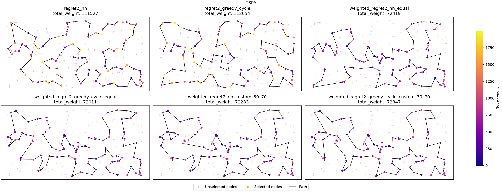
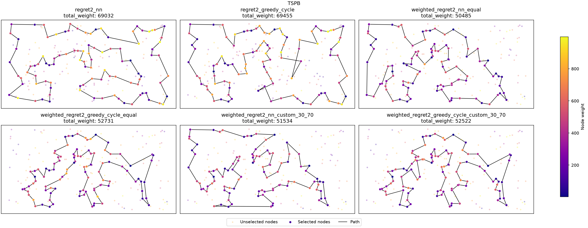

## Problem Description

We are given three columns of integers, with one row for each node. The first two columns contain the \(x\) and \(y\) coordinates of the node positions in a plane. The third column contains node costs. The goal is to select exactly 50% of the nodes (if the number of nodes is odd, we round the number of selected nodes up) and form a Hamiltonian cycle through this set of nodes such that the sum of the total length of the cycle and the total cost of the selected nodes is minimized.

The distances between nodes are calculated as Euclidean distances rounded mathematically to integer values. The distance matrix is calculated just after reading an instance, so the optimization methods can use the distance matrix without accessing node coordinates.

More formally, we may define the problem as follows:

Let $V$ be a set of $n$ nodes, each node $j \in V$ has coordinates $(x_j, y_j)$ and a cost $c_j$. Let $d(i,j) = \text{euclidean}(x_i, y_i, x_j, y_j)$ be the distance between nodes $i$ and $j$. The task is to find a cycle $P = (p_0, p_1, \dots, p_{k-1})$, where $p_i \in V$, all $p_i$ are distinct, and $k = \lceil n/2 \rceil$, that minimizes the objective function, defined as:

$$f(P) = \sum_{i=0}^{k-1} d(p_i, p_{(i+1)}) + \sum_{i=0}^{k-1} c_{p_i}$$

where $p_{k} = p_0$.

### Instances

Both instances, TSPA and TSPB, contain 200 nodes, so each solution contains 100 nodes. Coordinates are in the range \([0,4000]\times[0,2000]\) in both instances. Node costs in TSPA are in the range \([0,1999]\), while those in TSPB are in the range \([0,999]\).

## Algorithms

The methods from Lab 1 are retained as baseline algorithms: random solution, nearest neighbor with endpoint extension, nearest neighbor with insertion at any position, and greedy cycle. Lab 2 introduces two greedy 2-regret heuristics and weighted variants of the extended version of the nearest neighbor heuristic ( anypoint ) and
the greedy cycle heuristic.

### Notation

Let \(P=(p_0,p_1,\ldots,p_{m-1})\) be the current path or cycle, and let \(j\) be a node that has not yet been selected.

When inserting node \(j\) between consecutive nodes \(a\) and \(b\), the change in the objective function is

\[
\Delta(a,j,b)=d(a,j)+d(j,b)-d(a,b)+c_j.
\]

The term \(d(a,j)+d(j,b)-d(a,b)\) represents the change in the total travel distance caused by replacing the edge \((a,b)\) with edges \((a,j)\) and \((j,b)\). The term \(c_j\) is the cost of selecting node \(j\).

For each unselected node \(j\), we evaluate the objective-function change for all feasible insertion positions and keep the two smallest values. Let \(\Delta_1(j)\) be the smallest insertion cost and \(\Delta_2(j)\) the second-smallest insertion cost.

The 2-regret value is defined as

\[
R_2(j)=\Delta_2(j)-\Delta_1(j).
\]

A large 2-regret value means that the best insertion position for node \(j\) is substantially better than its second-best position. Such a node may be worth inserting earlier, because delaying its insertion could force it into a much more expensive position.

### Greedy 2-regret nearest neighbor

This method extends the nearest neighbor heuristic that allows insertion at any position in the current path.

The path is initialized with the selected starting node. At each iteration, the algorithm evaluates every unselected node and calculates its insertion costs at all feasible positions. The node with the largest 2-regret value is selected and inserted at the position with the smallest insertion cost.

Unlike the nearest neighbor method from Lab 1, which selects the node with the smallest immediate insertion cost, the 2-regret version prioritizes nodes for which the choice of insertion position is particularly important.

The procedure is repeated until the path contains the required number of nodes.

```latex
\begin{algorithm}
\caption{Greedy 2-regret nearest neighbor}
\begin{algorithmic}
\STATE $P \gets (s)$
\WHILE{$|P| < k$}
    \FORALL{$j \notin P$}
        \STATE Calculate insertion costs for all feasible positions of $j$
        \STATE $\Delta_1(j) \gets$ smallest insertion cost
        \STATE $\Delta_2(j) \gets$ second-smallest insertion cost
        \STATE $R_2(j) \gets \Delta_2(j) - \Delta_1(j)$
    \ENDFOR
    \STATE $j^* \gets \arg\max_{j \notin P} R_2(j)$
    \STATE Insert $j^*$ into $P$ at its cheapest position
\ENDWHILE
\RETURN $P$
\end{algorithmic}
\end{algorithm}
```

### Greedy 2-regret cycle

This method applies the same 2-regret selection criterion to the greedy cycle heuristic.

The initial solution is a cycle containing the starting node and a second node. At each iteration, the algorithm calculates the insertion costs of all unselected nodes at every position in the current cycle, including the edge connecting the last node to the first.

The algorithm selects the node with the largest 2-regret value and inserts it at its cheapest position. The process continues until the cycle contains the required number of nodes.

The main difference between the two 2-regret methods is that the nearest neighbor variant maintains an open path, whereas the greedy cycle variant maintains a closed cycle throughout the construction process.

```latex
\begin{algorithm}
\caption{Greedy 2-regret cycle}
\begin{algorithmic}
\STATE $P \gets (s, \arg\min_{j \neq s} [d(s,j) + c_j])$
\WHILE{$|P| < k$}
    \FORALL{$j \notin P$}
        \STATE Calculate insertion costs for all feasible positions of $j$ in the cycle
        \STATE $\Delta_1(j) \gets$ smallest insertion cost
        \STATE $\Delta_2(j) \gets$ second-smallest insertion cost
        \STATE $R_2(j) \gets \Delta_2(j) - \Delta_1(j)$
    \ENDFOR
    \STATE $j^* \gets \arg\max_{j \notin P} R_2(j)$
    \STATE Insert $j^*$ into $P$ at its cheapest position
\ENDWHILE
\RETURN $P$
\end{algorithmic}
\end{algorithm}
```

### Weighted 2-regret criterion

The weighted variants combine the 2-regret value with the cheapest insertion cost. For each unselected node \(j\), the score is calculated as

\[
S(j)=w_rR_2(j)-w_c\Delta_1(j),
\]

where \(w_r\) is the regret weight and \(w_c\) is the insertion-cost weight.

The node with the highest score is selected and inserted at its cheapest feasible position. The regret term favors nodes whose best insertion position is significantly better than their second-best position, while the insertion-cost term favors nodes that can be added at a low objective-function cost.

Two weight configurations are considered:

- **Equal weights:** \(w_r=0.5\) and \(w_c=0.5\).
- **Custom weights:** \(w_r=0.3\) and \(w_c=0.7\).

The custom configuration assigns a larger coefficient to the cheapest insertion cost. Since regret and insertion cost can have different numerical scales, equal coefficients do not necessarily mean that both terms have equal practical influence.

Both the nearest neighbor and greedy cycle variants are implemented using the weighted criterion.


```latex
\begin{algorithm}
\caption{Weighted 2-regret nearest neighbor}
\begin{algorithmic}
\STATE $P \gets (s)$
\STATE Choose weights $w_r$ and $w_c$
\WHILE{$|P| < k$}
    \FORALL{$j \notin P$}
        \STATE Calculate insertion costs for all feasible positions of $j$
        \STATE $\Delta_1(j) \gets$ smallest insertion cost
        \STATE $\Delta_2(j) \gets$ second-smallest insertion cost
        \STATE $R_2(j) \gets \Delta_2(j) - \Delta_1(j)$
        \STATE $S(j) \gets w_r R_2(j) - w_c \Delta_1(j)$
    \ENDFOR
    \STATE $j^* \gets \arg\max_{j \notin P} S(j)$
    \STATE Insert $j^*$ into $P$ at its cheapest position
\ENDWHILE
\RETURN $P$
\end{algorithmic}
\end{algorithm}
```

```latex
\begin{algorithm}
\caption{Weighted 2-regret cycle}
\begin{algorithmic}
\STATE $P \gets (s, \arg\min_{j \neq s} [d(s,j) + c_j])$
\STATE Choose weights $w_r$ and $w_c$
\WHILE{$|P| < k$}
    \FORALL{$j \notin P$}
        \STATE Calculate insertion costs for all feasible positions of $j$ in the cycle
        \STATE $\Delta_1(j) \gets$ smallest insertion cost
        \STATE $\Delta_2(j) \gets$ second-smallest insertion cost
        \STATE $R_2(j) \gets \Delta_2(j) - \Delta_1(j)$
        \STATE $S(j) \gets w_r R_2(j) - w_c \Delta_1(j)$
    \ENDFOR
    \STATE $j^* \gets \arg\max_{j \notin P} S(j)$
    \STATE Insert $j^*$ into $P$ at its cheapest position
\ENDWHILE
\RETURN $P$
\end{algorithmic}
\end{algorithm}
```

## Computational Experiment

Each deterministic greedy method was run 200 times per instance, once from each possible starting node. The random method was also run 200 times per instance.

For each method and instance, the minimum, maximum, and average objective values were recorded, together with the average runtime of a single run. The results from Lab 1 are included as a baseline for comparison.

### Results for instance TSPA

| Method | Min | Max | Average | Time (\(\mu s\)) |
|---|---:|---:|---:|---:|
| Random | 232767 | 290020 | 263132.65 | **1** |
| Nearest neighbor (end) | 84362 | 90075 | 87476.63 | 36 |
| Nearest neighbor (any position) | 72328 | 77022 | 74346.96 | 612 |
| Greedy cycle | 72590 | 75281 | 73797.39 | 525 |
| 2-regret nearest neighbor | 111527 | 133181 | 122860.66 | 1034 |
| 2-regret greedy cycle | 112654 | 130924 | 121007.17 | 873 |
| Weighted 2-regret nearest neighbor (equal) | 72419 | 78504 | 75561.20 | 940 |
| Weighted 2-regret greedy cycle (equal) | **72011** | 75532 | 73348.72 | 917 |
| Weighted 2-regret nearest neighbor (0.3, 0.7) | 72283 | 78210 | 75303.05 | 912 |
| Weighted 2-regret greedy cycle (0.3, 0.7) | 72347 | **75162** | **73348.22** | 940 |

### Results for instance TSPB

| Method | Min | Max | Average | Time (\(\mu s\)) |
|---|---:|---:|---:|---:|
| Random | 185482 | 232014 | 206682.99 | **0** |
| Nearest neighbor (end) | 56007 | 63166 | 59397.33 | 25 |
| Nearest neighbor (any position) | 52915 | 66164 | 59475.50 | 576 |
| Greedy cycle | 53016 | 63736 | 59709.47 | 520 |
| 2-regret nearest neighbor | 69032 | 80767 | 74763.39 | 1113 |
| 2-regret greedy cycle | 69455 | 78142 | 73403.35 | 890 |
| Weighted 2-regret nearest neighbor (equal) | **50485** | **61406** | **55698.34** | 960 |
| Weighted 2-regret greedy cycle (equal) | 52731 | 63370 | 57895.54 | 913 |
| Weighted 2-regret nearest neighbor (0.3, 0.7) | 51534 | 64840 | 56435.25 | 899 |
| Weighted 2-regret greedy cycle (0.3, 0.7) | 52522 | 62491 | 55951.54 | 917 |

The best value in each column for each instance is highlighted in bold. Since the objective function is minimized, lower values are better for the minimum, maximum, and average columns. Lower runtime values indicate faster execution.

The runtime is the average execution time of a single run in microseconds. The values of 0 and 1 microsecond reported for the random method are below the useful resolution of the measurement and should not be interpreted as precise runtimes.

## Best Solutions

In the plots, node color represents node cost, using a common color scale for each instance. Selected nodes are drawn at full size, while unselected nodes are faded.





The comparison figures show the best solutions found by the available methods for each instance. The solutions illustrate how the different node-selection criteria influence the distribution of selected nodes and the resulting cycle.

```latex
The following tables summarize the best solutions obtained by the
2-regret and weighted 2-regret algorithms for the TSPA and TSPB
instances. The complete paths returned by the algorithms are listed
below each table.

\subsubsection{TSPA}

\begin{table}[H]
\centering
\caption{Objective values of the selected solutions for TSPA}
\begin{tabular}{lr}
\hline
Algorithm & Total weight \\
\hline
2-regret greedy cycle & 112654 \\
2-regret nearest neighbor & 111527 \\
Weighted 2-regret greedy cycle (30:70) & 72347 \\
Weighted 2-regret greedy cycle (50:50) & 72011 \\
Weighted 2-regret nearest neighbor (30:70) & 72283 \\
Weighted 2-regret nearest neighbor (50:50) & 72419 \\
\hline
\end{tabular}
\end{table}

\paragraph{2-regret greedy cycle}

\begin{verbatim}
133 139 112 5 175 39 154 62 34 109 186 136 24 163 19 29 17 101
155 21 147 37 47 169 164 142 85 81 93 117 130 159 170 75 193
107 64 57 124 89 106 151 0 72 134 84 58 158 192 181 118 114
25 98 70 27 10 183 166 171 92 110 129 188 97 161 12 160 123
100 152 108 49 63 82 77 199 48 126 137 91 71 4 76 132 68 162
23 145 180 102 35 67 45 61 140 177 52 190 51
\end{verbatim}

Total weight: 112654

\paragraph{2-regret nearest neighbor}

\begin{verbatim}
199 82 116 119 11 49 108 152 123 160 12 97 120 92 171 166 183
10 22 98 27 87 141 23 180 28 156 16 190 74 144 179 177 36 99
41 61 135 181 58 84 134 65 158 111 182 105 57 64 107 88 78
26 75 170 159 130 117 113 106 150 0 176 174 8 142 85 128 3 1
59 46 86 55 17 29 19 163 24 136 186 109 34 62 154 39 175
115 5 112 139 18 4 76 132 68 44 14 38 80
\end{verbatim}

Total weight: 111527

\paragraph{Weighted 2-regret greedy cycle (30:70)}

\begin{verbatim}
71 4 76 132 180 28 102 185 35 156 51 16 67 144 140 53 179 52
177 36 131 33 54 9 8 142 164 186 136 163 29 101 178 1 169 3
50 93 47 130 159 146 170 75 153 193 78 88 107 64 57 182 138
151 42 89 113 106 150 174 176 72 134 84 58 158 192 181 114
135 73 45 87 141 189 2 171 187 30 160 83 123 90 100 152 49
97 127 95 168 63 149 116 60 108 31 48 80 91 157
\end{verbatim}

Total weight: 72347

\paragraph{Weighted 2-regret greedy cycle (50:50)}

\begin{verbatim}
31 60 116 149 63 168 11 49 108 152 100 123 83 160 97 127 161
30 187 171 2 189 141 87 45 73 135 114 181 192 158 58 84 134
72 176 174 150 106 113 89 42 151 138 182 57 64 107 88 78
193 153 75 170 146 159 130 47 93 50 3 169 1 178 101 55 29
163 136 186 164 142 8 9 54 33 131 36 177 52 179 53 140 144
67 16 51 35 185 102 28 180 132 76 4 71 157 91 80 48
\end{verbatim}

Total weight: 72011

\paragraph{Weighted 2-regret nearest neighbor (30:70)}

\begin{verbatim}
31 48 80 91 157 71 4 76 132 90 123 83 160 180 28 102 185 35
156 51 16 67 144 140 53 179 52 177 36 131 33 54 9 8 142 164
186 136 163 29 101 178 1 169 3 50 93 47 130 159 146 170 75
153 193 78 88 107 64 57 182 138 151 42 89 113 106 150 174
176 72 134 84 58 158 192 181 114 135 73 45 87 141 189 2 171
187 30 161 97 127 95 168 63 149 116 60 108 152 49
\end{verbatim}

Total weight: 72283

\paragraph{Weighted 2-regret nearest neighbor (50:50)}

\begin{verbatim}
171 2 189 187 30 141 87 45 73 135 114 181 192 158 58 84 134
72 176 174 150 106 113 89 42 151 138 182 57 64 107 88 78
193 153 75 170 146 159 130 47 93 50 3 169 1 59 178 101 55
29 163 136 186 164 142 8 9 54 33 131 36 177 52 179 53 140
144 67 16 51 35 185 102 28 180 132 76 4 71 157 91 80 100
123 83 160 152 108 49 60 116 149 63 168 97 127 69 129 104
\end{verbatim}

Total weight: 72419


\subsubsection{TSPB}

\begin{table}[H]
\centering
\caption{Objective values of the selected solutions for TSPB}
\begin{tabular}{lr}
\hline
Algorithm & Total weight \\
\hline
2-regret greedy cycle & 69455 \\
2-regret nearest neighbor & 69032 \\
Weighted 2-regret greedy cycle (30:70) & 52522 \\
Weighted 2-regret greedy cycle (50:50) & 52731 \\
Weighted 2-regret nearest neighbor (30:70) & 51534 \\
Weighted 2-regret nearest neighbor (50:50) & 50485 \\
\hline
\end{tabular}
\end{table}

\paragraph{2-regret greedy cycle}

\begin{verbatim}
167 82 88 163 99 171 17 74 20 14 9 93 23 110 118 131 148 10
196 193 61 105 169 165 199 70 190 194 12 77 104 119 162 135
0 79 57 83 44 89 32 43 164 48 96 198 121 195 130 50 42 116
37 13 149 28 145 65 178 103 132 197 36 91 62 175 134 45
157 60 141 155 113 115 170 125 26 161 154 140 47 33 49 4
124 189 172 8 92 166 72 46 109 3 122 151 98 25 152 85
\end{verbatim}

Total weight: 69455

\paragraph{2-regret nearest neighbor}

\begin{verbatim}
57 44 89 32 43 48 58 198 121 195 50 42 116 37 13 149 145 65
178 103 132 1 108 62 175 134 157 60 141 155 113 115 19 177
125 26 161 154 140 47 38 21 168 136 8 95 128 122 151 111
3 137 72 86 0 185 104 162 54 127 129 52 182 150 84 66 35
24 25 73 59 101 179 88 163 99 171 17 74 20 14 2 93 23 110
118 131 148 10 196 193 61 105 169 165 199 70 190 194 12
\end{verbatim}

Total weight: 69032

\paragraph{Weighted 2-regret greedy cycle (30:70)}

\begin{verbatim}
60 157 45 134 175 71 36 197 132 29 6 180 115 170 177 125
26 154 140 38 176 30 183 191 130 63 121 198 96 48 43 156
89 57 79 185 104 54 196 114 10 90 14 2 74 20 153 182 52
129 127 80 192 162 76 135 27 11 66 67 24 34 181 152 88
179 87 82 167 51 85 59 73 98 151 122 173 3 184 86 46 72
117 8 120 133 136 172 160 69 168 189 21 64 33 47 97 155
141 40
\end{verbatim}

Total weight: 52522

\paragraph{Weighted 2-regret greedy cycle (50:50)}

\begin{verbatim}
91 36 197 132 29 6 180 115 170 177 125 26 97 154 140 47
38 21 30 183 191 130 63 121 198 96 48 43 156 32 89 57 79
185 104 54 196 114 10 90 14 2 20 153 129 127 80 192 162
76 135 27 11 66 67 24 34 152 181 126 88 179 87 82 167
51 85 59 73 98 151 122 173 3 184 86 46 72 117 8 120 133
136 172 160 69 124 4 64 33 155 71 141 40 60 157 45 134
175 62
\end{verbatim}

Total weight: 52731

\paragraph{Weighted 2-regret nearest neighbor (30:70)}

\begin{verbatim}
62 175 134 45 157 60 71 155 141 40 33 64 47 21 183 30 38
140 154 97 26 125 177 170 115 180 6 197 29 132 103 178 65
145 28 149 13 146 37 116 147 42 121 198 96 48 89 156 120
133 136 172 160 69 8 117 72 46 86 184 3 122 151 98 27 135
76 185 57 104 162 54 192 127 52 182 153 20 74 2 14 90
129 80 150 84 66 67 24 34 152 181 167 73 59 85 51 179 87 82
\end{verbatim}

Total weight: 51534

\paragraph{Weighted 2-regret nearest neighbor (50:50)}

\begin{verbatim}
65 145 28 149 13 146 37 116 147 42 50 130 63 121 198 96
48 156 89 57 185 76 104 162 54 192 80 127 129 90 153 14
2 20 74 17 171 99 88 179 87 82 51 85 59 73 167 181 152
34 24 67 66 27 98 151 122 3 184 46 72 117 8 120 133 136
172 160 69 124 21 183 30 38 47 154 140 64 33 40 141 155
71 60 157 45 134 175 62 36 197 6 115 170 125 177 29 132 174 1
\end{verbatim}

Total weight: 50485
```

## Solution Checker

Every generated solution was verified using the solution checker implemented in `src/utils/checker/solution_checker.hpp`.

The checker recalculates the objective function using the distance matrix and node costs. It also verifies that each solution contains exactly \(\lceil n/2\rceil\) nodes, that all node indices are valid, and that no node occurs more than once. The objective value calculated by the checker is compared with the value reported by the algorithm.

All generated solutions (200 per instance and method, 2400 in total) passed these checks. The best solutions can additionally be verified using the checker provided on ekursy.

## Conclusions

- **The weighted criteria perform substantially better than the unweighted 2-regret heuristics.** On TSPA, the unweighted nearest neighbor and greedy cycle variants achieve average objective values of 122860.66 and 121007.17, respectively. On TSPB, their averages are 74763.39 and 73403.35. These results are considerably worse than those of the weighted variants and the original greedy methods. Selecting a node solely because it has a large 2-regret value can lead to expensive insertions that outweigh the benefit of prioritizing that node.

- **The weighted greedy cycle achieves the best average result on TSPA.** The custom weights of 0.3 for regret and 0.7 for insertion cost produce an average objective of 73348.22, slightly better than the 73348.72 obtained with equal weights. Both weighted greedy cycle variants outperform the original greedy cycle average of 73797.39. However, the difference between the two weighted configurations is very small.

- **The weighted nearest neighbor with equal weights performs best on TSPB.** It achieves an average objective of 55698.34 and the best individual solution, with an objective value of 50485. Its average is approximately 6.4% lower than that of the original nearest neighbor with insertion at any position (59475.50). It also outperforms the original greedy cycle, whose average is 59709.47.

- **The best weight configuration depends on the instance and the heuristic.** On TSPA, the weighted greedy cycle variants have nearly identical averages. On TSPB, equal weights give better averages for both the nearest neighbor and greedy cycle variants. The custom weights do not consistently improve solution quality, so the experiments do not support the conclusion that assigning a larger coefficient to the immediate insertion cost is always beneficial.

- **The regret-based methods are somewhat slower than the original greedy heuristics.** The new methods take approximately 0.87–1.03 milliseconds per run on TSPA and 0.89–1.11 milliseconds on TSPB. In comparison, the original greedy cycle takes about 0.52 milliseconds, and nearest neighbor with insertion at any position about 0.6 milliseconds. The regret-based methods evaluate the same insertions as the original methods, but must find the best and second-best insertion cost separately for every unselected node, which makes them roughly 1.7–2 times slower.

- **The results differ between the two instances.** On TSPA, the improvement of the weighted methods over the original greedy cycle is relatively small. On TSPB, the weighted nearest neighbor with equal weights provides a more noticeable improvement. The unweighted 2-regret methods perform poorly on both instances.

## Source Code

The implementation is available at [github.com/Igor-S-666/EC_Assignments](https://github.com/Igor-S-666/EC_Assignments/tree/main/src/lab_2). The algorithms are in `src/lab_2/algorithms/`, and the experiment is in `src/lab_2/experiments/` and `src/lab_2/main.cpp`.

For detailed structure, see the README in the source code repository.
