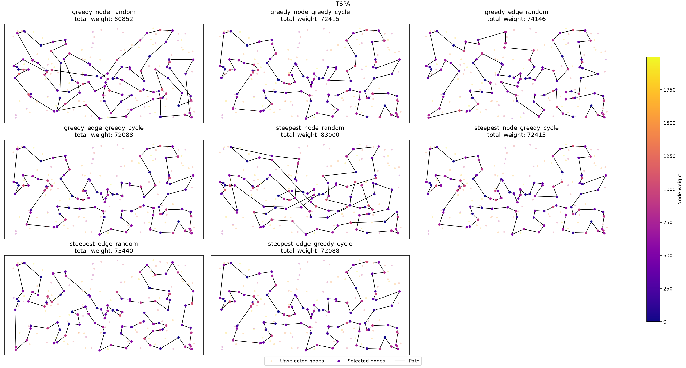
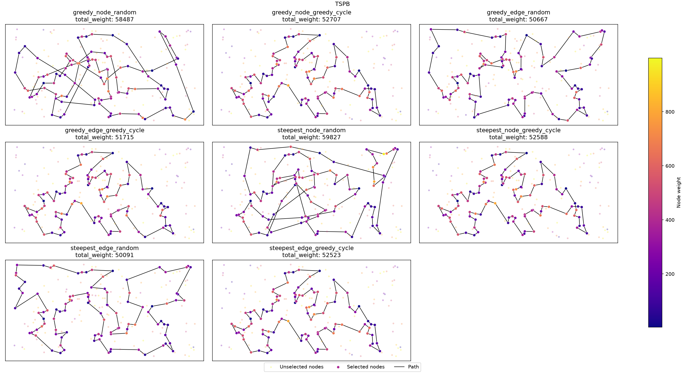

## Problem Description

We are given three columns of integers, with one row for each node. The first two columns contain the \(x\) and \(y\) coordinates of the node positions in a plane. The third column contains node costs. The goal is to select exactly 50% of the nodes (if the number of nodes is odd, we round the number of selected nodes up) and form a Hamiltonian cycle through this set of nodes such that the sum of the total length of the cycle and the total cost of the selected nodes is minimized.

The distances between nodes are calculated as Euclidean distances rounded mathematically to integer values. The distance matrix is calculated just after reading an instance, so the optimization methods can use the distance matrix without accessing node coordinates.

More formally, we may define the problem as follows:

Let $V$ be a set of $n$ nodes, each node $j \in V$ has coordinates $(x_j, y_j)$ and a cost $c_j$. Let $d(i,j) = \text{euclidean}(x_i, y_i, x_j, y_j)$ be the distance between nodes $i$ and $j$. The task is to find a cycle $P = (p_0, p_1, \dots, p_{k-1})$, where $p_i \in V$, all $p_i$ are distinct, and $k = \lceil n/2 \rceil$, that minimizes the objective function, defined as:

$$f(P) = \sum_{i=0}^{k-1} d(p_i, p_{(i+1)}) + \sum_{i=0}^{k-1} c_{p_i}$$

where $p_{k} = p_0$.

### Instances

Both instances, TSPA and TSPB, contain 200 nodes, so each solution contains 100 nodes. Coordinates are in the range \([0,4000]\times[0,2000]\) in both instances. Node costs in TSPA are in the range \([0,1999]\), while those in TSPB are in the range \([0,999]\).

## Algorithms

Local search starts from a complete solution and applies improving moves until none exists. We compare 8 variants, given by three binary options:

- **search type:** steepest or greedy,
- **intra-route move:** two-nodes or two-edges exchange,
- **starting solution:** random or greedy cycle.

### Neighborhood and deltas

Let \(P=(p_0,\ldots,p_{k-1})\) be the current cycle (indices modulo \(k\)) and \(U = V \setminus P\) the unselected nodes. A move is improving if its delta \(\Delta < 0\). All deltas are computed in \(O(1)\); the objective value is updated by adding the delta of each applied move.

**Inter-route: exchange of \(p_i\) with \(u \in U\)**:
\[
\Delta = d(p_{i-1},u) + d(u,p_{i+1}) - d(p_{i-1},p_i) - d(p_i,p_{i+1}) + c_u - c_{p_i}.
\]

**Intra-route** moves keep the set of nodes, so costs cancel out.

*Two-nodes exchange* of \(p_i\) and \(p_j\):
\[
\Delta = d(p_{i-1},p_j) + d(p_j,p_{i+1}) + d(p_{j-1},p_i) + d(p_i,p_{j+1}) - d(p_{i-1},p_i) - d(p_i,p_{i+1}) - d(p_{j-1},p_j) - d(p_j,p_{j+1}).
\]
If \(p_j\) directly follows \(p_i\), the edge between them is kept: \(\Delta = d(p_{i-1},p_j) + d(p_i,p_{j+1}) - d(p_{i-1},p_i) - d(p_j,p_{j+1})\).

*Two-edges exchange* removes \((p_i,p_{i+1})\), \((p_j,p_{j+1})\) and reverses \(p_{i+1},\ldots,p_j\):
\[
\Delta = d(p_i,p_j) + d(p_{i+1},p_{j+1}) - d(p_i,p_{i+1}) - d(p_j,p_{j+1}).
\]

### Steepest local search

Evaluates all moves of both kinds and applies the best one.

```latex
\begin{algorithm}
\caption{Steepest local search}
\begin{algorithmic}
\STATE $P \gets$ starting solution
\REPEAT
    \STATE $m^* \gets \arg\min_{m \in N(P)} \Delta(m)$ \COMMENT{all intra- and inter-route moves}
    \IF{$\Delta(m^*) < 0$}
        \STATE Apply $m^*$ to $P$
    \ENDIF
\UNTIL{$\Delta(m^*) \geq 0$}
\RETURN $P$
\end{algorithmic}
\end{algorithm}
```

### Greedy local search

Applies the first improving move found; later moves are not evaluated.

**Randomization:** at the start of each run, all moves of both kinds are put into one list, which is shuffled uniformly (`std::shuffle`), so intra- and inter-route moves are interleaved. Moves are stored as positions in \(P\) and \(U\), so the list stays valid after applying a move and is shuffled only once. Each iteration starts browsing at a random position of the list and wraps around at its end.

```latex
\begin{algorithm}
\caption{Greedy local search}
\begin{algorithmic}
\STATE $P \gets$ starting solution
\STATE $M \gets$ shuffled list of all intra- and inter-route moves
\REPEAT
    \STATE improved $\gets$ false
    \STATE $s \gets$ random position in $M$
    \FOR{$t \gets 0$ \TO $|M|-1$}
        \STATE $m \gets M[(s + t) \bmod |M|]$
        \IF{$\Delta(m) < 0$}
            \STATE Apply $m$ to $P$; improved $\gets$ true; \textbf{break}
        \ENDIF
    \ENDFOR
\UNTIL{not improved}
\RETURN $P$
\end{algorithmic}
\end{algorithm}
```

### Starting solutions

- **Random:** random \(k\) nodes in random order (Lab 1).
- **Greedy cycle:** the greedy cycle heuristic from Lab 1.

## Computational Experiment

Each method was run 200 times per instance: from 200 random solutions, or from the greedy cycle started once from each node. The methods from Lab 1 and Lab 2 are included for comparison (the weighted 2-regret methods with equal weights). The best value in each column is in bold.

```latex
\begin{table}[H]
\centering
\small
\caption{Objective function values}
\begin{tabular}{lrrrrrr}
\toprule
 & \multicolumn{3}{c}{TSPA} & \multicolumn{3}{c}{TSPB} \\
\cmidrule(lr){2-4} \cmidrule(lr){5-7}
Method & av & min & max & av & min & max \\
\midrule
Random & 263132.65 & 232767 & 290020 & 206682.99 & 185482 & 232014 \\
Nearest neighbor (end) & 87476.63 & 84362 & 90075 & 59397.33 & 56007 & 63166 \\
Nearest neighbor (any position) & 74346.96 & 72328 & 77022 & 59475.50 & 52915 & 66164 \\
Greedy cycle & 73797.39 & 72590 & 75281 & 59709.47 & 53016 & 63736 \\
2-regret nearest neighbor & 122860.66 & 111527 & 133181 & 74763.39 & 69032 & 80767 \\
2-regret greedy cycle & 121007.17 & 112654 & 130924 & 73403.35 & 69455 & 78142 \\
Weighted 2-regret nearest neighbor & 75561.20 & 72419 & 78504 & 55698.34 & 50485 & 61406 \\
Weighted 2-regret greedy cycle & 73348.72 & \textbf{72011} & 75532 & 57895.54 & 52731 & 63370 \\
\midrule
Greedy LS, nodes, random start & 87875.52 & 80852 & 96854 & 63592.77 & 58487 & 70640 \\
Greedy LS, nodes, greedy cycle start & 73478.34 & 72415 & 74736 & 59331.08 & 52707 & 63607 \\
Greedy LS, edges, random start & 76342.58 & 74146 & 78532 & 52869.81 & 50667 & 55260 \\
Greedy LS, edges, greedy cycle start & \textbf{73164.54} & 72088 & 74565 & 58728.54 & 51715 & 63178 \\
Steepest LS, nodes, random start & 90293.09 & 83000 & 98690 & 65919.13 & 59827 & 74954 \\
Steepest LS, nodes, greedy cycle start & 73468.17 & 72415 & 74736 & 59322.68 & 52588 & 63607 \\
Steepest LS, edges, random start & 76191.55 & 73440 & 79726 & \textbf{52575.82} & \textbf{50091} & \textbf{54983} \\
Steepest LS, edges, greedy cycle start & 73167.85 & 72088 & \textbf{74544} & 58736.80 & 52523 & 63178 \\
\bottomrule
\end{tabular}
\end{table}
```

```latex
\begin{table}[H]
\centering
\small
\caption{Running time of a single run in $\mu s$}
\begin{tabular}{lrrrrrr}
\toprule
 & \multicolumn{3}{c}{TSPA} & \multicolumn{3}{c}{TSPB} \\
\cmidrule(lr){2-4} \cmidrule(lr){5-7}
Method & av & min & max & av & min & max \\
\midrule
Random & \textbf{1} & -- & -- & \textbf{0} & -- & -- \\
Nearest neighbor (end) & 36 & -- & -- & 25 & -- & -- \\
Nearest neighbor (any position) & 612 & -- & -- & 576 & -- & -- \\
Greedy cycle & 525 & -- & -- & 520 & -- & -- \\
2-regret nearest neighbor & 1034 & -- & -- & 1113 & -- & -- \\
2-regret greedy cycle & 873 & -- & -- & 890 & -- & -- \\
Weighted 2-regret nearest neighbor & 940 & -- & -- & 960 & -- & -- \\
Weighted 2-regret greedy cycle & 917 & -- & -- & 913 & -- & -- \\
\midrule
Greedy LS, nodes, random start & 725 & 469 & 1528 & 704 & 390 & 1337 \\
Greedy LS, nodes, greedy cycle start & 799 & 670 & 1549 & 826 & 659 & 1391 \\
Greedy LS, edges, random start & 467 & \textbf{344} & \textbf{813} & 478 & \textbf{342} & \textbf{1011} \\
Greedy LS, edges, greedy cycle start & 814 & 684 & 1101 & 904 & 741 & 1555 \\
Steepest LS, nodes, random start & 2769 & 2099 & 3842 & 2836 & 2139 & 6516 \\
Steepest LS, nodes, greedy cycle start & 591 & 512 & 996 & 648 & 523 & 1153 \\
Steepest LS, edges, random start & 1176 & 924 & 1589 & 1194 & 1005 & 1744 \\
Steepest LS, edges, greedy cycle start & 574 & 498 & 1119 & 647 & 562 & 1043 \\
\bottomrule
\end{tabular}
\end{table}
```

The running time of local search includes constructing the starting solution (about 1 \(\mu s\) for random, 520 \(\mu s\) for greedy cycle). For Lab 1 and Lab 2 methods only the average time was recorded; times of 0–1 \(\mu s\) are below the measurement resolution.

<div class="newpage"></div>

## Best Solutions

Node color represents node cost (common scale per instance); unselected nodes are faded.





```latex
\subsubsection{TSPA}

\begin{table}[H]
\centering
\caption{Objective values of the best solutions for TSPA}
\begin{tabular}{lr}
\hline
Method & Total weight \\
\hline
Greedy LS, nodes, random start & 80852 \\
Greedy LS, nodes, greedy cycle start & 72415 \\
Greedy LS, edges, random start & 74146 \\
Greedy LS, edges, greedy cycle start & 72088 \\
Steepest LS, nodes, random start & 83000 \\
Steepest LS, nodes, greedy cycle start & 72415 \\
Steepest LS, edges, random start & 73440 \\
Steepest LS, edges, greedy cycle start & 72088 \\
\hline
\end{tabular}
\end{table}

\paragraph{Greedy LS, nodes, random start}

\begin{verbatim}
35 90 123 152 108 31 48 80 91 157 71 38 132 187 2 189 87 28
180 76 4 51 16 179 53 41 84 134 58 181 135 73 140 45 185 102
141 30 160 83 60 116 149 63 11 49 119 168 95 97 127 171 98 114
192 158 151 89 113 43 85 93 130 107 170 146 159 50 3 169 1 147
47 153 78 88 57 42 106 150 176 72 131 36 177 33 9 54 174 8 164
178 29 163 136 186 143 52 144 67
\end{verbatim}

Total weight: 80852

\paragraph{Greedy LS, nodes, greedy cycle start}

\begin{verbatim}
31 116 149 63 168 11 49 60 108 152 100 90 123 83 160 97 127 69
171 2 189 187 30 141 87 45 73 135 114 181 192 158 58 84 134 72
176 150 151 182 57 64 107 88 78 193 153 170 146 159 130 113 89
42 106 93 47 147 50 3 169 1 178 101 29 163 136 186 164 142 8
174 131 54 9 33 36 177 52 179 53 140 144 67 16 51 156 35 185
102 28 180 132 76 4 71 157 91 80 48
\end{verbatim}

Total weight: 72415

\paragraph{Greedy LS, edges, random start}

\begin{verbatim}
92 104 129 69 127 97 123 152 108 49 168 63 149 116 60 31 48 80
38 91 71 157 115 112 139 62 143 33 177 36 131 54 9 8 174 85
164 186 136 163 29 101 178 1 169 3 50 47 93 113 106 150 151 42
89 130 159 146 170 153 193 78 88 107 64 57 182 138 176 72 134
84 58 158 192 135 73 45 185 140 53 179 52 144 67 35 16 51 4 76
132 180 28 87 141 30 187 189 2 171
\end{verbatim}

Total weight: 74146

\paragraph{Greedy LS, edges, greedy cycle start}

\begin{verbatim}
31 116 149 63 168 11 49 60 108 152 100 90 123 83 160 97 127 69
171 2 189 187 30 141 87 45 73 135 114 181 192 158 58 84 134 72
176 150 151 182 57 64 107 88 78 193 153 170 146 159 130 113 89
42 106 93 47 147 50 3 169 1 178 101 29 163 136 186 164 85 174
8 54 9 33 131 36 177 52 179 53 140 144 67 16 51 156 35 185 102
28 180 132 76 4 71 157 91 80 48
\end{verbatim}

Total weight: 72088

\paragraph{Steepest LS, nodes, random start}

\begin{verbatim}
180 28 102 185 16 51 139 112 157 48 80 91 71 140 41 84 134 72
176 174 142 85 43 113 106 150 99 131 33 143 164 186 136 29 178
1 169 8 9 54 36 177 53 45 30 49 11 63 149 116 119 168 127 97
60 108 152 123 83 90 132 76 73 135 58 93 3 50 47 130 89 42 151
182 57 88 78 153 170 159 107 138 158 192 181 114 98 189 2 171
161 187 141 87 179 52 144 67 35 156
\end{verbatim}

Total weight: 83000

\paragraph{Steepest LS, nodes, greedy cycle start}

\begin{verbatim}
31 116 149 63 168 11 49 60 108 152 100 90 123 83 160 97 127 69
171 2 189 187 30 141 87 45 73 135 114 181 192 158 58 84 134 72
176 150 151 182 57 64 107 88 78 193 153 170 146 159 130 113 89
42 106 93 47 147 50 3 169 1 178 101 29 163 136 186 164 142 8
174 131 54 9 33 36 177 52 179 53 140 144 67 16 51 156 35 185
102 28 180 132 76 4 71 157 91 80 48
\end{verbatim}

Total weight: 72415

\paragraph{Steepest LS, edges, random start}

\begin{verbatim}
168 63 149 60 31 48 80 152 108 49 160 83 123 100 90 132 76 91
157 71 51 16 67 144 140 53 179 52 177 99 131 36 143 33 9 54 8
85 93 50 3 169 1 164 186 136 184 178 29 101 147 37 47 130 159
170 153 193 78 88 107 57 182 138 151 42 89 113 106 150 174 176
72 134 84 58 158 192 181 114 135 73 45 185 35 180 28 87 141
189 2 171 187 30 161 97 127 69 104 129
\end{verbatim}

Total weight: 73440

\paragraph{Steepest LS, edges, greedy cycle start}

\begin{verbatim}
31 116 149 63 168 11 49 60 108 152 100 90 123 83 160 97 127 69
171 2 189 187 30 141 87 45 73 135 114 181 192 158 58 84 134 72
176 150 151 182 57 64 107 88 78 193 153 170 146 159 130 113 89
42 106 93 47 147 50 3 169 1 178 101 29 163 136 186 164 85 174
8 54 9 33 131 36 177 52 179 53 140 144 67 16 51 156 35 185 102
28 180 132 76 4 71 157 91 80 48
\end{verbatim}

Total weight: 72088

\subsubsection{TSPB}

\begin{table}[H]
\centering
\caption{Objective values of the best solutions for TSPB}
\begin{tabular}{lr}
\hline
Method & Total weight \\
\hline
Greedy LS, nodes, random start & 58487 \\
Greedy LS, nodes, greedy cycle start & 52707 \\
Greedy LS, edges, random start & 50667 \\
Greedy LS, edges, greedy cycle start & 51715 \\
Steepest LS, nodes, random start & 59827 \\
Steepest LS, nodes, greedy cycle start & 52588 \\
Steepest LS, edges, random start & 50091 \\
Steepest LS, edges, greedy cycle start & 52523 \\
\hline
\end{tabular}
\end{table}

\paragraph{Greedy LS, nodes, random start}

\begin{verbatim}
187 196 114 54 162 76 135 111 98 151 183 130 191 30 38 140 154
97 170 6 29 132 177 125 26 21 189 120 72 46 86 27 34 24 67 66
84 80 153 90 129 127 192 57 89 48 96 198 121 133 136 168 64 40
141 71 60 85 59 47 158 149 28 65 178 103 115 155 175 134 45 69
160 172 8 117 122 184 3 25 152 181 167 73 51 179 82 87 88 99
39 171 20 14 2 93 110 10 190 70
\end{verbatim}

Total weight: 58487

\paragraph{Greedy LS, nodes, greedy cycle start}

\begin{verbatim}
49 64 33 40 60 141 155 71 157 45 134 175 62 36 197 29 132 178
103 6 180 115 170 177 125 26 97 154 140 47 38 21 176 30 183
191 130 63 121 198 96 48 89 156 120 133 136 172 69 160 8 117
72 46 86 3 184 173 122 151 98 111 27 135 76 185 57 104 162 192
54 127 52 182 153 20 74 2 14 90 129 80 150 84 66 67 31 24 34
152 181 88 179 87 82 51 167 73 59 85
\end{verbatim}

Total weight: 52707

\paragraph{Greedy LS, edges, random start}

\begin{verbatim}
78 54 162 192 80 127 129 90 52 182 153 20 14 2 74 17 171 99 67
24 34 152 181 179 87 82 51 167 73 59 85 45 134 60 71 155 40 47
140 154 97 26 125 177 170 115 180 6 197 29 132 103 178 65 28
149 37 116 147 121 198 96 48 120 133 136 189 183 130 191 30
176 38 21 69 160 172 8 117 122 151 173 3 184 46 72 89 57 185
76 104 190 70 81 94 105 61 196 114 10
\end{verbatim}

Total weight: 50667

\paragraph{Greedy LS, edges, greedy cycle start}

\begin{verbatim}
49 64 33 40 141 155 71 60 157 45 134 175 62 36 197 29 132 178
103 6 180 115 170 177 125 26 97 154 140 47 38 21 176 30 183
191 130 63 121 198 96 48 89 156 120 133 136 172 69 160 8 117
72 46 86 3 184 173 122 151 98 111 27 135 76 185 57 104 162 54
192 80 127 129 90 52 182 153 20 14 2 74 171 99 31 67 66 24 34
152 181 88 179 87 82 51 167 73 59 85
\end{verbatim}

Total weight: 51715

\paragraph{Steepest LS, nodes, random start}

\begin{verbatim}
190 70 187 18 41 78 114 196 57 89 58 147 116 158 125 26 97 154
140 47 130 121 198 96 48 156 72 86 79 185 76 104 162 54 192 66
67 59 60 71 115 170 6 29 132 197 36 62 175 134 64 69 160 151
98 24 34 152 181 85 45 157 40 122 184 3 46 117 8 120 133 183
30 176 38 21 136 172 73 167 51 82 87 179 99 171 80 127 129 90
153 20 2 14 10 105 94 81 169 165
\end{verbatim}

Total weight: 59827

\paragraph{Steepest LS, nodes, greedy cycle start}

\begin{verbatim}
49 64 33 40 141 155 71 60 157 45 134 175 62 36 197 29 132 178
103 6 180 115 170 177 125 26 97 154 140 47 38 21 176 30 183
191 130 63 121 198 96 48 89 156 120 133 136 172 69 160 8 117
72 46 86 3 184 173 122 151 98 111 27 135 76 185 57 104 162 192
54 127 52 182 153 20 74 2 14 90 129 80 150 84 66 67 31 24 34
152 181 88 179 87 82 51 167 73 59 85
\end{verbatim}

Total weight: 52588

\paragraph{Steepest LS, edges, random start}

\begin{verbatim}
76 162 84 66 67 31 181 152 34 24 27 3 184 46 72 120 156 89 48
96 198 121 42 147 116 37 146 13 149 28 145 65 158 26 125 177
170 115 180 6 29 132 197 175 134 45 157 60 40 71 155 97 154
140 47 38 21 176 30 183 133 136 172 160 69 151 98 167 73 59 85
51 82 87 179 99 171 74 20 2 14 153 90 129 127 80 192 54 78 10
148 114 196 105 94 81 70 190 57 185
\end{verbatim}

Total weight: 50091

\paragraph{Steepest LS, edges, greedy cycle start}

\begin{verbatim}
49 64 33 40 141 155 71 60 157 45 134 175 62 36 197 29 132 178
103 6 180 115 170 177 125 26 97 154 140 47 38 21 176 30 183
191 130 63 121 198 96 48 89 156 120 133 136 172 69 160 8 117
72 46 86 3 184 173 122 151 98 111 27 135 76 185 57 104 162 192
54 127 129 90 14 2 74 20 153 182 52 80 150 84 66 67 31 24 34
152 181 88 179 87 82 51 167 73 59 85
\end{verbatim}

Total weight: 52523
```

## Solution Checker

Every generated solution was verified using the solution checker: `src/utils/checker/solution_checker.hpp`.

The checker recalculates the objective function using the distance matrix and node costs. It also verifies that each solution contains exactly \(\lceil n/2\rceil\) nodes, that all node indices are valid, and that no node occurs more than once. The objective value calculated by the checker is compared with the value reported by the algorithm.

All generated solutions (200 per instance and method, 2400 in total) passed these checks. The best solutions can additionally be verified using the checker provided on ekursy.


## Conclusions

- **Local search improves every starting solution.** From random solutions (averages of about 263000 on TSPA and 207000 on TSPB) it reaches averages of 76000–90000 and 52600–66000. From greedy cycle solutions the gain is small, as they are already good: the average drops from 73797.39 to 73164.54–73478.34 on TSPA (0.4–0.9%) and from 59709.47 to 58728.54–59331.08 on TSPB (0.6–1.6%).

- **The two-edges exchange is clearly better than the two-nodes exchange.** With random starting solutions, its averages are 13–16% lower on TSPA and 17–20% lower on TSPB. Swapping two nodes replaces four edges at once, so in a random solution most swaps introduce some long edges, while the two-edges exchange replaces only two edges and can remove edge crossings. With greedy cycle starting solutions the difference is small, since the cycle is already well ordered.

- **The better starting solution depends on the instance.** On TSPA, starting from the greedy cycle gives the best averages (73164.54, about 4% better than from random solutions). On TSPB, the steepest local search with the two-edges exchange from random solutions is the best method overall (average 52575.82, best solution 50091): 10.5% better than any local search from the greedy cycle and 5.6% better than the best constructive heuristic. Local search from the greedy cycle stops in a nearby local optimum, so it keeps the node selection of the heuristic, while random starting solutions lead to more diverse local optima.

- **Greedy and steepest local search reach similar quality.** With random starting solutions, steepest is slightly better with the two-edges exchange (0.2–0.6%), and greedy with the two-nodes exchange (about 3%). From the greedy cycle, both give nearly identical results.

- **Greedy local search is faster with random starting solutions:** 467–725 \(\mu s\) per run compared to 1176–2836 \(\mu s\) for steepest, as it evaluates only part of the neighborhood per iteration, while steepest evaluates all 14950 moves. From the greedy cycle, greedy is 180–260 \(\mu s\) slower than steepest: few improving moves are needed, so creating and shuffling the list of 14950 moves at the start of each run most likely outweighs the savings.

- **Local search from random solutions is cheap.** Greedy local search with the two-edges exchange takes about 0.47 ms per run, less than the greedy cycle heuristic alone (0.52 ms), and on TSPB it finds better solutions than any constructive heuristic.

## Source Code

The implementation is available at [github.com/Igor-S-666/EC_Assignments](https://github.com/Igor-S-666/EC_Assignments/tree/main/src/lab_3). The local search algorithms are in `src/lab_3/algorithms/`, the moves and their deltas in `src/lab_3/neighbour_utils/`, and the experiment is in `src/lab_3/main.cpp`.

For detailed structure, see the README in the source code repository.
