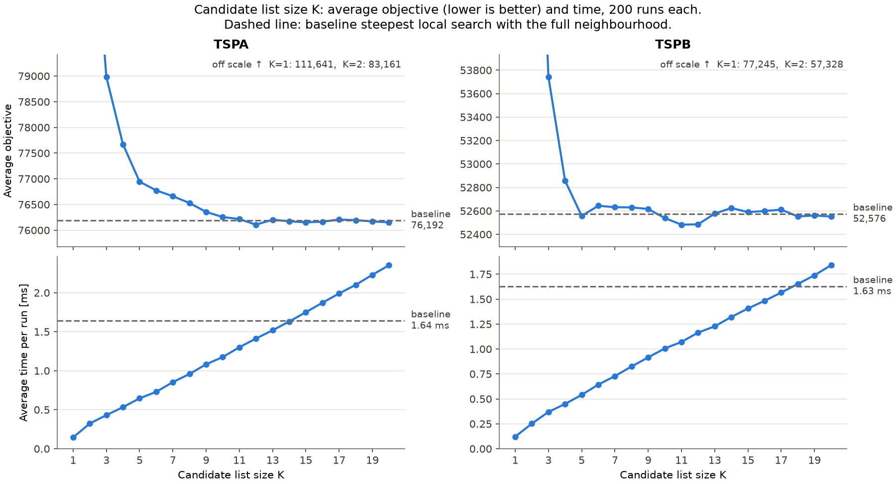
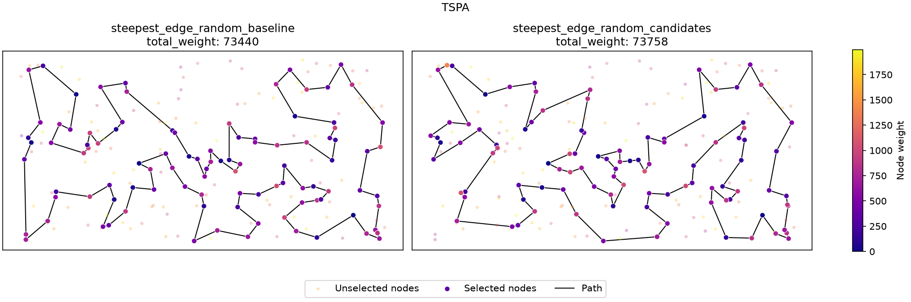
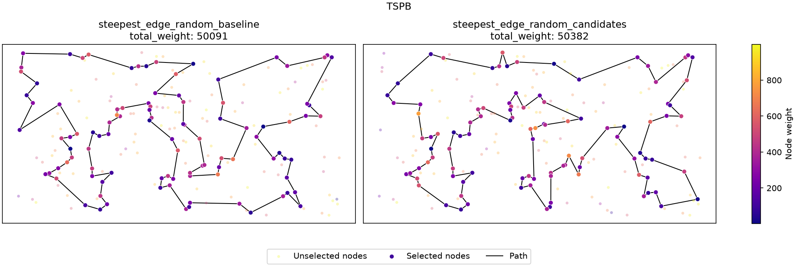

## Problem Description

We are given three columns of integers, with one row for each node. The first two columns contain the \(x\) and \(y\) coordinates of the node positions in a plane. The third column contains node costs. The goal is to select exactly 50% of the nodes (if the number of nodes is odd, we round the number of selected nodes up) and form a Hamiltonian cycle through this set of nodes such that the sum of the total length of the cycle and the total cost of the selected nodes is minimized.

The distances between nodes are calculated as Euclidean distances rounded mathematically to integer values. The distance matrix is calculated just after reading an instance, so the optimization methods can use the distance matrix without accessing node coordinates.

More formally, we may define the problem as follows:

Let $V$ be a set of $n$ nodes, each node $j \in V$ has coordinates $(x_j, y_j)$ and a cost $c_j$. Let $d(i,j) = \text{euclidean}(x_i, y_i, x_j, y_j)$ be the distance between nodes $i$ and $j$. The task is to find a cycle $P = (p_0, p_1, \dots, p_{k-1})$, where $p_i \in V$, all $p_i$ are distinct, and $k = \lceil n/2 \rceil$, that minimizes the objective function, defined as:

$$f(P) = \sum_{i=0}^{k-1} d(p_i, p_{(i+1)}) + \sum_{i=0}^{k-1} c_{p_i}$$

where $p_{k} = p_0$.

Both TSPA and TSPB contain 200 nodes, so each solution contains 100 nodes.

## Algorithms

### Baseline: steepest local search

The baseline algorithm is the steepest local search with two-edge exchange and a random starting solution, as used in Lab 3.

At each iteration, it evaluates all intra-route moves (two-edge exchanges) and inter-route moves (exchanges of a selected and an unselected node) and applies the move with the smallest negative objective delta. The process ends when no improving move remains.

### Candidate-based steepest local search

The purpose of Lab 4 is to reduce the computational cost of steepest local search by restricting the neighbourhood to a subset of promising moves.

Instead of evaluating every possible move, the algorithm uses candidate lists. These lists contain nearby nodes for each node in the instance, and an edge between a node and a node from its list is a candidate edge. Only moves that introduce at least one candidate edge into the solution (candidate moves) are considered.

The candidate list size is \(K=10\). Candidate lists are symmetrized: an edge is included if either endpoint selected the other endpoint as a candidate.

The candidate lists are constructed using the cost matrix:

\[
cost(i,j)=d(i,j)+c_j
\]

Thus, the attractiveness of a candidate depends on both the distance to it and its node cost.

For a candidate edge \((u,v)\) with \(u\) selected, there are exactly two moves that introduce it (\(u^-\) and \(u^+\) denote the predecessor and successor of \(u\) in the cycle):

- **\(v\) selected (intra-route):** the two-edge exchange removing \((u,u^+)\) and \((v,v^+)\), which adds \((u,v)\) and \((u^+,v^+)\), and the one removing \((u^-,u)\) and \((v^-,v)\), which adds \((u^-,v^-)\) and \((u,v)\).
- **\(v\) unselected (inter-route):** replacing \(u^+\) with \(v\), which adds \((u,v)\), and replacing \(u^-\) with \(v\), which adds \((v,u)\).

Exchanging \(u\) itself with \(v\) does not introduce the edge \((u,v)\), so it is not a candidate move for this edge.

### Pseudocode: candidate list construction

**Input:** Cost matrix \(C\), set of nodes \(V\), candidate list size \(K\).

**Output:** Symmetric candidate lists \(N\).

```latex
\begin{algorithm}
\caption{Candidate list construction}
\begin{algorithmic}
\FORALL{$i \in V$}
    \STATE $N_K(i) \gets$ the $\min(K, n-1)$ nodes $j \neq i$ with the smallest $C[i][j] = d(i,j) + c_j$
\ENDFOR
\FORALL{$i \in V$}
    \STATE $N(i) \gets \{\, j : j \in N_K(i) \ \text{or}\ i \in N_K(j) \,\}$
\ENDFOR
\RETURN $N$
\end{algorithmic}
\end{algorithm}
```

The symmetrization step ensures that a candidate edge is available from both endpoints, even if it was initially selected by only one of them.

### Pseudocode: candidate-based steepest local search

The search iterates only over candidate moves: the outer loop goes over the selected nodes, the inner loop over their candidate lists, and depending on whether the candidate node is selected, the two corresponding moves are evaluated.

In the pseudocode, \(\text{2opt}(a, b)\) is the two-edge exchange that removes the edges \((p_a, p_{a+1})\) and \((p_b, p_{b+1})\) and adds \((p_a, p_b)\) and \((p_{a+1}, p_{b+1})\); it is skipped if the two removed edges share a node. \(\text{exchange}(a, v)\) replaces \(p_a\) with the unselected node \(v\). Positions are cyclic, and \(\text{pos}(v)\) is the position of a selected node \(v\) in \(P\).

```latex
\begin{algorithm}
\caption{Candidate-based steepest local search}
\begin{algorithmic}
\STATE $P \gets$ random solution; $U \gets V \setminus P$
\REPEAT
    \STATE $m^* \gets$ none; $\Delta^* \gets 0$
    \FORALL{positions $i$ of $P$, $u = p_i$}
        \FORALL{$v \in N(u)$}
            \IF{$v \in P$}
                \IF{$u < v$}
                    \STATE $j \gets \text{pos}(v)$ \COMMENT{each selected pair once}
                    \STATE evaluate $\text{2opt}(i, j)$ \COMMENT{adds $(u,v)$ and $(p_{i+1}, p_{j+1})$}
                    \STATE evaluate $\text{2opt}(i-1, j-1)$ \COMMENT{adds $(p_{i-1}, p_{j-1})$ and $(u,v)$}
                \ENDIF
            \ELSE
                \STATE evaluate $\text{exchange}(i+1, v)$ \COMMENT{adds $(u,v)$}
                \STATE evaluate $\text{exchange}(i-1, v)$ \COMMENT{adds $(v,u)$}
            \ENDIF
            \STATE update $m^*, \Delta^*$ if an evaluated move has $\Delta < \Delta^*$
        \ENDFOR
    \ENDFOR
    \IF{$\Delta^* < 0$}
        \STATE apply $m^*$ to $P$ and $U$; update $\text{pos}$ of the moved nodes
    \ENDIF
\UNTIL{$\Delta^* \geq 0$}
\RETURN $P$
\end{algorithmic}
\end{algorithm}
```

The algorithm uses lookup arrays to determine whether a node is selected and to retrieve its position or unselected-node index efficiently. This avoids repeatedly searching through the current solution. The arrays are updated after each applied move: after a two-edge exchange only the reversed segment changes positions, and after a node exchange only the two exchanged nodes do. The moves are evaluated directly while browsing the candidate lists, without first building a list of moves.

The moves are evaluated using the same delta calculations and move-application procedures as in the baseline algorithm.

The main difference from the baseline is the restricted neighbourhood. The candidate-based algorithm evaluates fewer moves, which reduces the time spent searching for an improvement. However, because some moves are omitted, it may reach a different local optimum.

## Computational Experiment

The Lab 4 results are compared with all methods from Lab 3. The Lab 3 methods include constructive heuristics, 2-regret heuristics, greedy local search and steepest local search.

The Lab 4 baseline is the steepest local search with two-edge exchange and a random starting solution. The candidate-based version uses the same starting solutions and search strategy, but restricts the neighbourhood using candidate lists. Each method was run 200 times per instance.

### Objective function values

The following table contains the average, minimum and maximum objective values reported in Lab 3 and Lab 4.

```latex
\begin{table}[H]
\centering
\small
\caption{Objective function values}
\begin{tabular}{lrrrrrr}
\toprule
 & \multicolumn{3}{c}{TSPA} & \multicolumn{3}{c}{TSPB} \\
\cmidrule(lr){2-4} \cmidrule(lr){5-7}
Method & avg & min & max & avg & min & max \\
\midrule
Random & 263132.65 & 232767 & 290020 & 206682.99 & 185482 & 232014 \\
Nearest neighbor (end) & 87476.63 & 84362 & 90075 & 59397.33 & 56007 & 63166 \\
Nearest neighbor (any position) & 74346.96 & 72328 & 77022 & 59475.50 & 52915 & 66164 \\
Greedy cycle & 73797.39 & 72590 & 75281 & 59709.47 & 53016 & 63736 \\
2-regret nearest neighbor & 122860.66 & 111527 & 133181 & 74763.39 & 69032 & 80767 \\
2-regret greedy cycle & 121007.17 & 112654 & 130924 & 73403.35 & 69455 & 78142 \\
Weighted 2-regret nearest neighbor & 75561.20 & 72419 & 78504 & 55698.34 & 50485 & 61406 \\
Weighted 2-regret greedy cycle & 73348.72 & 72011 & 75532 & 57895.54 & 52731 & 63370 \\
Greedy LS, nodes, random start & 87875.52 & 80852 & 96854 & 63592.77 & 58487 & 70640 \\
Greedy LS, nodes, greedy cycle start & 73478.34 & 72415 & 74736 & 59331.08 & 52707 & 63607 \\
Greedy LS, edges, random start & 76342.58 & 74146 & 78532 & 52869.81 & 50667 & 55260 \\
Greedy LS, edges, greedy cycle start & 73164.54 & 72088 & 74565 & 58728.54 & 51715 & 63178 \\
Steepest LS, nodes, random start & 90293.09 & 83000 & 98690 & 65919.13 & 59827 & 74954 \\
Steepest LS, nodes, greedy cycle start & 73468.17 & 72415 & 74736 & 59322.68 & 52588 & 63607 \\
\textbf{Steepest LS, edges, random start (Lab 4 baseline)} & \textbf{76191.55} & \textbf{73440} & \textbf{79726} & \textbf{52575.82} & \textbf{50091} & \textbf{54983} \\
Steepest LS, edges, greedy cycle start & 73167.85 & 72088 & 74544 & 58736.80 & 52523 & 63178 \\
\textbf{Steepest LS, edges, random start, candidates} & \textbf{76255.74} & \textbf{74039} & \textbf{79511} & \textbf{52539.14} & \textbf{50382} & \textbf{55096} \\
\bottomrule
\end{tabular}
\end{table}
```

The Lab 4 candidate-based method has a slightly higher average objective value on TSPA than the baseline, by 64.19 (approximately 0.084%). On TSPB, its average is lower by 36.68 (approximately 0.070%).

The best individual baseline solutions are better on both instances. The candidate method nevertheless achieves a lower maximum value on TSPA, while its maximum on TSPB is slightly higher.

### Running time

The following table compares the average running times of all methods. Times are in microseconds (\(\mu s\)).

For Lab 1 and Lab 2 methods, the previous report recorded only average times. Minimum and maximum values are therefore unavailable. The Lab 3 local-search methods and Lab 4 methods include minimum and maximum times.

```latex
\begin{table}[H]
\centering
\small
\caption{Running time of a single run in $\mu s$}
\begin{tabular}{lrrrrrr}
\toprule
 & \multicolumn{3}{c}{TSPA} & \multicolumn{3}{c}{TSPB} \\
\cmidrule(lr){2-4} \cmidrule(lr){5-7}
Method & avg & min & max & avg & min & max \\
\midrule
Random & 1 & -- & -- & 0 & -- & -- \\
Nearest neighbor (end) & 36 & -- & -- & 25 & -- & -- \\
Nearest neighbor (any position) & 612 & -- & -- & 576 & -- & -- \\
Greedy cycle & 525 & -- & -- & 520 & -- & -- \\
2-regret nearest neighbor & 1034 & -- & -- & 1113 & -- & -- \\
2-regret greedy cycle & 873 & -- & -- & 890 & -- & -- \\
Weighted 2-regret nearest neighbor & 940 & -- & -- & 960 & -- & -- \\
Weighted 2-regret greedy cycle & 917 & -- & -- & 913 & -- & -- \\
Greedy LS, nodes, random start & 725 & 469 & 1528 & 704 & 390 & 1337 \\
Greedy LS, nodes, greedy cycle start & 799 & 670 & 1549 & 826 & 659 & 1391 \\
Greedy LS, edges, random start & 467 & 344 & 813 & 478 & 342 & 1011 \\
Greedy LS, edges, greedy cycle start & 814 & 684 & 1101 & 904 & 741 & 1555 \\
Steepest LS, nodes, random start & 2769 & 2099 & 3842 & 2836 & 2139 & 6516 \\
Steepest LS, nodes, greedy cycle start & 591 & 512 & 996 & 648 & 523 & 1153 \\
\textbf{Steepest LS, edges, random start (Lab 4 baseline)} & \textbf{1643} & \textbf{1292} & \textbf{4305} & \textbf{1630} & \textbf{1310} & \textbf{2792} \\
Steepest LS, edges, greedy cycle start & 574 & 498 & 1119 & 647 & 562 & 1043 \\
\textbf{Steepest LS, edges, random start, candidates} & \textbf{1177} & \textbf{980} & \textbf{2764} & \textbf{1001} & \textbf{797} & \textbf{2380} \\
\bottomrule
\end{tabular}
\end{table}
```

The candidate-based version is faster than the Lab 4 baseline:

- **TSPA:** approximately 1.40 times faster, reducing average runtime by 28.4%.
- **TSPB:** approximately 1.63 times faster, reducing average runtime by 38.6%.

### Influence of the candidate list size \(K\)

To select the candidate list size experimentally, the candidate-based method was run 200 times per instance for every \(K = 1, \dots, 20\).

| \(K\) | TSPA avg | TSPA avg time (\(\mu s\)) | TSPB avg | TSPB avg time (\(\mu s\)) |
|---:|---:|---:|---:|---:|
| 1 | 111641.10 | 145 | 77245.40 | 120 |
| 2 | 83160.78 | 323 | 57328.40 | 252 |
| 3 | 78983.24 | 431 | 53742.43 | 369 |
| 4 | 77669.96 | 533 | 52857.45 | 449 |
| 5 | 76943.84 | 646 | 52557.40 | 540 |
| 6 | 76774.38 | 729 | 52644.05 | 643 |
| 7 | 76660.72 | 854 | 52631.64 | 729 |
| 8 | 76529.72 | 958 | 52630.21 | 825 |
| 9 | 76355.76 | 1082 | 52616.13 | 916 |
| 10 | 76255.74 | 1175 | 52539.14 | 1006 |
| 11 | 76216.59 | 1301 | 52482.79 | 1071 |
| 12 | 76107.56 | 1413 | 52485.64 | 1164 |
| 13 | 76203.82 | 1518 | 52576.49 | 1227 |
| 14 | 76173.34 | 1631 | 52624.78 | 1321 |
| 15 | 76152.87 | 1750 | 52589.86 | 1407 |
| 16 | 76165.27 | 1872 | 52599.14 | 1483 |
| 17 | 76207.68 | 1990 | 52610.85 | 1566 |
| 18 | 76195.08 | 2101 | 52553.29 | 1652 |
| 19 | 76170.58 | 2229 | 52560.75 | 1739 |
| 20 | 76153.57 | 2352 | 52552.49 | 1840 |
| baseline | 76191.55 | 1643 | 52575.82 | 1630 |



The running time grows linearly with \(K\), and the candidate method is faster than the baseline up to \(K = 14\) on TSPA and \(K = 17\) on TSPB. For \(K \le 4\) the search stops much too early, as many improving moves do not introduce any candidate edge. From \(K = 5\) on TSPB and from about \(K = 10\) on TSPA, the average objective is within about 0.1% of the baseline, and larger \(K\) brings no further improvement. \(K = 10\) therefore gives baseline quality at a lower time, while \(K = 5\) is 2.5–3 times faster than the baseline at a cost of at most 1% in the average objective.

## Best Solutions





### TSPA

**Baseline solution:**

```text
168 63 149 60 31 48 80 152 108 49 160 83 123 100 90 132 76 91 157 71
51 16 67 144 140 53 179 52 177 99 131 36 143 33 9 54 8 85 93 50
3 169 1 164 186 136 184 178 29 101 147 37 47 130 159 170 153 193 78 88
107 57 182 138 151 42 89 113 106 150 174 176 72 134 84 58 158 192 181 114
135 73 45 185 35 180 28 87 141 189 2 171 187 30 161 97 127 69 104 129
```

Total weight: **73440**

**Candidate-based solution:**

```text
113 89 42 150 151 57 64 107 88 78 193 153 170 146 159 130 47 147 101 29
178 184 136 164 9 54 33 131 99 36 177 179 52 67 144 53 140 41 61 135
73 45 185 102 28 180 156 35 16 51 139 112 4 76 132 71 157 91 80 48
7 31 108 60 116 149 63 168 49 152 123 83 160 97 95 127 69 171 2 189
187 30 141 87 98 114 181 58 84 134 72 176 174 85 1 169 3 50 93 106
```

Total weight: **74039**

### TSPB

**Baseline solution:**

```text
76 162 84 66 67 31 181 152 34 24 27 3 184 46 72 120 156 89 48 96
198 121 42 147 116 37 146 13 149 28 145 65 158 26 125 177 170 115 180 6
29 132 197 175 134 45 157 60 40 71 155 97 154 140 47 38 21 176 30 183
133 136 172 160 69 151 98 167 73 59 85 51 82 87 179 99 171 74 20 2
14 153 90 129 127 80 192 54 78 10 148 114 196 105 94 81 70 190 57 185
```

Total weight: **50091**

**Candidate-based solution:**

```text
78 127 129 90 118 110 2 14 20 74 153 182 80 192 54 162 66 67 31 11
24 34 152 181 179 87 82 51 85 59 73 167 151 122 173 184 3 135 76 46
72 117 120 133 136 172 160 69 183 30 21 38 47 140 154 97 155 71 40 60
157 45 134 175 36 197 132 29 6 180 115 170 26 125 177 138 158 145 28 149
116 147 121 198 58 96 48 89 57 190 70 187 81 94 105 61 196 114 148 10
```

Total weight: **50382**

## Solution Checker

Every generated solution was verified using the solution checker: `src/utils/checker/solution_checker.hpp`.

The checker recalculates the objective function using the distance matrix and node costs. It also verifies that each solution contains exactly \(\lceil n/2\rceil\) nodes, that all node indices are valid, and that no node occurs more than once. The objective value calculated by the checker is compared with the value reported by the algorithm.

All generated solutions (200 per instance and method) passed these checks. The best solutions can additionally be verified using the checker provided on ekursy.

## Conclusions

- **Candidate lists reduce runtime.** Compared with the full-neighbourhood Lab 4 baseline, the candidate method is approximately 1.40 times faster on TSPA and 1.63 times faster on TSPB.

- **The objective quality remains close to the baseline.** The average objective changes by only +0.084% on TSPA and -0.070% on TSPB. This indicates that restricting the neighbourhood can preserve solution quality while reducing computation time.

- **The best individual baseline solutions remain better.** The baseline obtains 73440 on TSPA and 50091 on TSPB, while the candidate method obtains 74039 and 50382, respectively.

- **The candidate method does not necessarily find the same local optimum.** Since it evaluates only a subset of possible moves, it can stop even when an improving move exists outside the candidate neighbourhood.

- **The candidate list size controls the speed-quality trade-off.** The running time grows linearly with \(K\), while the quality reaches the baseline level from about \(K = 5\) on TSPB and \(K = 10\) on TSPA. Very small lists (\(K \le 4\)) clearly worsen the results.

## Source Code

The implementation is available in the repository:

[EC_Assignments – Lab 4](https://github.com/Igor-S-666/EC_Assignments/tree/main/src/lab_4)

The candidate-list construction is implemented in `candidate.hpp`. The candidate-based steepest local search in `local_search_steepest.hpp` evaluates only the candidate moves introduced by these lists at each iteration.
