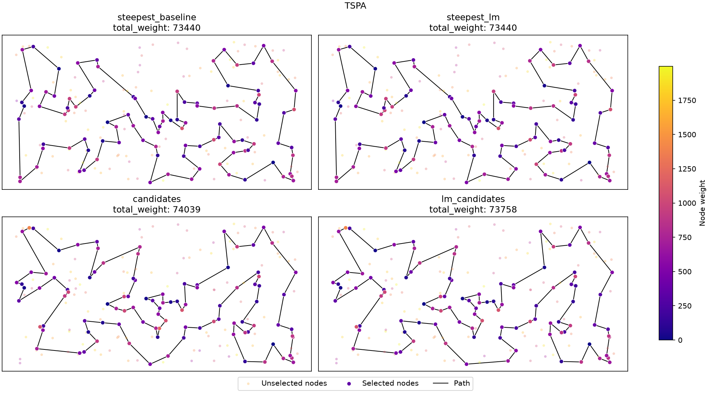
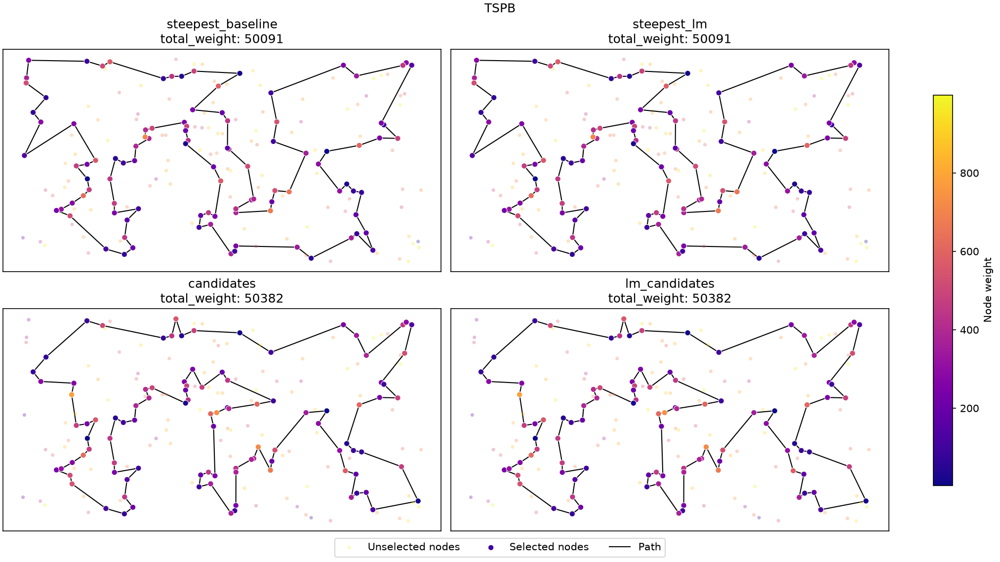

## Problem Description

We are given three columns of integers, with one row for each node. The first two columns contain the \(x\) and \(y\) coordinates of the node positions in a plane. The third column contains node costs. The goal is to select exactly 50% of the nodes (if the number of nodes is odd, we round the number of selected nodes up) and form a Hamiltonian cycle through this set of nodes such that the sum of the total length of the cycle and the total cost of the selected nodes is minimized.

The distances between nodes are calculated as Euclidean distances rounded mathematically to integer values. The distance matrix is calculated just after reading an instance, so the optimization methods can use the distance matrix without accessing node coordinates.

More formally, we may define the problem as follows:

Let $V$ be a set of $n$ nodes, each node $j \in V$ has coordinates $(x_j, y_j)$ and a cost $c_j$. Let $d(i,j) = \text{euclidean}(x_i, y_i, x_j, y_j)$ be the distance between nodes $i$ and $j$. The task is to find a cycle $P = (p_0, p_1, \dots, p_{k-1})$, where $p_i \in V$, all $p_i$ are distinct, and $k = \lceil n/2 \rceil$, that minimizes the objective function, defined as:

$$f(P) = \sum_{i=0}^{k-1} d(p_i, p_{(i+1)}) + \sum_{i=0}^{k-1} c_{p_i}$$

where $p_{k} = p_0$.

Both TSPA and TSPB contain 200 nodes, so each solution contains 100 nodes.

## Algorithms

### Baseline: steepest local search

The baseline algorithm is the steepest local search with two-edge exchange and a random starting solution, as used in Lab 3 (the neighbourhood that turned out to be the best in Lab 3).

At each iteration, it evaluates all intra-route moves (two-edge exchanges) and inter-route moves (exchanges of a selected and an unselected node) and applies the move with the smallest negative objective delta. The process ends when no improving move remains.

### Steepest local search with a list of improving moves (LM)

The purpose of Lab 5 is to improve the time efficiency of the steepest local search by reusing move evaluations (deltas) from previous iterations. After a move is applied, most of the moves evaluated before have exactly the same delta, since a move changes only a few edges of the solution. Therefore, improving moves are stored in a list of improving moves (LM), ordered from the best to the worst, and only the moves that involve the changed parts of the solution are evaluated again. Both intra-route and inter-route moves are kept in LM.

A move is stored by the nodes it depends on, not by positions in the cycle, as positions change after every two-edge exchange:

- **Two-edge exchange:** the removed edges \(a \to b\) and \(c \to d\), in the direction in which they were traversed when the move was evaluated. The move adds the edges \((a, c)\) and \((b, d)\).
- **Node exchange:** the selected node \(v\), its neighbours \(v^-\) and \(v^+\), and the unselected node \(u\) that replaces \(v\).

When LM is browsed, each saved two-edge exchange is in one of three situations:

1. **At least one of the removed edges no longer exists in the current solution:** the move is removed from LM.
2. **Both edges exist, but in a different relative direction than the saved one** (exactly one of them is reversed): applying the move would split the cycle into two cycles, so it is not applicable now. The move stays in LM, as it may become applicable later, and browsing continues.
3. **Both edges exist in the same relative direction** (also both reversed, which is the same move read along the opposite direction of the cycle): the move is applied and removed from LM.

A node exchange does not depend on the direction of the cycle: it is applicable if \(v\) is still selected with the neighbours \(v^-\) and \(v^+\) (in any order) and \(u\) is still unselected; otherwise it is removed from LM.

Because of situation 2, moves with relatively inverted edges also have to be evaluated. For two edges \(a \to b\) and \(c \to d\) of the current solution, there are two ways of reconnecting them: \((a, c) + (b, d)\), which is applicable now, and \((a, d) + (b, c)\), which becomes applicable when one of the edges is reversed relative to the other. A two-edge exchange reverses a segment of the cycle, which reverses the direction of all edges inside it without creating them anew; such edges are not evaluated again, so the moves that become applicable through the reversal can only be found in LM if they were saved before. Both reconnections are therefore evaluated, also for the initial solution.

### Pseudocode: steepest local search with LM

In the pseudocode, \(\text{2opt}(a \to b, c \to d)\) is the two-edge exchange removing these edges and adding \((a, c)\) and \((b, d)\), and \(\text{exchange}(v, u)\) replaces the selected node \(v\) with the unselected node \(u\). Only improving moves (\(\Delta < 0\)) are inserted into LM.

```latex
\begin{algorithm}
\caption{Steepest local search with a list of improving moves}
\begin{algorithmic}
\STATE $P \gets$ random solution; $U \gets V \setminus P$
\STATE $LM \gets$ empty list of moves, ordered by $\Delta$ from the best
\FORALL{pairs of edges $a \to b$, $c \to d$ of $P$}
    \STATE insert $\text{2opt}(a \to b, c \to d)$ and $\text{2opt}(a \to b, d \to c)$ into $LM$ if improving
\ENDFOR
\FORALL{$v \in P$, $u \in U$}
    \STATE insert $\text{exchange}(v, u)$ into $LM$ if improving
\ENDFOR
\REPEAT
    \STATE $m^* \gets$ none
    \FORALL{$m \in LM$, starting from the best}
        \IF{$m$ is not applicable and can never be again}
            \STATE remove $m$ from $LM$ \COMMENT{a removed edge is gone / $v \notin P$ / $u \notin U$}
        \ELSIF{$m$ is a 2opt with edges in a different relative direction}
            \STATE \textbf{continue} \COMMENT{keep $m$ in $LM$}
        \ELSE
            \STATE $m^* \gets m$; remove $m$ from $LM$; \textbf{break}
        \ENDIF
    \ENDFOR
    \IF{$m^* \neq$ none}
        \STATE apply $m^*$ to $P$ and $U$
        \FORALL{new edges $a \to b$ of $P$ and all edges $c \to d$ of $P$}
            \STATE insert $\text{2opt}(a \to b, c \to d)$ and $\text{2opt}(a \to b, d \to c)$ into $LM$ if improving
        \ENDFOR
        \FORALL{nodes $v \in P$ with new neighbours, $u \in U$}
            \STATE insert $\text{exchange}(v, u)$ into $LM$ if improving
        \ENDFOR
        \IF{$m^*$ was $\text{exchange}(v, u)$}
            \STATE insert $\text{exchange}(x, v)$ into $LM$ for all $x \in P$ if improving \COMMENT{$v$ is unselected now}
        \ENDIF
    \ENDIF
\UNTIL{$m^* =$ none}
\RETURN $P$
\end{algorithmic}
\end{algorithm}
```

The moves whose deltas may have changed are exactly the moves removing a new edge (two-edge exchanges with a new edge, node exchanges of a node with a new neighbour) and the moves of a node whose selection changed; all of them are evaluated right after the move is applied. All other moves keep their deltas, which are taken from LM. The search ends when LM contains no applicable move; at that point no improving move exists in the whole neighbourhood, so the result is a local optimum of the same neighbourhood as in the baseline.

The delta of a two-edge exchange depends only on distances, as the set of selected nodes does not change. The delta of a node exchange also includes the difference of the node costs.

### Candidate moves and their combination with LM

For comparison, the candidate-based steepest local search from Lab 4 (candidate lists of size \(K = 10\), built with the cost matrix and symmetrized) is also included. It was reimplemented in a faster way than in previous Lab as we found few unnecessary operations in the previous implementation.

Optionally, both mechanisms were combined: LM restricted to candidate moves, i.e. moves introducing at least one candidate edge. Initially, for every candidate edge \((x, y)\) of selected nodes, the four two-edge exchanges adding it are inserted (removing the edge of \(x\) to its successor or predecessor together with the edge of \(y\) to its successor or predecessor; two of them are applicable, the other two are the moves with relatively inverted edges), together with all node exchanges putting an unselected node next to one of its candidate neighbours. After a move, only the candidate moves removing one of the new edges, the node exchanges of the nodes with new neighbours and the exchanges bringing the removed node back next to its candidate neighbours are evaluated.

## Computational Experiment

The Lab 5 results are compared with all methods from Labs 1–4. The baseline is the steepest local search with two-edge exchange and a random starting solution; the LM version, the candidate version and their combination use the same neighbourhood and the same starting solutions (each method uses its own random generator with the same seed). Each method was run 200 times per instance. The Lab 5 methods were run interleaved, run by run, so that fluctuations of the machine load affect all of them equally.

### Objective function values

The following table contains the average, minimum and maximum objective values reported in Labs 1–4 and Lab 5.

```latex
\begin{table}[H]
\centering
\small
\caption{Objective function values}
\begin{tabular}{lrrrrrr}
\toprule
 & \multicolumn{3}{c}{TSPA} & \multicolumn{3}{c}{TSPB} \\
\cmidrule(lr){2-4} \cmidrule(lr){5-7}
Method & avg & min & max & avg & min & max \\
\midrule
Random & 263132.65 & 232767 & 290020 & 206682.99 & 185482 & 232014 \\
Nearest neighbor (end) & 87476.63 & 84362 & 90075 & 59397.33 & 56007 & 63166 \\
Nearest neighbor (any position) & 74346.96 & 72328 & 77022 & 59475.50 & 52915 & 66164 \\
Greedy cycle & 73797.39 & 72590 & 75281 & 59709.47 & 53016 & 63736 \\
2-regret nearest neighbor & 122860.66 & 111527 & 133181 & 74763.39 & 69032 & 80767 \\
2-regret greedy cycle & 121007.17 & 112654 & 130924 & 73403.35 & 69455 & 78142 \\
Weighted 2-regret nearest neighbor & 75561.20 & 72419 & 78504 & 55698.34 & 50485 & 61406 \\
Weighted 2-regret greedy cycle & 73348.72 & 72011 & 75532 & 57895.54 & 52731 & 63370 \\
Greedy LS, nodes, random start & 87875.52 & 80852 & 96854 & 63592.77 & 58487 & 70640 \\
Greedy LS, nodes, greedy cycle start & 73478.34 & 72415 & 74736 & 59331.08 & 52707 & 63607 \\
Greedy LS, edges, random start & 76342.58 & 74146 & 78532 & 52869.81 & 50667 & 55260 \\
Greedy LS, edges, greedy cycle start & 73164.54 & 72088 & 74565 & 58728.54 & 51715 & 63178 \\
Steepest LS, nodes, random start & 90293.09 & 83000 & 98690 & 65919.13 & 59827 & 74954 \\
Steepest LS, nodes, greedy cycle start & 73468.17 & 72415 & 74736 & 59322.68 & 52588 & 63607 \\
\textbf{Steepest LS, edges, random start (baseline)} & \textbf{76191.55} & \textbf{73440} & \textbf{79726} & \textbf{52575.82} & \textbf{50091} & \textbf{54983} \\
Steepest LS, edges, greedy cycle start & 73167.85 & 72088 & 74544 & 58736.80 & 52523 & 63178 \\
Steepest LS, edges, random start, candidates & 76255.74 & 74039 & 79511 & 52539.14 & 50382 & 55096 \\
\textbf{Steepest LS, edges, random start, LM} & \textbf{76191.55} & \textbf{73440} & \textbf{79726} & \textbf{52575.82} & \textbf{50091} & \textbf{54983} \\
\textbf{Steepest LS, edges, random start, LM + candidates} & \textbf{76241.80} & \textbf{73758} & \textbf{79511} & \textbf{52559.71} & \textbf{50382} & \textbf{55096} \\
\bottomrule
\end{tabular}
\end{table}
```

The LM version obtains exactly the same results as the baseline: not only the same statistics, but the same local optimum in each of the 200 runs on both instances, which is expected, as LM should only speed up the search without changing the final result. Both methods need on average 133.0 (TSPA) and 133.3 (TSPB) moves to reach a local optimum.

The combination of LM with candidate moves searches the same restricted neighbourhood as the candidate method. In about 90% of the runs it ends in the same local optimum; in the remaining ones, different moves with equal deltas were chosen at some iteration, which leads to a different local optimum. Its average objective is 13.94 lower than that of the candidate method on TSPA and 20.57 higher on TSPB, i.e. within 0.07% of the baseline on both instances.

### Running time

The following table compares the average running times of all methods. Times are in microseconds (\(\mu s\)).

For Lab 1 and Lab 2 methods, the previous report recorded only average times. Minimum and maximum values are therefore unavailable. The Lab 1–3 times are the ones reported previously; the times of the baseline and of the Lab 5 methods were measured in the Lab 5 experiment.

```latex
\begin{table}[H]
\centering
\small
\caption{Running time of a single run in $\mu s$}
\begin{tabular}{lrrrrrr}
\toprule
 & \multicolumn{3}{c}{TSPA} & \multicolumn{3}{c}{TSPB} \\
\cmidrule(lr){2-4} \cmidrule(lr){5-7}
Method & avg & min & max & avg & min & max \\
\midrule
Random & 1 & -- & -- & 0 & -- & -- \\
Nearest neighbor (end) & 36 & -- & -- & 25 & -- & -- \\
Nearest neighbor (any position) & 612 & -- & -- & 576 & -- & -- \\
Greedy cycle & 525 & -- & -- & 520 & -- & -- \\
2-regret nearest neighbor & 1034 & -- & -- & 1113 & -- & -- \\
2-regret greedy cycle & 873 & -- & -- & 890 & -- & -- \\
Weighted 2-regret nearest neighbor & 940 & -- & -- & 960 & -- & -- \\
Weighted 2-regret greedy cycle & 917 & -- & -- & 913 & -- & -- \\
Greedy LS, nodes, random start & 725 & 469 & 1528 & 704 & 390 & 1337 \\
Greedy LS, nodes, greedy cycle start & 799 & 670 & 1549 & 826 & 659 & 1391 \\
Greedy LS, edges, random start & 467 & 344 & 813 & 478 & 342 & 1011 \\
Greedy LS, edges, greedy cycle start & 814 & 684 & 1101 & 904 & 741 & 1555 \\
Steepest LS, nodes, random start & 2769 & 2099 & 3842 & 2836 & 2139 & 6516 \\
Steepest LS, nodes, greedy cycle start & 591 & 512 & 996 & 648 & 523 & 1153 \\
\textbf{Steepest LS, edges, random start (baseline)} & \textbf{1692} & \textbf{1381} & \textbf{4189} & \textbf{1644} & \textbf{1324} & \textbf{2351} \\
Steepest LS, edges, greedy cycle start & 574 & 498 & 1119 & 647 & 562 & 1043 \\
Steepest LS, edges, random start, candidates & 814 & 638 & 2205 & 674 & 531 & 1216 \\
\textbf{Steepest LS, edges, random start, LM} & \textbf{558} & \textbf{423} & \textbf{1064} & \textbf{530} & \textbf{418} & \textbf{809} \\
\textbf{Steepest LS, edges, random start, LM + candidates} & \textbf{491} & \textbf{394} & \textbf{832} & \textbf{448} & \textbf{363} & \textbf{790} \\
\bottomrule
\end{tabular}
\end{table}
```

The baseline evaluates the whole neighbourhood (about 15,000 moves) in each of its about 134 iterations, i.e. about 2 million move evaluations per run. The LM version evaluates all moves only once, for the initial solution, and then only the moves involving the changed parts of the solution (about 800 per applied move), about 120,000 evaluations in total, roughly 16 times fewer. The gain in time is smaller than that, as managing LM (browsing it and checking whether the saved moves are still applicable) takes about half of the running time. Restricting LM to candidate moves reduces the size of LM (from about 9,700 to about 2,600 moves for the initial solution) and the number of evaluations, which gives a further 12–15% reduction of the running time.

## Best Solutions

The best solutions of the baseline and of the LM version are identical, as are the best solutions of the candidate method and of LM + candidates on TSPB.





### TSPA

**Baseline and LM solution:**

```text
168 63 149 60 31 48 80 152 108 49 160 83 123 100 90 132 76 91 157 71
51 16 67 144 140 53 179 52 177 99 131 36 143 33 9 54 8 85 93 50
3 169 1 164 186 136 184 178 29 101 147 37 47 130 159 170 153 193 78 88
107 57 182 138 151 42 89 113 106 150 174 176 72 134 84 58 158 192 181 114
135 73 45 185 35 180 28 87 141 189 2 171 187 30 161 97 127 69 104 129
```

Total weight: **73440**

**Candidate-based solution:**

```text
113 89 42 150 151 57 64 107 88 78 193 153 170 146 159 130 47 147 101 29
178 184 136 164 9 54 33 131 99 36 177 179 52 67 144 53 140 41 61 135
73 45 185 102 28 180 156 35 16 51 139 112 4 76 132 71 157 91 80 48
7 31 108 60 116 149 63 168 49 152 123 83 160 97 95 127 69 171 2 189
187 30 141 87 98 114 181 58 84 134 72 176 174 85 1 169 3 50 93 106
```

Total weight: **74039**

**LM + candidates solution:**

```text
113 89 42 150 151 57 64 107 88 78 193 153 170 146 159 130 47 147 101 29
178 184 136 164 9 54 33 131 99 36 177 179 52 67 144 53 140 41 135 73
45 185 102 28 180 156 35 16 51 139 112 4 76 132 71 157 91 80 48 7
31 108 60 116 149 63 168 49 152 123 83 160 97 95 127 69 171 2 189 187
30 141 87 98 114 192 158 58 84 134 72 176 174 85 1 169 3 50 93 106
```

Total weight: **73758**

### TSPB

**Baseline and LM solution:**

```text
76 162 84 66 67 31 181 152 34 24 27 3 184 46 72 120 156 89 48 96
198 121 42 147 116 37 146 13 149 28 145 65 158 26 125 177 170 115 180 6
29 132 197 175 134 45 157 60 40 71 155 97 154 140 47 38 21 176 30 183
133 136 172 160 69 151 98 167 73 59 85 51 82 87 179 99 171 74 20 2
14 153 90 129 127 80 192 54 78 10 148 114 196 105 94 81 70 190 57 185
```

Total weight: **50091**

**Candidate-based and LM + candidates solution:**

```text
78 127 129 90 118 110 2 14 20 74 153 182 80 192 54 162 66 67 31 11
24 34 152 181 179 87 82 51 85 59 73 167 151 122 173 184 3 135 76 46
72 117 120 133 136 172 160 69 183 30 21 38 47 140 154 97 155 71 40 60
157 45 134 175 36 197 132 29 6 180 115 170 26 125 177 138 158 145 28 149
116 147 121 198 58 96 48 89 57 190 70 187 81 94 105 61 196 114 148 10
```

Total weight: **50382**

## Solution Checker

Every generated solution was verified using the solution checker: `src/utils/checker/solution_checker.hpp`.

The checker recalculates the objective function using the distance matrix and node costs. It also verifies that each solution contains exactly \(\lceil n/2\rceil\) nodes, that all node indices are valid, and that no node occurs more than once. The objective value calculated by the checker is compared with the value reported by the algorithm.

All generated solutions (200 per instance and method) passed these checks. The best solutions can additionally be verified using the checker provided on ekursy.

## Conclusions

- **Reusing move evaluations makes the steepest local search about 3 times faster.** The LM version is 3.03 times faster on TSPA and 3.10 times faster on TSPB than the baseline.

- **The LM version gives exactly the same results as the baseline.** It applies the best improving move of the same neighbourhood in every iteration, and with the same tie-breaking it ends in the same local optimum in all runs.

- **Moves with relatively inverted edges are necessary.** A two-edge exchange reverses the direction of a segment without creating its edges anew, so moves that become applicable through such a reversal are found only if they were saved in LM before.

- **The number of move evaluations drops about 16 times, but the running time only about 3 times.** About half of the running time of the LM version is spent on managing the list, i.e. on browsing it and checking whether the saved moves are still applicable.

- **Combining LM with candidate moves is the fastest method.** It is 3.44 (TSPA) and 3.67 (TSPB) times faster than the baseline and about 1.1 times faster than LM alone, with an average objective within 0.07% of the baseline.

## Source Code

The implementation is available in the repository:

[EC_Assignments – Lab 5](https://github.com/Igor-S-666/EC_Assignments/tree/main/src/lab_5)

The steepest local search with the list of improving moves (and its combination with candidate moves) is implemented in `local_steepest_fast.hpp`, the reimplemented candidate-based steepest local search in `local_search_candidates.hpp`, and the flat candidate lists shared by both in `candidate_lists.hpp`. The baseline and the Lab 4 candidate search are used from `src/lab_4/algorithms/local_search_steepest.hpp`.
