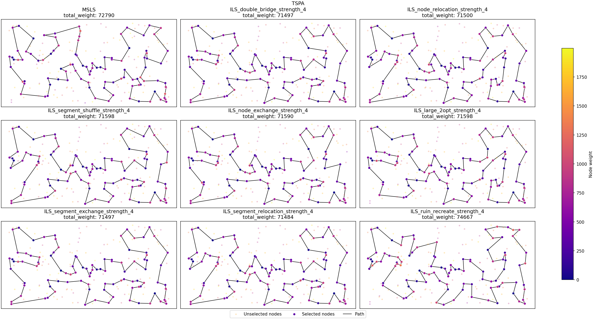

# Lab 6 – Iterated Local Search and Perturbation Operators

## 1. Problem Description

The objective of this laboratory assignment is to solve a Travelling Salesperson Problem (TSP) variant in which only a subset of all available nodes must be visited.

For an instance containing \(n\) nodes, a solution must select exactly

\[
k = \left\lceil \frac{n}{2} \right\rceil
\]

nodes and arrange them into a Hamiltonian cycle. Each selected node must appear exactly once in the cycle.

The objective function consists of the total distance travelled along the cycle and the costs associated with the selected nodes.

For a solution represented by

\[
P = (p_0,p_1,\ldots,p_{k-1}),
\]

the objective function is

\[
F(P) =
\sum_{i=0}^{k-1}
d(p_i,p_{(i+1)\bmod k})
+
\sum_{i=0}^{k-1} c(p_i),
\]

where:

- \(d(p_i,p_j)\) is the distance between nodes \(p_i\) and \(p_j\),
- \(c(p_i)\) is the cost of selecting node \(p_i\),
- \(k\) is the required number of selected nodes.

The objective is to find a feasible solution minimizing \(F(P)\).

Two problem instances were considered:

- **TSPA:** 200 available nodes, with 100 nodes selected in each solution.
- **TSPB:** 200 available nodes, with 100 nodes selected in each solution.

The experiments compare Multi-Start Local Search (MSLS) with Iterated Local Search (ILS) using different perturbation operators.

## 2. Algorithms

### 2.1. Local Search

Local Search is used to improve a given solution by examining possible modifications of its current structure.

The algorithm starts with a feasible solution and searches for a neighbouring solution with a lower objective value. If an improving move is found, it replaces the current solution. The process continues until no improving move can be found.

In this assignment, local search works with two types of modifications:

1. **Intra-route modifications:** change the order of nodes in the selected cycle.
2. **Inter-route modifications:** exchange a selected node with an unselected node.

The first type changes the order of the cycle while preserving the selected set. The second type changes which nodes belong to the solution.

A common intra-route operation is 2-opt. It removes two edges from the cycle and reconnects the resulting paths in a different way.

If the removed edges are \((a,b)\) and \((c,d)\), and the new edges are \((a,c)\) and \((b,d)\), the change in distance is

\[
\Delta =
d(a,c)+d(b,d)-d(a,b)-d(c,d).
\]

The move is beneficial when

\[
\Delta < 0.
\]

The local search terminates when it reaches a local optimum, meaning that none of the examined neighbouring moves improves the current solution.

### 2.2. Multi-Start Local Search (MSLS)

Multi-Start Local Search repeatedly generates new initial solutions and improves each one using Local Search.

The purpose of this algorithm is to explore different parts of the solution space by starting from multiple random solutions. Since Local Search may become trapped in a local optimum, using different initial solutions increases the chance of finding a better result.

The best solution found across all starts is retained.

**Pseudocode:**

```text
MSLS(number_of_starts):

    best_solution = NONE

    FOR i = 1 TO number_of_starts:

        solution = generate_random_solution()

        solution = local_search(solution)

        IF best_solution is NONE OR
           solution.cost < best_solution.cost:

            best_solution = solution

    RETURN best_solution
```

In the experiment, MSLS uses 400 starting solutions per run.

### 2.3. Iterated Local Search (ILS)

Iterated Local Search attempts to improve upon a locally optimized solution by repeatedly applying perturbations.

First, the algorithm generates an initial solution and improves it using Local Search. It then applies a perturbation operator to change the current solution. Local Search is performed again on the perturbed solution.

The perturbation helps the algorithm escape from the local optimum reached during the previous Local Search phase.

The experiment evaluates several different perturbation operators. Each operator changes the solution in a different way.

**Pseudocode:**

```text
ILS(number_of_iterations, perturbation, strength):

    current = generate_random_solution()

    current = local_search(current)

    best = current

    FOR i = 1 TO number_of_iterations:

        candidate = perturb(current, perturbation, strength)

        candidate = local_search(candidate)

        IF candidate.cost < best.cost:

            best = candidate

        current = candidate

    RETURN best
```

The pseudocode describes the general ILS process. The exact acceptance rule for the current solution should follow the implementation in the ILS source file.

### 2.4. Perturbation Strength

The perturbation strength controls how many times a perturbation operation is applied during one ILS iteration.

In the experiments, the parameter is set to

\[
\text{strength}=4.
\]

For most perturbations, this means that the corresponding operation is executed four times before Local Search is started again.

However, the exact effect of strength depends on the operator. For example, four node relocations move four individual nodes, whereas four segment relocations move four randomly selected blocks.

**Ruin-recreate is an exception:** its implementation calls the operation only once, regardless of the strength parameter. Instead, one call replaces approximately one eighth of the selected nodes.

The following sections describe the operators and the exact meaning of strength in the supplied implementation.

## 3. Perturbation Operators

### 3.1. Double Bridge

The Double Bridge operator performs a large modification of the cycle by cutting the route into several parts and reconnecting these parts in a different order.

It is based on a 4-edge exchange and is designed to make a larger change than a simple 2-opt move.

The operator preserves the selected nodes but changes their order in the cycle.

**Strength 4:** the implementation applies the Double Bridge operation four times during one perturbation phase.

**Pseudocode:**

```text
DOUBLE_BRIDGE(solution):

    divide the cycle into several sections

    reconnect the sections in a different order

    RETURN modified_solution
```

### 3.2. Node Relocation

Node Relocation selects one node from the cycle, removes it from its current position and inserts it at another randomly selected position.

The selected set remains unchanged. Only the order of nodes is modified.

**Strength 4:** four individual node relocation operations are performed.

**Pseudocode:**

```text
NODE_RELOCATION(solution):

    choose a random node position FROM

    choose a random insertion position TO

    remove the node at FROM

    insert the node at TO

    RETURN modified_solution
```

### 3.3. Segment Shuffle

Segment Shuffle selects a random contiguous segment of the cycle and randomly rearranges the nodes inside that segment.

The segment is selected using two random positions. Its length can vary from two nodes up to the length of the cycle.

The selected nodes remain the same, but their order inside the chosen segment changes.

**Strength 4:** four segment-shuffling operations are performed. Each operation selects a new random segment.

**Pseudocode:**

```text
SEGMENT_SHUFFLE(solution):

    choose random segment boundaries i and j

    randomly shuffle nodes between i and j

    RETURN modified_solution
```

### 3.4. Node Exchange

Node Exchange replaces one selected node with one currently unselected node.

The implementation randomly selects:

- a position in the current cycle,
- a node from the unselected-node list.

The selected node is exchanged with the unselected node. Therefore, unlike pure route-order perturbations, this operator changes the set of selected nodes.

**Strength 4:** four node exchanges are attempted during one perturbation phase.

**Pseudocode:**

```text
NODE_EXCHANGE(solution):

    choose random selected node

    choose random unselected node

    replace selected node with unselected node

    RETURN modified_solution
```

### 3.5. Segment Relocation

Segment Relocation removes a contiguous block of nodes from the cycle and inserts it at another randomly selected position.

The relative order of nodes inside the moved block is preserved.

In the supplied implementation, the segment length is selected randomly. For a cycle of 100 nodes, its length can range from 2 to 33 nodes.

**Strength 4:** four segment relocation operations are performed. Each operation selects a new block and insertion position.

**Pseudocode:**

```text
SEGMENT_RELOCATION(solution):

    choose random segment length

    choose random starting position

    remove the selected segment

    choose a new insertion position

    insert the segment at the new position

    RETURN modified_solution
```

### 3.6. Segment Exchange

Segment Exchange selects two non-overlapping blocks of equal length and swaps their positions in the cycle.

The internal order of each block is preserved.

In the supplied implementation, the segment length is selected randomly. For a cycle of 100 nodes, it can range from 2 to 25 nodes.

**Strength 4:** four segment exchanges are performed during one perturbation phase.

**Pseudocode:**

```text
SEGMENT_EXCHANGE(solution):

    choose a random segment length

    choose two non-overlapping segment positions

    swap the two segments

    RETURN modified_solution
```

### 3.7. Large 2-opt

Large 2-opt reverses a randomly selected segment of the cycle.

Unlike a conventional short 2-opt modification, this operator can reverse a large part of the route.

The segment length is selected randomly and can range from 3 nodes to one less than the complete cycle length. The entire cycle is never reversed.

**Strength 4:** four large 2-opt operations are performed during one perturbation phase.

**Pseudocode:**

```text
LARGE_2OPT(solution):

    choose random segment length

    choose random starting position

    reverse the selected segment

    RETURN modified_solution
```

### 3.8. Ruin-Recreate

Ruin-Recreate performs a stronger modification by replacing a group of selected nodes with currently unselected nodes.

First, the algorithm chooses several distinct positions in the current cycle. It then replaces the nodes at those positions with randomly selected unselected nodes.

This changes both the selected-node set and the resulting cycle.

In the supplied implementation, the number of replacements is calculated as

\[
r = \min\left(
|U|,
\max\left(2,\left\lfloor\frac{m}{8}\right\rfloor\right)
\right),
\]

where:

- \(U\) is the set of currently unselected nodes,
- \(m\) is the number of selected nodes in the cycle.

For the two tested instances, \(m=100\). Therefore,

\[
r=\min(|U|,12).
\]

Assuming there are at least 12 unselected nodes, one Ruin-Recreate operation replaces exactly 12 selected nodes.

**Strength 4:** in the current implementation, strength does not cause four Ruin-Recreate operations. The `apply()` function calls `ruin_recreate()` only once. The operation itself replaces approximately one eighth of the selected nodes.

After the replacements, the implementation recalculates the objective value.

**Pseudocode:**

```text
RUIN_RECREATE(solution):

    determine number of nodes to replace

    choose distinct positions in the cycle

    FOR each chosen position:

        choose a random unselected node

        replace the selected node with the unselected node

    recalculate the complete objective value

    RETURN modified_solution
```

### 3.9. Summary of Perturbation Strength

The following table summarizes what `strength = 4` means in the actual supplied implementation.

| Perturbation | Meaning of strength 4 |
|---|---|
| Double Bridge | Four Double Bridge operations |
| Node Relocation | Four individual node relocations |
| Segment Shuffle | Four segment shuffles |
| Node Exchange | Four selected/unselected node exchanges |
| Segment Relocation | Four segment relocations |
| Segment Exchange | Four segment exchanges |
| Large 2-opt | Four large segment reversals |
| Ruin-Recreate | One operation, replacing approximately 12 nodes for a 100-node cycle |

The number of nodes affected is not necessarily four. Strength counts operation calls for the first seven operators, while Ruin-Recreate uses its own replacement-count rule.

## 4. Computational Experiment

### 4.1. Experimental Setup

The algorithms were tested on two instances: TSPA and TSPB.

Both instances contain 200 nodes, and every feasible solution contains 100 selected nodes.

The experiment compares:

- MSLS,
- ILS with Double Bridge,
- ILS with Node Relocation,
- ILS with Segment Shuffle,
- ILS with Node Exchange,
- ILS with Segment Relocation,
- ILS with Segment Exchange,
- ILS with Large 2-opt,
- ILS with Ruin-Recreate.

For all ILS perturbations, the configured strength is 4.

Each method was executed 20 times. The results were evaluated using the best, maximum and average objective values, as well as execution times.

The following table contains the average, minimum and maximum objective values reported in Labs 1–4 and Lab 5.

```latex
\begin{table}[H]
\centering
\small
\caption{Objective function values}
\begin{tabular}{lrrrrrr}
\toprule
 & \multicolumn{3}{c}{TSPA} & \multicolumn{3}{c}{TSPB} \\
\cmidrule(lr){2-4} \cmidrule(lr){5-7}
Method & avg & min & max & avg & min & max \\
\midrule
Random & 263132.65 & 232767 & 290020 & 206682.99 & 185482 & 232014 \\
Nearest neighbor (end) & 87476.63 & 84362 & 90075 & 59397.33 & 56007 & 63166 \\
Nearest neighbor (any position) & 74346.96 & 72328 & 77022 & 59475.50 & 52915 & 66164 \\
Greedy cycle & 73797.39 & 72590 & 75281 & 59709.47 & 53016 & 63736 \\
2-regret nearest neighbor & 122860.66 & 111527 & 133181 & 74763.39 & 69032 & 80767 \\
2-regret greedy cycle & 121007.17 & 112654 & 130924 & 73403.35 & 69455 & 78142 \\
Weighted 2-regret nearest neighbor & 75561.20 & 72419 & 78504 & 55698.34 & 50485 & 61406 \\
Weighted 2-regret greedy cycle & 73348.72 & 72011 & 75532 & 57895.54 & 52731 & 63370 \\
Greedy LS, nodes, random start & 87875.52 & 80852 & 96854 & 63592.77 & 58487 & 70640 \\
Greedy LS, nodes, greedy cycle start & 73478.34 & 72415 & 74736 & 59331.08 & 52707 & 63607 \\
Greedy LS, edges, random start & 76342.58 & 74146 & 78532 & 52869.81 & 50667 & 55260 \\
Greedy LS, edges, greedy cycle start & 73164.54 & 72088 & 74565 & 58728.54 & 51715 & 63178 \\
Steepest LS, nodes, random start & 90293.09 & 83000 & 98690 & 65919.13 & 59827 & 74954 \\
Steepest LS, nodes, greedy cycle start & 73468.17 & 72415 & 74736 & 59322.68 & 52588 & 63607 \\
\textbf{Steepest LS, edges, random start (baseline)} & \textbf{76191.55} & \textbf{73440} & \textbf{79726} & \textbf{52575.82} & \textbf{50091} & \textbf{54983} \\
Steepest LS, edges, greedy cycle start & 73167.85 & 72088 & 74544 & 58736.80 & 52523 & 63178 \\
Steepest LS, edges, random start, candidates & 76255.74 & 74039 & 79511 & 52539.14 & 50382 & 55096 \\
\textbf{Steepest LS, edges, random start, LM} & \textbf{76191.55} & \textbf{73440} & \textbf{79726} & \textbf{52575.82} & \textbf{50091} & \textbf{54983} \\
\textbf{Steepest LS, edges, random start, LM + candidates} & \textbf{76241.80} & \textbf{73758} & \textbf{79511} & \textbf{52559.71} & \textbf{50382} & \textbf{55096} \\
\bottomrule
\end{tabular}
\end{table}
```


```latex
\begin{table}[H]
\centering
\small
\caption{Running time of a single run in $\mu s$}
\begin{tabular}{lrrrrrr}
\toprule
 & \multicolumn{3}{c}{TSPA} & \multicolumn{3}{c}{TSPB} \\
\cmidrule(lr){2-4} \cmidrule(lr){5-7}
Method & avg & min & max & avg & min & max \\
\midrule
Random & 1 & -- & -- & 0 & -- & -- \\
Nearest neighbor (end) & 36 & -- & -- & 25 & -- & -- \\
Nearest neighbor (any position) & 612 & -- & -- & 576 & -- & -- \\
Greedy cycle & 525 & -- & -- & 520 & -- & -- \\
2-regret nearest neighbor & 1034 & -- & -- & 1113 & -- & -- \\
2-regret greedy cycle & 873 & -- & -- & 890 & -- & -- \\
Weighted 2-regret nearest neighbor & 940 & -- & -- & 960 & -- & -- \\
Weighted 2-regret greedy cycle & 917 & -- & -- & 913 & -- & -- \\
Greedy LS, nodes, random start & 725 & 469 & 1528 & 704 & 390 & 1337 \\
Greedy LS, nodes, greedy cycle start & 799 & 670 & 1549 & 826 & 659 & 1391 \\
Greedy LS, edges, random start & 467 & 344 & 813 & 478 & 342 & 1011 \\
Greedy LS, edges, greedy cycle start & 814 & 684 & 1101 & 904 & 741 & 1555 \\
Steepest LS, nodes, random start & 2769 & 2099 & 3842 & 2836 & 2139 & 6516 \\
Steepest LS, nodes, greedy cycle start & 591 & 512 & 996 & 648 & 523 & 1153 \\
\textbf{Steepest LS, edges, random start (baseline)} & \textbf{1692} & \textbf{1381} & \textbf{4189} & \textbf{1644} & \textbf{1324} & \textbf{2351} \\
Steepest LS, edges, greedy cycle start & 574 & 498 & 1119 & 647 & 562 & 1043 \\
Steepest LS, edges, random start, candidates & 814 & 638 & 2205 & 674 & 531 & 1216 \\
\textbf{Steepest LS, edges, random start, LM} & \textbf{558} & \textbf{423} & \textbf{1064} & \textbf{530} & \textbf{418} & \textbf{809} \\
\textbf{Steepest LS, edges, random start, LM + candidates} & \textbf{491} & \textbf{394} & \textbf{832} & \textbf{448} & \textbf{363} & \textbf{790} \\
\bottomrule
\end{tabular}
\end{table}
```


### 4.2. Summary of Objective Values

The following table presents the objective values obtained for TSPA and TSPB.

The `best` column contains the lowest objective value obtained across the runs. The `max` column contains the highest objective value, and `average` contains the arithmetic mean.

| Instance | Method | Best | Max | Average |
|---|---|---:|---:|---:|
| TSPA | MSLS | 72790 | 73966 | 73638.00 |
| TSPA | ILS_double_bridge_strength_4 | 71497 | 71884 | 71702.00 |
| TSPA | ILS_node_relocation_strength_4 | 71500 | 71996 | 71669.25 |
| TSPA | ILS_segment_shuffle_strength_4 | 71598 | 72279 | 71832.50 |
| TSPA | ILS_node_exchange_strength_4 | 71590 | 72962 | 72237.85 |
| TSPA | ILS_segment_relocation_strength_4 | 71484 | 71782 | 71629.00 |
| TSPA | ILS_segment_exchange_strength_4 | 71497 | 72044 | 71668.85 |
| TSPA | ILS_large_2opt_strength_4 | 71598 | 72434 | 71917.55 |
| TSPA | ILS_ruin_recreate_strength_4 | 74667 | 78113 | 76307.10 |
| TSPB | MSLS | 49600 | 50617 | 50239.35 |
| TSPB | ILS_double_bridge_strength_4 | 48152 | 48885 | 48383.50 |
| TSPB | ILS_node_relocation_strength_4 | 48165 | 48955 | 48455.30 |
| TSPB | ILS_segment_shuffle_strength_4 | 48293 | 48952 | 48592.05 |
| TSPB | ILS_node_exchange_strength_4 | 48325 | 49282 | 48791.90 |
| TSPB | ILS_segment_relocation_strength_4 | 48149 | 49818 | 48342.85 |
| TSPB | ILS_segment_exchange_strength_4 | 48167 | 48733 | 48374.85 |
| TSPB | ILS_large_2opt_strength_4 | 48165 | 49016 | 48446.60 |
| TSPB | ILS_ruin_recreate_strength_4 | 50757 | 56182 | 52589.95 |

### 4.3. Comparison of Results

For TSPA, the lowest average objective value was obtained by

**ILS_segment_relocation_strength_4**, with an average of 71629.00 and a best result of 71484.

The second-best average was obtained by ILS_segment_exchange_strength_4, with an average of 71668.85. ILS_node_relocation_strength_4 achieved a very similar average of 71669.25.

For TSPB, the best average was also obtained by

**ILS_segment_relocation_strength_4**, with an average of 48342.85 and a best result of 48149.

The second-best average was ILS_segment_exchange_strength_4, with 48374.85, followed closely by ILS_double_bridge_strength_4, with 48383.50.

These results suggest that segment-based perturbations are particularly effective for the tested instances.

MSLS performed worse than the ILS variants in terms of average objective value. This indicates that repeatedly perturbing and improving a solution can be more effective than relying only on independent random starting solutions.

Ruin-Recreate produced the highest average objective values for both instances. Its stronger modifications may make it more difficult for the subsequent Local Search to recover a high-quality solution. Its performance suggests that the current replacement strategy may be too disruptive or insufficiently effective for these instances.

### 4.4. Execution Times

The measured execution times are shown below. All values are in microseconds.

```latex
\begin{table}[H]
\centering
\small
\caption{Running time of a single run in $\mu s$}
\begin{tabular}{lrrrrrr}
\toprule
 & \multicolumn{3}{c}{TSPA} & \multicolumn{3}{c}{TSPB} \\
\cmidrule(lr){2-4} \cmidrule(lr){5-7}
Method & avg & min & max & avg & min & max \\
\midrule
Random & 1 & -- & -- & 0 & -- & -- \\
Nearest neighbor (end) & 36 & -- & -- & 25 & -- & -- \\
Nearest neighbor (any position) & 612 & -- & -- & 576 & -- & -- \\
Greedy cycle & 525 & -- & -- & 520 & -- & -- \\
2-regret nearest neighbor & 1034 & -- & -- & 1113 & -- & -- \\
2-regret greedy cycle & 873 & -- & -- & 890 & -- & -- \\
Weighted 2-regret nearest neighbor & 940 & -- & -- & 960 & -- & -- \\
Weighted 2-regret greedy cycle & 917 & -- & -- & 913 & -- & -- \\
Greedy LS, nodes, random start & 725 & 469 & 1528 & 704 & 390 & 1337 \\
Greedy LS, nodes, greedy cycle start & 799 & 670 & 1549 & 826 & 659 & 1391 \\
Greedy LS, edges, random start & 467 & 344 & 813 & 478 & 342 & 1011 \\
Greedy LS, edges, greedy cycle start & 814 & 684 & 1101 & 904 & 741 & 1555 \\
Steepest LS, nodes, random start & 2769 & 2099 & 3842 & 2836 & 2139 & 6516 \\
Steepest LS, nodes, greedy cycle start & 591 & 512 & 996 & 648 & 523 & 1153 \\
\textbf{Steepest LS, edges, random start (baseline)} & \textbf{1692} & \textbf{1381} & \textbf{4189} & \textbf{1644} & \textbf{1324} & \textbf{2351} \\
Steepest LS, edges, greedy cycle start & 574 & 498 & 1119 & 647 & 562 & 1043 \\
Steepest LS, edges, random start, candidates & 814 & 638 & 2205 & 674 & 531 & 1216 \\
\textbf{Steepest LS, edges, random start, LM} & \textbf{558} & \textbf{423} & \textbf{1064} & \textbf{530} & \textbf{418} & \textbf{809} \\
\textbf{Steepest LS, edges, random start, LM + candidates} & \textbf{491} & \textbf{394} & \textbf{832} & \textbf{448} & \textbf{363} & \textbf{790} \\
\bottomrule
\end{tabular}
\end{table}
```


| Instance | Method | Average time (µs) | Minimum time (µs) | Maximum time (µs) |
|---|---|---:|---:|---:|
| TSPA | MSLS | 215254.95 | 207998 | 236942 |
| TSPA | ILS_double_bridge_strength_4 | 215296.00 | 215254 | 215615 |
| TSPA | ILS_node_relocation_strength_4 | 215274.20 | 215255 | 215289 |
| TSPA | ILS_segment_shuffle_strength_4 | 215378.45 | 215274 | 215533 |
| TSPA | ILS_node_exchange_strength_4 | 215272.05 | 215254 | 215341 |
| TSPA | ILS_segment_relocation_strength_4 | 215284.75 | 215258 | 215347 |
| TSPA | ILS_segment_exchange_strength_4 | 215290.90 | 215255 | 215319 |
| TSPA | ILS_large_2opt_strength_4 | 215268.80 | 215255 | 215288 |
| TSPA | ILS_ruin_recreate_strength_4 | 215293.70 | 215254 | 215391 |
| TSPB | MSLS | 221030.95 | 206696 | 250372 |
| TSPB | ILS_double_bridge_strength_4 | 221055.05 | 221030 | 221076 |
| TSPB | ILS_node_relocation_strength_4 | 221051.15 | 221033 | 221074 |
| TSPB | ILS_segment_shuffle_strength_4 | 221133.70 | 221031 | 221314 |
| TSPB | ILS_node_exchange_strength_4 | 221048.00 | 221032 | 221096 |
| TSPB | ILS_segment_relocation_strength_4 | 221055.40 | 221031 | 221076 |
| TSPB | ILS_segment_exchange_strength_4 | 221062.55 | 221032 | 221091 |
| TSPB | ILS_large_2opt_strength_4 | 221047.00 | 221033 | 221067 |
| TSPB | ILS_ruin_recreate_strength_4 | 221062.15 | 221038 | 221100 |

The execution times are very similar for all ILS variants.

For TSPA, the average times are approximately 215 milliseconds. For TSPB, they are approximately 221 milliseconds.

This means that the differences in solution quality are not accompanied by substantial differences in execution time. Consequently, the choice of perturbation operator has a greater influence on the objective value than on the measured runtime in these experiments.

### 4.5. Local Search Statistics

The following table presents the local-search statistics recorded by the implementation.

| Instance | Perturbation | Strength | Average LS runs | Min LS runs | Max LS runs |
|---|---|---:|---:|---:|---:|
| TSPA | double_bridge | 4 | 4254.95 | 3689 | 4585 |
| TSPA | node_relocation | 4 | 5453.95 | 5185 | 5637 |
| TSPA | segment_shuffle | 4 | 1083.65 | 985 | 1153 |
| TSPA | node_exchange | 4 | 6854.65 | 6315 | 7260 |
| TSPA | segment_relocation | 4 | 4573.05 | 4258 | 4730 |
| TSPA | segment_exchange | 4 | 3033.50 | 2831 | 3176 |
| TSPA | large_2opt | 4 | 6678.35 | 6267 | 6985 |
| TSPA | ruin_recreate | 4 | 2865.10 | 2782 | 2994 |
| TSPB | double_bridge | 4 | 4303.90 | 3856 | 4629 |
| TSPB | node_relocation | 4 | 5525.65 | 5209 | 5836 |
| TSPB | segment_shuffle | 4 | 1069.75 | 990 | 1167 |
| TSPB | node_exchange | 4 | 7503.70 | 7096 | 7629 |
| TSPB | segment_relocation | 4 | 4802.85 | 4505 | 4973 |
| TSPB | segment_exchange | 4 | 3305.25 | 3195 | 3489 |
| TSPB | large_2opt | 4 | 7256.55 | 6510 | 7487 |
| TSPB | ruin_recreate | 4 | 3052.15 | 2776 | 3257 |

The recorded values vary considerably between perturbation operators.

Segment Shuffle has the lowest average recorded LS count for both instances. Node Exchange and Large 2-opt have among the highest counts.

This indicates that the different perturbations lead to different amounts of recorded Local Search work. However, a lower LS count does not automatically mean a better solution. The objective values must also be considered when evaluating an operator.

The exact interpretation of the LS counter should follow the counter's definition in the source code; the table preserves the name and values reported by the experiment.

## 5. Solution Visualizations

### 5.1. TSPA – Comparison of Methods



### 5.2. TSPB – Comparison of Methods


## 6. Best Solutions

The following examples contain the solution paths and their objective values supplied by the experiment.

Each path represents a cycle through 100 selected nodes. The examples are identified by their objective values. The generating method is not assigned here because the supplied path data does not include a method-to-path mapping.

### 6.1. TSPA

**ILS segment exchange – Objective value: 71497**

```text
30 187 189 2 171 104 129 69 127 97 168 116 149 63 11 49 160 83 123 100 152 108 60 31 48 80 91 157 71 4 76 132 180 28 102 185 35 51 16 67 144 140 53 179 52 177 36 131 33 9 54 8 174 85 93 50 3 169 1 164 186 136 184 178 29 101 147 47 130 159 146 170 153 193 78 88 107 64 57 182 151 42 89 113 106 150 176 72 134 84 58 158 192 181 114 135 73 45 87 141
```

**ILS large 2opt – Objective value: 71598**

```text
170 146 159 130 47 147 101 29 178 184 136 186 164 142 8 54 9 33 131 36 177 52 179 53 140 144 67 16 51 35 156 28 180 132 76 4 71 157 91 80 48 31 60 108 152 100 123 83 160 49 11 63 149 116 168 97 127 69 171 2 189 187 30 141 87 102 185 45 73 135 114 181 192 158 58 84 134 72 176 174 85 1 169 3 50 93 113 89 42 106 150 151 182 57 64 107 88 78 193 153
```

**ILS node exchange – Objective value: 71590**

```text
91 80 48 31 60 108 152 100 123 83 160 49 63 149 116 168 95 97 127 69 129 104 171 2 189 187 30 141 87 45 73 135 114 181 192 158 58 84 134 72 176 150 106 113 89 42 151 182 57 64 107 88 78 193 153 170 146 159 130 47 93 50 3 169 1 101 29 178 184 136 186 164 85 174 8 54 9 33 131 36 177 52 179 53 140 144 67 16 51 156 35 185 102 28 180 132 76 4 71 157
```

**ILS node relocation – Objective value: 71500**

```text
108 152 100 123 83 160 97 127 69 129 104 171 2 189 187 30 141 87 45 73 135 114 181 192 158 58 84 134 72 176 174 85 1 169 3 50 93 113 89 42 106 150 151 182 57 64 107 88 78 193 153 170 146 159 130 47 147 101 29 178 184 136 186 164 8 54 9 33 131 36 177 52 179 53 140 144 67 16 51 156 35 185 102 28 180 132 76 4 71 157 91 80 48 31 60 116 149 63 168 49
```

**ILS ruin and recreate – Objective value: 74667**

```text
123 83 148 90 100 152 108 49 11 119 168 63 149 116 60 31 48 80 38 91 157 71 132 76 4 139 51 16 35 67 144 140 53 179 52 177 36 131 33 9 54 174 176 150 106 93 50 169 1 3 85 164 178 184 136 163 29 17 55 101 147 37 47 159 170 153 78 88 107 130 113 89 42 151 57 182 158 134 84 58 181 114 25 135 73 45 185 102 28 180 87 141 30 187 189 2 171 127 97 160
```

**ILS double bridge – Objective value: 71497**

```text
53 140 144 67 16 51 35 185 102 28 180 132 76 4 71 157 91 80 48 31 60 108 152 100 123 83 160 49 11 63 149 116 168 97 127 69 129 104 171 2 189 187 30 141 87 45 73 135 114 181 192 158 58 84 134 72 176 150 106 113 89 42 151 182 57 64 107 88 78 193 153 170 146 159 130 47 147 101 29 178 184 136 186 164 1 169 3 50 93 85 174 8 54 9 33 131 36 177 52 179
```

**ILS segment realocation – Objective value: 71484**

```text
52 179 53 140 144 67 16 51 35 156 28 180 132 76 4 71 157 91 80 48 31 60 116 149 63 168 49 108 152 100 123 83 160 97 127 69 129 104 171 2 189 187 30 141 87 102 185 45 73 135 114 181 192 158 58 84 134 72 176 150 106 113 89 42 151 182 57 64 107 88 78 193 153 170 146 159 130 47 147 101 29 178 184 136 186 164 1 169 3 50 93 85 174 8 54 9 33 131 36 177
```

**ILS segment shuffle – Objective value: 71598**

```text
67 144 140 53 179 52 177 36 131 33 9 54 8 174 85 93 50 3 169 1 164 186 136 178 29 101 147 37 47 130 159 146 170 153 193 78 88 107 64 57 182 151 42 89 113 106 150 176 72 134 84 58 158 192 181 114 135 73 45 185 102 87 141 30 187 189 2 171 104 129 69 127 97 160 83 123 100 152 108 49 168 63 149 116 60 31 48 80 91 157 71 4 76 132 180 28 156 35 51 16
```

**MSLS – Objective value: 72790**

```text
176 174 150 106 89 42 151 182 57 64 107 88 78 193 153 75 170 146 159 130 113 43 93 3 1 169 50 47 147 101 55 29 178 136 186 164 8 54 9 33 131 36 177 52 179 53 140 144 67 16 51 139 112 5 115 157 91 71 4 76 132 90 123 152 108 80 48 31 60 49 11 63 149 116 168 95 97 127 69 171 2 187 30 141 87 28 180 156 35 185 45 73 135 181 192 158 58 84 134 72
```

### 6.2. TSPB

**ILS double bridge – Objective value: 48152**

```text
38 47 140 154 26 125 177 170 115 155 71 40 60 157 45 134 175 36 197 6 29 132 103 178 65 145 28 149 13 146 37 116 147 42 121 198 96 48 89 57 185 76 162 192 54 187 70 190 81 94 105 61 196 114 10 127 80 129 90 153 14 2 20 74 17 171 99 88 179 87 82 51 85 59 73 167 181 152 34 24 67 66 27 151 3 184 86 46 72 117 8 120 133 136 172 160 69 183 30 21
```

**ILS large 2opt – Objective value: 48165**

```text
46 72 117 8 120 133 136 172 160 69 183 30 21 38 47 140 154 97 155 71 40 60 157 45 134 175 36 197 132 29 6 115 170 125 177 158 145 28 149 13 146 37 116 147 42 121 198 96 48 89 57 185 76 104 190 70 187 81 94 105 61 196 114 10 78 54 162 192 80 127 129 90 153 14 2 20 74 17 171 99 88 179 87 82 51 85 59 73 167 181 152 34 24 67 66 27 151 3 184 86
```


** ILS node exchange – Objective value: 48325**

```text
125 177 170 115 180 6 29 132 197 36 175 134 45 157 60 40 141 71 155 97 154 140 47 38 21 30 183 189 69 160 172 136 133 120 8 117 72 46 184 3 151 27 76 66 67 24 34 152 181 167 73 59 85 51 82 87 179 88 99 171 17 74 20 2 14 153 90 129 127 80 192 162 54 78 10 114 196 61 105 94 81 187 70 190 57 89 48 96 198 121 147 116 37 146 13 149 28 145 158 26
```

**ILS node relocation – Objective value: 48165**

```text
147 116 37 146 13 149 28 145 158 177 125 170 115 6 29 132 197 36 175 134 45 157 60 40 71 155 97 154 140 47 38 21 30 183 69 160 172 136 133 120 8 117 72 46 86 184 3 151 27 66 67 24 34 152 181 167 73 59 85 51 82 87 179 88 99 171 17 74 20 2 14 153 90 129 127 80 192 162 54 78 10 114 196 61 105 94 81 187 70 190 104 76 185 57 89 48 96 198 121 42
```

**ILS ruin and recreate – Objective value: 50757**

```text
85 107 59 51 167 73 151 122 173 3 184 137 117 8 120 133 136 172 160 69 21 38 47 140 154 26 97 155 71 40 60 157 45 134 175 36 197 132 29 6 115 170 125 177 138 158 65 145 28 149 13 146 37 116 147 42 121 198 58 96 48 43 156 89 72 46 86 135 76 185 57 190 94 105 81 196 114 10 54 192 80 127 129 90 153 14 2 20 74 171 99 67 66 24 34 152 181 179 87 82
```

**ILS segment exchange – Objective value: 48167**

```text
61 105 94 81 187 70 190 57 89 48 96 198 121 42 147 116 37 146 13 149 28 145 65 178 103 132 29 6 197 36 175 134 45 157 60 40 71 155 115 170 177 125 26 154 140 47 38 21 30 183 69 160 172 136 133 120 8 117 72 46 86 184 3 151 27 76 66 67 24 34 152 181 167 73 59 85 51 82 87 179 88 99 171 17 74 20 2 14 153 90 129 127 80 192 162 54 78 10 114 196
```

**ILS segment realocation – Objective value: 48149**

```text
85 51 82 87 179 88 99 171 17 74 20 2 14 153 182 80 127 129 90 10 114 196 61 105 94 81 190 70 187 54 192 162 76 185 57 89 48 96 198 121 42 147 116 37 146 13 149 28 145 65 178 103 132 29 6 197 36 175 134 45 157 60 40 71 155 115 170 177 125 26 154 140 47 38 21 30 183 69 160 172 136 133 120 8 117 72 46 184 3 151 27 66 67 24 34 152 181 167 73 59
```

**ILS segment shuffle – Objective value: 48293**

```text
180 6 29 132 197 36 175 134 45 157 60 40 71 155 97 154 140 47 38 21 30 191 130 183 189 69 160 172 136 133 120 8 117 72 46 86 184 3 151 98 167 73 59 85 51 82 87 179 181 152 34 24 67 99 171 17 74 20 2 14 153 182 80 127 129 90 10 114 196 61 105 94 81 190 70 187 54 192 162 76 185 57 89 48 96 198 121 147 116 37 146 13 149 28 145 158 177 125 170 115
```

**MSLS – Objective value: 49600**

```text
80 153 14 2 20 74 17 171 99 88 179 87 82 51 85 59 73 167 181 152 67 24 34 98 151 3 184 86 46 72 120 133 136 172 160 69 183 30 21 38 154 140 47 64 33 40 71 60 157 45 134 175 36 197 132 29 6 180 115 170 97 26 125 177 138 158 145 28 149 116 147 121 198 96 48 89 57 185 135 76 104 162 192 54 18 187 70 190 81 94 105 61 139 196 114 148 10 90 129 127
```

## 7. Solution Validation

The solutions should be checked using the solution checker provided with the assignment.

The checker should verify that:

1. Each solution contains exactly 100 selected nodes.
2. Every node identifier is valid for the corresponding instance.
3. No selected node appears more than once.
4. The solution forms a valid cycle.
5. The objective value calculated by the checker agrees with the objective value reported by the algorithm.

This validation is especially important for perturbations that change the selected-node set, such as Node Exchange and Ruin-Recreate.

For example, when a selected node is replaced by an unselected node, the objective must account for the change in the route and the node-selection cost. Recalculating or independently checking the complete objective is a useful way to detect incorrect incremental updates.

The final results should be considered valid only after the exported solutions pass the checker.

## 8. Conclusions

The experiments demonstrate that the choice of perturbation operator has a significant influence on the performance of Iterated Local Search.

For both TSPA and TSPB, **ILS_segment_relocation_strength_4** achieved the lowest average objective value.

For TSPA, it obtained an average objective value of 71629.00 and the best result of 71484.

For TSPB, it obtained an average objective value of 48342.85 and the best result of 48149.

Segment Exchange and Double Bridge also produced competitive results. Their average objective values were close to those of Segment Relocation, especially on TSPB.

Node Relocation performed well on TSPA, while Segment Shuffle was less competitive in terms of objective quality despite having the lowest recorded Local Search count.

Ruin-Recreate produced significantly worse results than the other methods. Its average objective value was even worse than MSLS on both instances. This suggests that replacing a large number of nodes at once may be too disruptive for the current implementation.

The execution times of all ILS variants were very similar. Therefore, the observed differences in solution quality are mainly associated with the perturbation strategies rather than substantial runtime differences.

Overall, the results indicate that moderate structural changes, particularly segment relocation and segment exchange, are effective ways of escaping local optima while preserving enough of the existing solution structure for Local Search to improve it.

## 9. Source Code

The implementation of Lab 6 is available in the project repository:

[EC_Assignments – Lab 6](https://github.com/Igor-S-666/EC_Assignments/tree/main/src/lab_6)

The implementation includes the Local Search algorithm, MSLS, ILS, perturbation operators, experiment execution and result visualization utilities.
