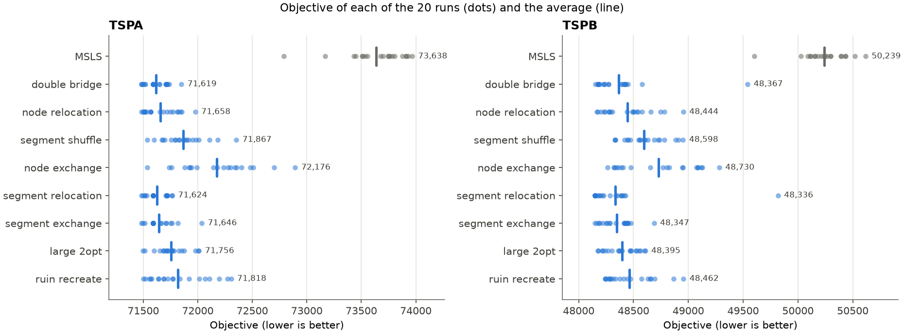
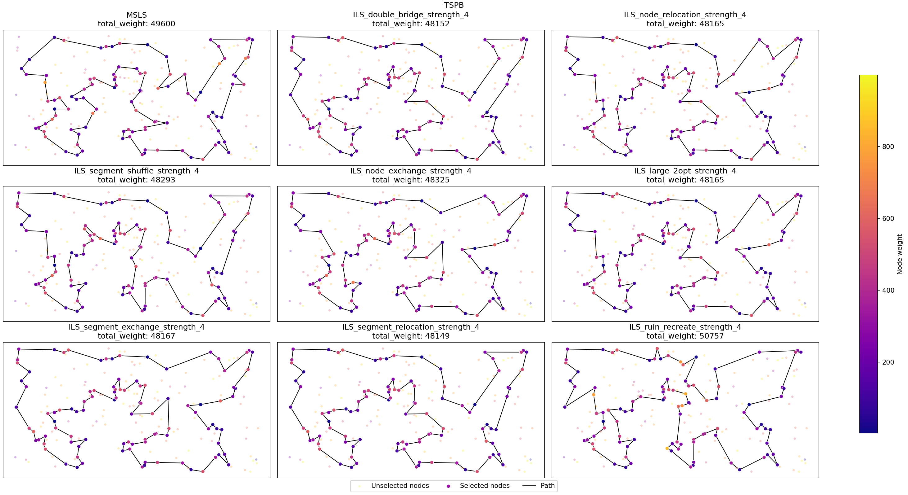

## Problem Description

We are given three columns of integers, with one row for each node. The first two columns contain the \(x\) and \(y\) coordinates of the node positions in a plane. The third column contains node costs. The goal is to select exactly 50% of the nodes (if the number of nodes is odd, we round the number of selected nodes up) and form a Hamiltonian cycle through this set of nodes such that the sum of the total length of the cycle and the total cost of the selected nodes is minimized.

The distances between nodes are calculated as Euclidean distances rounded mathematically to integer values. The distance matrix is calculated just after reading an instance, so the optimization methods can use the distance matrix without accessing node coordinates.

More formally, we may define the problem as follows:

Let $V$ be a set of $n$ nodes, each node $j \in V$ has coordinates $(x_j, y_j)$ and a cost $c_j$. Let $d(i,j) = \text{euclidean}(x_i, y_i, x_j, y_j)$ be the distance between nodes $i$ and $j$. The task is to find a cycle $P = (p_0, p_1, \dots, p_{k-1})$, where $p_i \in V$, all $p_i$ are distinct, and $k = \lceil n/2 \rceil$, that minimizes the objective function, defined as:

$$f(P) = \sum_{i=0}^{k-1} d(p_i, p_{(i+1)}) + \sum_{i=0}^{k-1} c_{p_i}$$

where $p_{k} = p_0$.

Both TSPA and TSPB contain 200 nodes, so each solution contains 100 nodes.

## Algorithms

### Local search

Both methods use the steepest local search with two-edge exchange as the intra-route move and node exchange (a selected node replaced with an unselected one) as the inter-route move, in the version with the list of improving moves from Lab 5. It gives exactly the same local optima as the basic steepest local search, only faster. Below, \(\text{LS}(P)\) denotes this local search started from the solution \(P\); it returns a local optimum.

### Multiple start local search (MSLS)

MSLS runs the local search from 400 random solutions and returns the best local optimum. One run of MSLS is therefore 400 runs of the basic local search, and its result is the best of them.

```latex
\begin{algorithm}
\caption{Multiple start local search}
\begin{algorithmic}
\STATE $P^* \gets$ none
\FOR{$i = 1$ \TO $400$}
    \STATE $P \gets \text{LS}(\text{random solution})$
    \IF{$P^* =$ none \OR $f(P) < f(P^*)$}
        \STATE $P^* \gets P$
    \ENDIF
\ENDFOR
\RETURN $P^*$
\end{algorithmic}
\end{algorithm}
```

### Iterated local search (ILS)

ILS starts from a local optimum of a random solution and repeats: perturb the current solution, improve the perturbed solution with the local search, and accept the result if it is better than the current solution. The perturbation should move the search to a different part of the solution space, while keeping most of the structure of the current (good) solution. The stopping condition is the average running time of MSLS on the same instance.

```latex
\begin{algorithm}
\caption{Iterated local search}
\begin{algorithmic}
\STATE $P \gets \text{LS}(\text{random solution})$
\STATE $\textit{runs} \gets 1$ \COMMENT{number of runs of the basic local search}
\WHILE{the running time is below the average running time of MSLS}
    \STATE $P' \gets \text{LS}(\text{Perturb}(P))$
    \STATE $\textit{runs} \gets \textit{runs} + 1$
    \IF{$f(P') < f(P)$}
        \STATE $P \gets P'$
    \ENDIF
\ENDWHILE
\RETURN $P$, $\textit{runs}$
\end{algorithmic}
\end{algorithm}
```

Since only improving solutions are accepted, the current solution is always the best one found so far.

### Perturbations

Eight perturbations were designed and compared. In the following, \(P = (p_0, \dots, p_{k-1})\) is the current cycle (\(k = 100\)), \(U = V \setminus P\) the set of unselected nodes, and all random choices are uniform. Each perturbation except ruin-recreate applies its basic operation **4 times** (perturbation strength 4), each time with new random choices. The objective value of the perturbed solution is computed from scratch.

**Double bridge.** Cuts the cycle at three random positions into four parts \(A\,B\,C\,D\) and reconnects them as \(A\,C\,B\,D\). Four edges are replaced, and the result cannot be undone by a single two-edge exchange. The selected nodes do not change.

```latex
\begin{algorithm}
\caption{Double bridge (one operation)}
\begin{algorithmic}
\STATE choose positions $0 < i < j < l < k$
\STATE $A \gets (p_0, \dots, p_{i-1})$, $B \gets (p_i, \dots, p_{j-1})$, $C \gets (p_j, \dots, p_{l-1})$, $D \gets (p_l, \dots, p_{k-1})$
\RETURN $A\,C\,B\,D$
\end{algorithmic}
\end{algorithm}
```

**Node relocation.** Removes a random node from the cycle and inserts it at a random position.

**Segment shuffle.** Chooses a random segment \(p_i, \dots, p_j\) (\(0 \le i < j \le k - 1\), so its length ranges from 2 nodes to the whole cycle) and randomly reorders its nodes.

**Node exchange.** Replaces a random selected node with a random unselected node (the removed node becomes unselected).

**Segment relocation.** Removes a random segment of 2 to \(\lfloor k/3 \rfloor = 33\) consecutive nodes and inserts it, in the same order, at a random position of the remaining cycle.

**Segment exchange.** Swaps two random non-overlapping segments of equal length, 2 to \(\lfloor k/4 \rfloor = 25\) nodes; the order of nodes inside each segment is kept. The pair of segments is chosen uniformly among all such pairs.

**Large 2-opt.** Reverses a random segment of 3 to \(k - 3\) consecutive nodes, i.e. a two-edge exchange of two random edges that are at least 3 nodes apart.

```latex
\begin{algorithm}
\caption{various perturbations (one operation)}
\begin{algorithmic}
\STATE \textbf{node relocation:} choose $i$, $j$; move $p_i$ to position $j$
\STATE \textbf{segment shuffle:} choose $i < j$; randomly permute $p_i, \dots, p_j$
\STATE \textbf{node exchange:} choose $i$ and $u \in U$; $U \gets U \cup \{p_i\} \setminus \{u\}$; $p_i \gets u$
\STATE \textbf{segment relocation:} choose $L \in [2, \lfloor k/3 \rfloor]$ and $i$; remove $S = (p_i, \dots, p_{i+L-1})$; insert $S$ at a random position of the rest
\STATE \textbf{segment exchange:} choose $L \in [2, \lfloor k/4 \rfloor]$ and $i, j$ with $i + L \le j$, $j + L \le k$; swap $(p_i, \dots, p_{i+L-1})$ with $(p_j, \dots, p_{j+L-1})$
\STATE \textbf{large 2-opt:} choose $L \in [3, k - 3]$ and $i$; reverse $(p_i, \dots, p_{i+L-1})$
\end{algorithmic}
\end{algorithm}
```

**Ruin-recreate.** Applied once (not 4 times): replaces \(r = \max(2, \lfloor k/8 \rfloor) = 12\) selected nodes at distinct random positions with 12 distinct random unselected nodes. It changes the selected set much more than the other perturbations.

```latex
\begin{algorithm}
\caption{Ruin-recreate}
\begin{algorithmic}
\STATE $r \gets \min(|U|, \max(2, \lfloor k/8 \rfloor))$
\STATE choose $r$ distinct positions $i_1, \dots, i_r$ of $P$ and $r$ distinct nodes $u_1, \dots, u_r \in U$
\FOR{$t = 1$ \TO $r$}
    \STATE $U \gets U \cup \{p_{i_t}\} \setminus \{u_t\}$; $p_{i_t} \gets u_t$
\ENDFOR
\RETURN $P$
\end{algorithmic}
\end{algorithm}
```

## Computational Experiment

Each method (MSLS and ILS with each of the 8 perturbations) was run 20 times on each instance. One run of MSLS performs 400 runs of the basic local search. ILS starts each run from a new random solution and stops after the average running time of MSLS on the given instance. The results are compared with the best construction heuristics (Labs 1–2) and the best versions of the local search (Labs 3–5).

All Lab 6 measurements were taken on one machine (Intel Core i7-12700, g++ 13.2 with `-O2`). After a few seconds of continuous load, the machine runs the experiment noticeably slower (a run of MSLS then takes up to almost 2 times longer). To make this affect both instances equally, the instances were run interleaved, run by run (as the methods in Lab 5): first MSLS on TSPA and TSPB alternately, then each ILS variant on TSPA and TSPB alternately.

### Objective function values

```latex
\begin{table}[H]
\centering
\small
\caption{Objective function values}
\begin{tabular}{lrrrrrr}
\toprule
 & \multicolumn{3}{c}{TSPA} & \multicolumn{3}{c}{TSPB} \\
\cmidrule(lr){2-4} \cmidrule(lr){5-7}
Method & avg & min & max & avg & min & max \\
\midrule
Greedy cycle & 73797.39 & 72590 & 75281 & 59709.47 & 53016 & 63736 \\
Weighted 2-regret nearest neighbor & 75561.20 & 72419 & 78504 & 55698.34 & 50485 & 61406 \\
Weighted 2-regret greedy cycle & 73348.72 & 72011 & 75532 & 57895.54 & 52731 & 63370 \\
Greedy LS, edges, greedy cycle start & 73164.54 & 72088 & 74565 & 58728.54 & 51715 & 63178 \\
Steepest LS, edges, random start, LM & 76191.55 & 73440 & 79726 & 52575.82 & 50091 & 54983 \\
Steepest LS, edges, random start, candidates & 76255.74 & 74039 & 79511 & 52539.14 & 50382 & 55096 \\
\midrule
MSLS & 73638.00 & 72790 & 73966 & 50239.35 & 49600 & 50617 \\
ILS, double bridge & \textbf{71618.75} & \textbf{71484} & 71850 & 48367.20 & 48151 & 49541 \\
ILS, node relocation & 71657.50 & \textbf{71484} & 71977 & 48444.10 & 48165 & 48954 \\
ILS, segment shuffle & 71866.60 & 71535 & 72354 & 48597.75 & 48328 & 48952 \\
ILS, node exchange & 72175.70 & 71537 & 72894 & 48730.30 & 48265 & 49282 \\
ILS, segment relocation & 71624.25 & \textbf{71484} & \textbf{71764} & \textbf{48335.55} & \textbf{48149} & 49818 \\
ILS, segment exchange & 71645.75 & \textbf{71484} & 72036 & 48347.15 & 48150 & 48687 \\
ILS, large 2-opt & 71756.40 & 71497 & 72011 & 48395.05 & 48175 & \textbf{48607} \\
ILS, ruin-recreate & 71818.10 & 71503 & 72306 & 48461.55 & 48242 & 48956 \\
\bottomrule
\end{tabular}
\end{table}
```

The best value of each ILS column is in bold.



**Every ILS variant is better than MSLS on both instances,** on average by 1462–2019 on TSPA and 1509–1904 on TSPB. Even the worst ILS runs are better than the best MSLS run in almost all cases (the exceptions are node exchange on TSPA and a single run of segment relocation on TSPB). With the same running time, improving one good solution step by step is much more effective than repeating the local search from random solutions, which always ends in local optima of similar, mediocre quality. ILS also beats all methods from the previous labs; MSLS is better than all of them on TSPB, but on TSPA its average is slightly worse than that of the weighted 2-regret greedy cycle heuristic and of the greedy local search starting from greedy cycle (73638.00 vs 73348.72 and 73164.54).

The best perturbations are **double bridge** (best average on TSPA), **segment relocation** (best average on TSPB, second on TSPA) and **segment exchange**; node relocation is close to them. They move whole parts of the cycle while keeping their internal order, a change that a single local search move cannot undo, so the local search does not just return to the previous local optimum. Four perturbations found the same best TSPA solution, 71484.

The weaker perturbations change the solution either too much or in a less useful way:

- **Segment shuffle** reorders a random segment of on average a third of the cycle, 4 times, which destroys a large part of the solution. The following local search is long (only about 1000 local search runs per ILS run) and ILS behaves similarly to a restart.
- **Node exchange** changes only the selected set; it gives the worst averages of the ILS variants and the largest spread of results.
- **Ruin-recreate** replaces 12 nodes with random unselected nodes, which are usually poor choices, and the local search spends much of its effort on repairing them; it lands in the middle of the ranking.

### Running time

Times are in microseconds (\(\mu s\)). For the Lab 1 and Lab 2 methods, only average times were recorded. The times of the previous methods are the ones reported in the previous labs.

```latex
\begin{table}[H]
\centering
\small
\caption{Running time of a single run in $\mu s$}
\begin{tabular}{lrrrrrr}
\toprule
 & \multicolumn{3}{c}{TSPA} & \multicolumn{3}{c}{TSPB} \\
\cmidrule(lr){2-4} \cmidrule(lr){5-7}
Method & avg & min & max & avg & min & max \\
\midrule
Greedy cycle & 525 & -- & -- & 520 & -- & -- \\
Weighted 2-regret nearest neighbor & 940 & -- & -- & 960 & -- & -- \\
Weighted 2-regret greedy cycle & 917 & -- & -- & 913 & -- & -- \\
Greedy LS, edges, greedy cycle start & 814 & 684 & 1101 & 904 & 741 & 1555 \\
Steepest LS, edges, random start, LM & 558 & 423 & 1064 & 530 & 418 & 809 \\
Steepest LS, edges, random start, candidates & 814 & 638 & 2205 & 674 & 531 & 1216 \\
\midrule
MSLS & 223772 & 181596 & 314042 & 234374 & 176542 & 347854 \\
ILS, double bridge & 223802 & 223772 & 223915 & 234392 & 234374 & 234456 \\
ILS, node relocation & 223796 & 223772 & 223866 & 234389 & 234375 & 234417 \\
ILS, segment shuffle & 223939 & 223778 & 224292 & 234647 & 234374 & 235673 \\
ILS, node exchange & 223785 & 223772 & 223839 & 234383 & 234374 & 234399 \\
ILS, segment relocation & 223798 & 223775 & 223862 & 234409 & 234379 & 234514 \\
ILS, segment exchange & 223819 & 223776 & 223926 & 234404 & 234376 & 234561 \\
ILS, large 2-opt & 223788 & 223772 & 223925 & 234394 & 234376 & 234459 \\
ILS, ruin-recreate & 223815 & 223778 & 223955 & 234437 & 234378 & 234672 \\
\bottomrule
\end{tabular}
\end{table}
```

One run of MSLS (400 local searches) takes about 180 ms on both instances when the machine is not slowed down (the minimum times are 182 ms on TSPA and 177 ms on TSPB), i.e. about 0.45 ms per local search. The averages, 224 ms on TSPA and 234 ms on TSPB, are higher because about half of the runs were slowed down by the machine (see above); thanks to interleaving, both instances are affected similarly. ILS stops after the average running time of MSLS; the measured times exceed it only by the time needed to finish the last local search (at most about 0.1%).

### Number of runs of the basic local search in ILS

The number of local search runs in one ILS run includes the initial local search and one local search after each perturbation.

```latex
\begin{table}[H]
\centering
\small
\caption{Number of runs of the basic local search in one run of ILS}
\begin{tabular}{lrrrrrr}
\toprule
 & \multicolumn{3}{c}{TSPA} & \multicolumn{3}{c}{TSPB} \\
\cmidrule(lr){2-4} \cmidrule(lr){5-7}
Perturbation & avg & min & max & avg & min & max \\
\midrule
Double bridge & 6491.55 & 3959 & 7864 & 6650.45 & 4830 & 8163 \\
Node relocation & 7488.35 & 4534 & 9282 & 7565.80 & 5131 & 9609 \\
Segment shuffle & 1016.90 & 634 & 1313 & 1001.75 & 597 & 1247 \\
Node exchange & 11054.15 & 9164 & 12769 & 11463.50 & 7608 & 14017 \\
Segment relocation & 6240.65 & 5385 & 7315 & 6134.60 & 3929 & 7650 \\
Segment exchange & 4610.15 & 2415 & 5823 & 5123.40 & 2909 & 6331 \\
Large 2-opt & 11396.50 & 8933 & 13499 & 12490.60 & 9419 & 14914 \\
Ruin-recreate & 3007.80 & 2016 & 3859 & 3421.25 & 2066 & 4160 \\
\bottomrule
\end{tabular}
\end{table}
```

For comparison, MSLS performs 400 local search runs in the same time. ILS performs many more, since a local search started from a perturbed local optimum needs far fewer moves than one started from a random solution. The number depends on how much the perturbation changes: node exchange and large 2-opt allow about 11000–12500 local searches per run, segment shuffle only about 1000. A higher number does not automatically mean better results – node exchange has one of the highest numbers and the worst averages of the ILS variants. The wide min–max ranges are caused mainly by the slowdowns of the machine: a slowed-down run completes fewer local searches before the time limit.

## Best Solutions




### TSPA

**MSLS:**

```text
176 174 150 106 89 42 151 182 57 64 107 88 78 193 153 75 170 146 159 130
113 43 93 3 1 169 50 47 147 101 55 29 178 136 186 164 8 54 9 33
131 36 177 52 179 53 140 144 67 16 51 139 112 5 115 157 91 71 4 76
132 90 123 152 108 80 48 31 60 49 11 63 149 116 168 95 97 127 69 171
2 187 30 141 87 28 180 156 35 185 45 73 135 181 192 158 58 84 134 72
```

Total weight: **72790**

**ILS, double bridge:**

```text
108 49 168 63 149 116 60 31 48 80 91 157 71 4 76 132 180 28 156 35
51 16 67 144 140 53 179 52 177 36 131 33 9 54 8 174 85 93 50 3
169 1 164 186 136 184 178 29 101 147 47 130 159 146 170 153 193 78 88 107
64 57 182 151 42 89 113 106 150 176 72 134 84 58 158 192 181 114 135 73
45 185 102 87 141 30 187 189 2 171 104 129 69 127 97 160 83 123 100 152
```

Total weight: **71484**

**ILS, node relocation:**

```text
102 87 141 30 187 189 2 171 104 129 69 127 97 160 83 123 100 152 108 49
168 63 149 116 60 31 48 80 91 157 71 4 76 132 180 28 156 35 51 16
67 144 140 53 179 52 177 36 131 33 9 54 8 174 85 93 50 3 169 1
164 186 136 184 178 29 101 147 47 130 159 146 170 153 193 78 88 107 64 57
182 151 42 89 113 106 150 176 72 134 84 58 158 192 181 114 135 73 45 185
```

Total weight: **71484**

**ILS, segment shuffle:**

```text
49 11 168 63 149 116 60 31 48 80 91 157 71 4 76 132 180 28 102 185
35 156 51 16 67 144 140 53 179 52 177 36 131 33 9 54 8 142 164 186
136 184 178 29 101 1 169 3 50 93 47 130 159 146 170 153 193 78 88 107
64 57 182 151 42 89 113 106 150 174 176 72 134 84 58 158 192 181 114 135
73 45 87 141 30 187 189 2 171 104 129 69 127 97 160 83 123 100 152 108
```

Total weight: **71535**

**ILS, node exchange:**

```text
91 80 48 31 60 108 152 100 123 83 160 49 11 63 149 116 168 97 127 69
129 104 171 2 189 187 30 141 87 45 73 135 114 181 192 158 58 84 134 72
176 150 106 113 89 42 151 182 57 64 107 88 78 193 153 170 146 159 130 47
93 50 3 169 1 101 29 178 184 136 186 164 85 174 8 54 9 33 131 36
177 52 179 53 140 144 67 16 51 156 35 185 102 28 180 132 76 4 71 157
```

Total weight: **71537**

**ILS, segment relocation:**

```text
52 179 53 140 144 67 16 51 35 156 28 180 132 76 4 71 157 91 80 48
31 60 116 149 63 168 49 108 152 100 123 83 160 97 127 69 129 104 171 2
189 187 30 141 87 102 185 45 73 135 114 181 192 158 58 84 134 72 176 150
106 113 89 42 151 182 57 64 107 88 78 193 153 170 146 159 130 47 147 101
29 178 184 136 186 164 1 169 3 50 93 85 174 8 54 9 33 131 36 177
```

Total weight: **71484**

**ILS, segment exchange:**

```text
144 67 16 51 156 35 185 102 28 180 132 76 4 71 157 91 80 48 31 60
116 149 63 168 49 108 152 100 123 83 160 97 127 69 129 104 171 2 189 187
30 141 87 45 73 135 114 181 192 158 58 84 134 72 176 150 106 113 89 42
151 182 57 64 107 88 78 193 153 170 146 159 130 47 147 101 29 178 184 136
186 164 1 169 3 50 93 85 174 8 54 9 33 131 36 177 52 179 53 140
```

Total weight: **71484**

**ILS, large 2-opt:**

```text
88 107 64 57 182 151 42 89 113 106 150 176 72 134 84 58 158 192 181 114
135 73 45 87 141 30 187 189 2 171 104 129 69 127 97 168 116 149 63 11
49 160 83 123 100 152 108 60 31 48 80 91 157 71 4 76 132 180 28 102
185 35 51 16 67 144 140 53 179 52 177 36 131 33 9 54 8 174 85 93
50 3 169 1 164 186 136 184 178 29 101 147 47 130 159 146 170 153 193 78
```

Total weight: **71497**

**ILS, ruin-recreate:**

```text
45 73 135 114 181 192 158 58 84 134 72 176 150 106 113 89 42 151 182 57
64 107 88 78 193 153 170 146 159 130 47 147 101 29 178 184 136 186 164 1
169 3 50 93 85 174 8 54 9 33 131 36 177 52 179 53 140 144 67 16
51 156 35 185 102 28 180 132 76 4 71 157 91 80 48 31 60 108 152 100
123 83 160 49 63 149 116 168 97 127 69 129 104 171 2 189 187 30 141 87
```

Total weight: **71503**

### TSPB

**MSLS:**

```text
80 153 14 2 20 74 17 171 99 88 179 87 82 51 85 59 73 167 181 152
67 24 34 98 151 3 184 86 46 72 120 133 136 172 160 69 183 30 21 38
154 140 47 64 33 40 71 60 157 45 134 175 36 197 132 29 6 180 115 170
97 26 125 177 138 158 145 28 149 116 147 121 198 96 48 89 57 185 135 76
104 162 192 54 18 187 70 190 81 94 105 61 139 196 114 148 10 90 129 127
```

Total weight: **49600**

**ILS, double bridge:**

```text
60 157 45 134 175 62 36 197 6 29 132 103 178 65 145 28 149 13 146 37
116 147 42 121 198 96 48 89 57 185 76 162 192 54 187 70 190 81 94 105
61 196 114 10 127 80 129 90 153 14 2 20 74 17 171 99 88 179 87 82
51 85 59 73 167 181 152 34 24 67 66 27 151 3 184 46 72 117 8 120
133 136 172 160 69 183 30 21 38 47 140 154 26 125 177 170 115 155 71 40
```

Total weight: **48151**

**ILS, node relocation:**

```text
147 116 37 146 13 149 28 145 158 177 125 170 115 6 29 132 197 36 175 134
45 157 60 40 71 155 97 154 140 47 38 21 30 183 69 160 172 136 133 120
8 117 72 46 86 184 3 151 27 66 67 24 34 152 181 167 73 59 85 51
82 87 179 88 99 171 17 74 20 2 14 153 90 129 127 80 192 162 54 78
10 114 196 61 105 94 81 187 70 190 104 76 185 57 89 48 96 198 121 42
```

Total weight: **48165**

**ILS, segment shuffle:**

```text
30 183 189 168 69 160 172 136 133 120 8 117 72 46 184 3 151 98 34 24
67 152 181 167 73 59 85 51 82 87 179 88 99 171 17 74 20 2 14 153
182 52 80 127 129 90 10 114 196 61 105 94 81 190 70 187 54 192 162 76
185 57 89 48 96 198 121 147 116 37 146 13 149 28 145 158 177 125 170 115
180 6 29 132 197 36 175 134 45 157 60 40 71 155 97 154 140 47 38 21
```

Total weight: **48328**

**ILS, node exchange:**

```text
57 185 76 104 190 70 81 94 105 61 196 114 10 54 162 192 80 127 129 90
153 14 2 20 74 171 99 88 179 87 82 51 85 59 73 167 181 152 67 24
34 98 151 3 184 86 46 72 117 8 120 133 136 172 160 69 189 183 30 21
38 47 140 154 26 125 177 170 115 155 71 40 60 157 45 134 175 62 36 197
6 29 132 103 178 65 145 28 149 13 146 37 116 147 42 121 198 96 48 89
```

Total weight: **48265**

**ILS, segment relocation:**

```text
85 51 82 87 179 88 99 171 17 74 20 2 14 153 182 80 127 129 90 10
114 196 61 105 94 81 190 70 187 54 192 162 76 185 57 89 48 96 198 121
42 147 116 37 146 13 149 28 145 65 178 103 132 29 6 197 36 175 134 45
157 60 40 71 155 115 170 177 125 26 154 140 47 38 21 30 183 69 160 172
136 133 120 8 117 72 46 184 3 151 27 66 67 24 34 152 181 167 73 59
```

Total weight: **48149**

**ILS, segment exchange:**

```text
114 196 61 105 94 81 187 70 190 104 76 185 57 89 48 96 198 121 42 147
116 37 146 13 149 28 145 158 177 125 170 115 180 6 29 132 197 36 175 134
45 157 60 40 71 155 97 154 140 47 38 21 30 183 69 160 172 136 133 120
8 117 72 46 184 3 151 27 66 67 24 34 152 181 167 73 59 85 51 82
87 179 88 99 171 17 74 20 2 14 153 90 129 127 80 192 162 54 78 10
```

Total weight: **48150**

**ILS, large 2-opt:**

```text
10 114 196 61 105 94 81 190 70 187 54 192 162 76 185 57 89 48 96 198
121 42 147 116 37 146 13 149 28 145 158 177 125 170 115 180 6 29 132 197
36 175 134 45 157 60 40 71 155 97 154 140 47 38 21 30 183 69 160 172
136 133 120 8 117 72 46 86 184 3 151 27 66 67 24 34 152 181 167 73
59 85 51 82 87 179 88 99 171 17 74 20 2 14 153 182 80 127 129 90
```

Total weight: **48175**

**ILS, ruin-recreate:**

```text
51 82 87 179 181 152 34 24 67 99 171 17 74 20 2 14 153 90 129 127
80 192 162 54 78 10 114 196 61 105 94 81 187 70 190 104 76 185 57 89
48 96 198 121 42 147 116 37 146 13 149 28 145 158 177 125 170 115 6 29
132 197 36 175 134 45 157 60 40 71 155 97 154 140 47 38 21 30 191 130
183 69 160 172 136 133 120 8 117 72 46 86 184 3 151 98 167 73 59 85
```

Total weight: **48242**

## Solution Checker

Every generated solution was verified using the solution checker: `src/utils/checker/solution_checker.hpp`.

The checker recalculates the objective function using the distance matrix and node costs. It also verifies that each solution contains exactly \(\lceil n/2\rceil\) nodes, that all node indices are valid, and that no node occurs more than once. The objective value calculated by the checker is compared with the value reported by the algorithm.

All generated solutions (the results of all 20 runs per instance and method) passed these checks. The best solutions can additionally be verified using the checker provided on ekursy.

## Conclusions

- **ILS is clearly better than MSLS with the same running time.** For every perturbation, ILS obtained a lower average objective than MSLS on both instances; the best variants are 2.7% better on TSPA (71618.75 vs 73638.00) and 3.8% better on TSPB (48335.55 vs 50239.35).

- **ILS gives the best solutions so far.** The best ILS solutions (71484 for TSPA, 48149 for TSPB) are better than the best solutions of all methods from the previous labs (72011 and 50091).

- **The best perturbations move whole parts of the cycle.** Double bridge, segment relocation and segment exchange give the best results: they keep most of the structure of the current solution, but make a change that a single local search move cannot undo.

- **Too destructive or too narrow perturbations are worse.** Segment shuffle destroys a large part of the cycle, so ILS performs only about 1000 local searches per run; node exchange only changes the selected set and gives the worst averages among the ILS variants.

- **ILS performs many more local searches than MSLS in the same time** (about 1000–12500 instead of 400), since a local search started from a perturbed local optimum is much shorter than one started from a random solution.

## Source Code

The implementation is available in the repository:

[EC_Assignments – Lab 6](https://github.com/Igor-S-666/EC_Assignments/tree/main/src/lab_6)

MSLS is implemented in `msls.hpp`, ILS in `ils.hpp` and the perturbations in `perturbations.hpp`. The steepest local search with the list of improving moves (from Lab 5) is in `local_steepest_fast.hpp`.
