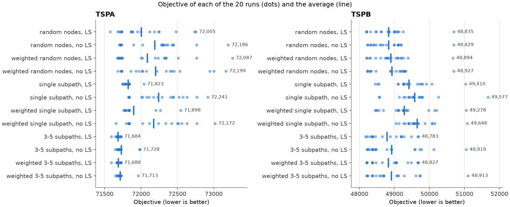
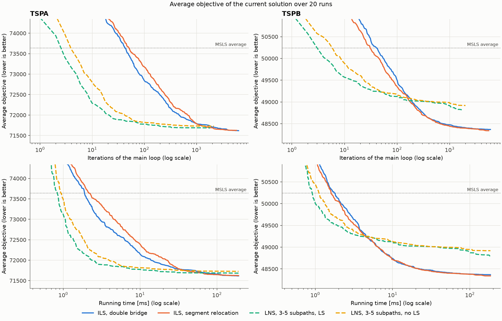
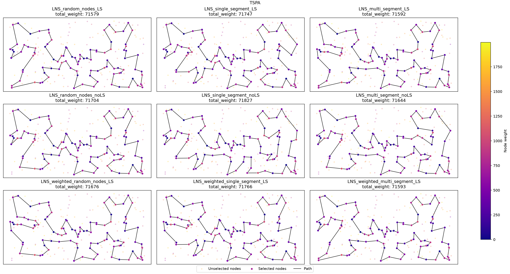
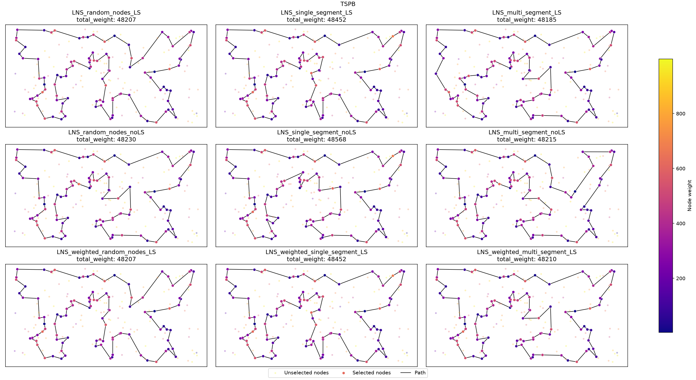

## Problem Description

We are given three columns of integers, with one row for each node. The first two columns contain the \(x\) and \(y\) coordinates of the node positions in a plane. The third column contains node costs. The goal is to select exactly 50% of the nodes (if the number of nodes is odd, we round the number of selected nodes up) and form a Hamiltonian cycle through this set of nodes such that the sum of the total length of the cycle and the total cost of the selected nodes is minimized.

The distances between nodes are calculated as Euclidean distances rounded mathematically to integer values. The distance matrix is calculated just after reading an instance, so the optimization methods can use the distance matrix without accessing node coordinates.

More formally, we may define the problem as follows:

Let $V$ be a set of $n$ nodes, each node $j \in V$ has coordinates $(x_j, y_j)$ and a cost $c_j$. Let $d(i,j) = \text{euclidean}(x_i, y_i, x_j, y_j)$ be the distance between nodes $i$ and $j$. The task is to find a cycle $P = (p_0, p_1, \dots, p_{k-1})$, where $p_i \in V$, all $p_i$ are distinct, and $k = \lceil n/2 \rceil$, that minimizes the objective function, defined as:

$$f(P) = \sum_{i=0}^{k-1} d(p_i, p_{(i+1)}) + \sum_{i=0}^{k-1} c_{p_i}$$

where $p_{k} = p_0$.

Both TSPA and TSPB contain 200 nodes, so each solution contains 100 nodes.

## Algorithms

### Local search

The local search is the best steepest local search from the previous labs. It uses two-edge exchange as the intra-route move and node exchange (a selected node replaced with an unselected one) as the inter-route move, in the version with the list of improving moves from Lab 5. Below, \(\text{LS}(P)\) denotes this local search started from the solution \(P\); it returns a local optimum.

### Large neighbourhood search (LNS)

LNS starts from a random solution improved by the local search. It then repeats: destroy the current solution (remove 30% of its nodes), repair it with a greedy heuristic, optionally improve it with the local search, and accept the result if it is better than the current solution. The stopping condition is the average running time of MSLS on the same instance.

```latex
\begin{algorithm}
\caption{Large neighbourhood search}
\begin{algorithmic}
\STATE $P \gets \text{LS}(\text{random solution})$
\STATE $\textit{iterations} \gets 0$
\WHILE{the running time is below the average running time of MSLS}
    \STATE $P' \gets \text{Repair}(\text{Destroy}(P))$
    \IF{the version with local search}
        \STATE $P' \gets \text{LS}(P')$
    \ENDIF
    \STATE $\textit{iterations} \gets \textit{iterations} + 1$
    \IF{$f(P') < f(P)$}
        \STATE $P \gets P'$
    \ENDIF
\ENDWHILE
\RETURN $P$, $\textit{iterations}$
\end{algorithmic}
\end{algorithm}
```

The local search is always applied to the initial solution. Since only improving solutions are accepted, the current solution is always the best one found so far. Each method is run in two versions: with local search after destroy-repair (LS) and without it (no LS).

### Destroy operators

All destroy operators remove \(r = \text{round}(0.3\,k) = 30\) of the \(k = 100\) nodes of the current cycle \(P = (p_0, \dots, p_{k-1})\); positions are taken cyclically. The remaining nodes keep their order and form a partial cycle of 70 nodes. Where nodes were removed, their former neighbours become directly connected. The removed nodes are added to the set of unselected nodes \(U\).

**Random nodes.** Removes 30 distinct nodes chosen uniformly at random.

**Single subpath.** Removes one subpath of 30 consecutive nodes, \(p_i, \dots, p_{i+29}\), with a uniformly random start \(i\).

**3–5 subpaths.** Draws the number of subpaths \(s \in \{3, 4, 5\}\) uniformly and splits the 30 removed nodes into \(s\) random positive lengths. The subpaths are placed one by one, the longest first. The start of each subpath is chosen uniformly among the positions where neither the subpath nor its two neighbouring nodes has been removed yet. So two subpaths never touch, which would merge them into one longer subpath.

```latex
\begin{algorithm}
\caption{Destroy: 3--5 subpaths (uniform version)}
\begin{algorithmic}
\STATE choose $s \in \{3, 4, 5\}$; split $r$ into random positive lengths $L_1 \ge \dots \ge L_s$
\STATE $R \gets \emptyset$ \COMMENT{removed positions}
\FOR{$t = 1$ \TO $s$}
    \STATE $F \gets \{ i : p_{i-1}, \dots, p_{i+L_t} \notin R \}$ \COMMENT{free starts, the subpath does not touch $R$}
    \STATE choose $i \in F$ uniformly; $R \gets R \cup \{ i, \dots, i + L_t - 1 \}$
\ENDFOR
\STATE $U \gets U \cup \{ p_i : i \in R \}$
\RETURN $P$ without the positions in $R$ (the order of the remaining nodes is kept)
\end{algorithmic}
\end{algorithm}
```

The single-subpath operator is the same procedure with \(s = 1\).

**Weighted (heuristic) versions.** Each operator also has a randomised heuristic version that prefers to remove "bad" parts of the solution. The choice is not deterministic: every candidate keeps a non-zero probability, proportional to \(\max(\text{score}, 1)^{\alpha}\).

- Weighted random nodes: the score is the cost \(c_v\) of the node, with \(\alpha = 1\), so expensive nodes are removed more often.
- Weighted subpaths (single and 3–5): the score of a subpath \(p_i, \dots, p_{i+L-1}\) is its contribution to the objective. That is the costs of its \(L\) nodes plus the lengths of its \(L + 1\) edges (the edge entering it, the \(L - 1\) inner edges and the edge leaving it):
  \[ \text{cost}(i, L) = \sum_{t=i}^{i+L-1} c_{p_t} + \sum_{t=i-1}^{i+L-1} d(p_t, p_{t+1}). \]
  Costs of 30-node subpaths differ much less than costs of single nodes, so we use \(\alpha = 3\). With \(\alpha = 1\), the distribution was almost uniform.

### Repair operator

As the repair operator we use the best greedy heuristic from Lab 2, the weighted 2-regret greedy cycle. Its criterion is \(0.3 \cdot \text{regret} - 0.7 \cdot \text{insertion cost}\), where regret is the difference between the second-best and the best insertion cost of a node. With these weights it had the best average on TSPA and the best among the greedy-cycle variants on TSPB. It is a cycle-based heuristic, so it continues directly from the partial cycle left by the destroy operator. No breaking of the cycle is needed, which a nearest neighbour-based heuristic would require. Nodes are inserted until the cycle has \(k = 100\) nodes again. Any unselected node may be inserted, not only the removed ones.

```latex
\begin{algorithm}
\caption{Repair: weighted 2-regret greedy cycle}
\begin{algorithmic}
\WHILE{$|P| < k$}
    \FORALL{$u \in U$}
        \STATE $\Delta_1(u), \Delta_2(u) \gets$ the best and second-best cost of inserting $u$ into an edge of $P$
        \STATE $\textit{score}(u) \gets 0.3\,(\Delta_2(u) - \Delta_1(u)) - 0.7\,\Delta_1(u)$
    \ENDFOR
    \STATE $u^* \gets \arg\max_{u \in U} \textit{score}(u)$ \COMMENT{ties: smallest node index}
    \STATE insert $u^*$ into its best edge of $P$; $U \gets U \setminus \{u^*\}$
\ENDWHILE
\RETURN $P$
\end{algorithmic}
\end{algorithm}
```

We also tried a randomised version of the repair, which inserts a random node among the 3 with the best scores. It gave mostly small improvements, the largest with single-subpath removal, so we do not report it in detail.

## Computational Experiment

Each LNS version was run 20 times on each instance. The 6 required versions combine the 3 destroy operators (uniform) with and without local search. Additionally, we ran the 6 versions with the weighted destroy operators. Each run starts from a new random solution and stops after the average running time of MSLS on the given instance: **191.0 ms on TSPA and 184.4 ms on TSPB**.

All measurements were taken on one machine (Intel Core i7-12700, g++ 13.2 with `-O2`).

### Objective function values

The previous methods are the best constructive heuristics (Labs 1–2) and the best local searches (Labs 3–5), with the values reported in the previous labs. The weighted 2-regret greedy cycle is the version with weights 0.3/0.7, the one used as the repair operator. MSLS and ILS are from the Lab 6 experiment. Of the ILS variants, we include the two best ones. The best value of each column among the LNS versions is in bold.

```latex
\begin{table}[H]
\centering
\small
\caption{Objective function values}
\begin{tabular}{lrrrrrr}
\toprule
 & \multicolumn{3}{c}{TSPA} & \multicolumn{3}{c}{TSPB} \\
\cmidrule(lr){2-4} \cmidrule(lr){5-7}
Method & avg & min & max & avg & min & max \\
\midrule
Greedy cycle & 73797.39 & 72590 & 75281 & 59709.47 & 53016 & 63736 \\
Weighted 2-regret nearest neighbor & 75561.20 & 72419 & 78504 & 55698.34 & 50485 & 61406 \\
Weighted 2-regret greedy cycle (0.3/0.7) & 73348.22 & 72347 & 75162 & 55951.54 & 52522 & 62491 \\
Greedy LS, edges, greedy cycle start & 73164.54 & 72088 & 74565 & 58728.54 & 51715 & 63178 \\
Steepest LS, edges, random start, LM & 76191.55 & 73440 & 79726 & 52575.82 & 50091 & 54983 \\
Steepest LS, edges, random start, candidates & 76255.74 & 74039 & 79511 & 52539.14 & 50382 & 55096 \\
MSLS & 73638.00 & 72790 & 73966 & 50239.35 & 49600 & 50617 \\
ILS, double bridge & 71616.55 & 71484 & 71850 & 48366.90 & 48151 & 49541 \\
ILS, segment relocation & 71624.25 & 71484 & 71764 & 48339.40 & 48149 & 49818 \\
\midrule
\multicolumn{7}{l}{\textit{LNS, uniform destroy (required versions)}} \\
LNS, random nodes, LS & 72004.95 & \textbf{71579} & 72752 & 48834.55 & 48207 & 50697 \\
LNS, random nodes, no LS & 72186.40 & 71704 & 73199 & 48829.30 & 48230 & 50697 \\
LNS, single subpath, LS & 71823.45 & 71747 & 72040 & 49410.45 & 48452 & 51033 \\
LNS, single subpath, no LS & 72240.55 & 71827 & 72918 & 49577.05 & 48568 & 51674 \\
LNS, 3--5 subpaths, LS & \textbf{71684.15} & 71592 & \textbf{71725} & \textbf{48782.80} & \textbf{48185} & \textbf{49688} \\
LNS, 3--5 subpaths, no LS & 71728.00 & 71644 & 71983 & 48918.65 & 48215 & 51052 \\
\midrule
\multicolumn{7}{l}{\textit{LNS, weighted destroy}} \\
LNS, weighted random nodes, LS & 72086.75 & 71676 & 73257 & 48894.50 & 48207 & 50671 \\
LNS, weighted random nodes, no LS & 72199.30 & 71682 & 73167 & 48927.10 & 48230 & 50697 \\
LNS, weighted single subpath, LS & 71897.90 & 71766 & 72547 & 49277.60 & 48452 & 51052 \\
LNS, weighted single subpath, no LS & 72172.20 & 71657 & 73018 & 49648.25 & 49046 & 51083 \\
LNS, weighted 3--5 subpaths, LS & 71688.10 & 71593 & \textbf{71725} & 48827.25 & 48210 & \textbf{49688} \\
LNS, weighted 3--5 subpaths, no LS & 71713.00 & 71650 & 71962 & 48912.85 & 48215 & 51107 \\
\bottomrule
\end{tabular}
\end{table}
```



**Destroy operators.** Removing 3–5 subpaths gives the best results on both instances (71684.15 on TSPA, 48782.80 on TSPB, with local search). It also has by far the smallest spread on TSPA (71592–71725). Several separate subpaths let the repair rebuild the cycle in several places at once, while the rest of the structure stays intact.

The other two operators are each weak on one instance:

- **Single subpath** is the best of the remaining operators on TSPA but the worst on TSPB (49410.45). One iteration changes only one region of the cycle, and the deterministic repair always rebuilds a given region in the same way. Once every region has been tried, the search cannot move any more.
- **Random nodes** removes 30 isolated nodes. Each gap is a single missing node, and the cheapest insertion of a removed node is often exactly its old position, so the repair frequently returns the same solution.

**Local search after destroy-repair helps in 5 of the 6 combinations of destroy operator and instance.** The largest gain is with single-subpath removal on TSPA (71823.45 vs 72240.55). The exception is random nodes on TSPB, where both versions are equal (48834.55 vs 48829.30). The repair itself already produces good solutions, so the local search usually makes only a few moves. It is therefore cheap, and the LS versions perform only about 5% fewer iterations (see below).

**Weighted destroy.** Weighting by node cost is slightly worse than uniform removal in all 4 cases (2 instances, with and without LS). Expensive nodes are often a necessary part of a good cycle, because they connect cheap regions, so the repair has to put them back. Weighting by subpath cost has a mixed effect. It helps a single subpath with LS on TSPB (49277.60 vs 49410.45) and without LS on TSPA, and is slightly worse in the other two cases. For 3–5 subpaths the differences go both ways and are within the spread of the results.

**Comparison with the other methods.** All LNS versions are much better than MSLS and than all methods from Labs 1–5. Even the worst LNS average (72240.55 on TSPA, 49648.25 on TSPB) is better than the MSLS average (73638.00, 50239.35). On TSPA it is also better than the best MSLS run (72790). Compared with ILS, the best LNS is slightly worse: 0.1% on TSPA (71684.15 vs 71616.55) and 0.9% on TSPB (48782.80 vs 48339.40).

### Running time

Times are in microseconds (\(\mu s\)). For the Lab 1 and Lab 2 methods, only average times were recorded. The times of the previous methods are the ones reported in the previous labs.

```latex
\begin{table}[H]
\centering
\small
\caption{Running time of a single run in $\mu s$}
\begin{tabular}{lrrrrrr}
\toprule
 & \multicolumn{3}{c}{TSPA} & \multicolumn{3}{c}{TSPB} \\
\cmidrule(lr){2-4} \cmidrule(lr){5-7}
Method & avg & min & max & avg & min & max \\
\midrule
Greedy cycle & 525 & -- & -- & 520 & -- & -- \\
Weighted 2-regret nearest neighbor & 940 & -- & -- & 960 & -- & -- \\
Weighted 2-regret greedy cycle (0.3/0.7) & 940 & -- & -- & 917 & -- & -- \\
Greedy LS, edges, greedy cycle start & 814 & 684 & 1101 & 904 & 741 & 1555 \\
Steepest LS, edges, random start, LM & 558 & 423 & 1064 & 530 & 418 & 809 \\
Steepest LS, edges, random start, candidates & 814 & 638 & 2205 & 674 & 531 & 1216 \\
MSLS & 190997 & 184210 & 202325 & 184393 & 179185 & 193800 \\
ILS, double bridge & 191013 & 190997 & 191035 & 184407 & 184393 & 184427 \\
ILS, segment relocation & 191012 & 190998 & 191037 & 184410 & 184392 & 184431 \\
\midrule
\multicolumn{7}{l}{\textit{LNS, uniform destroy (required versions)}} \\
LNS, random nodes, LS & 191022 & 190999 & 191065 & 184425 & 184393 & 184472 \\
LNS, random nodes, no LS & 191018 & 190998 & 191054 & 184419 & 184397 & 184464 \\
LNS, single subpath, LS & 191035 & 190996 & 191082 & 184448 & 184394 & 184569 \\
LNS, single subpath, no LS & 191049 & 191000 & 191135 & 184444 & 184392 & 184501 \\
LNS, 3--5 subpaths, LS & 191027 & 190997 & 191072 & 184432 & 184397 & 184479 \\
LNS, 3--5 subpaths, no LS & 191040 & 190999 & 191083 & 184444 & 184399 & 184585 \\
\midrule
\multicolumn{7}{l}{\textit{LNS, weighted destroy}} \\
LNS, weighted random nodes, LS & 191030 & 190996 & 191070 & 184430 & 184392 & 184457 \\
LNS, weighted random nodes, no LS & 191030 & 190996 & 191106 & 184422 & 184394 & 184458 \\
LNS, weighted single subpath, LS & 191028 & 191000 & 191098 & 184454 & 184400 & 184532 \\
LNS, weighted single subpath, no LS & 191044 & 190997 & 191095 & 184443 & 184394 & 184513 \\
LNS, weighted 3--5 subpaths, LS & 191050 & 190999 & 191111 & 184453 & 184399 & 184585 \\
LNS, weighted 3--5 subpaths, no LS & 191036 & 190998 & 191077 & 184429 & 184398 & 184483 \\
\bottomrule
\end{tabular}
\end{table}
```

LNS and ILS stop after the average running time of MSLS. The measured times exceed it only by the time needed to finish the last iteration, at most about 0.15 ms.

### Number of iterations of the main loop

One iteration is one destroy-repair step, followed by the local search in the LS versions. For comparison, one ILS run in the same time performs on average 6734 (double bridge) and 6088 (segment relocation) local searches on TSPA, and 6406 and 5834 on TSPB. MSLS performs 400 local searches.

```latex
\begin{table}[H]
\centering
\small
\caption{Number of iterations of the main loop in one run of LNS}
\begin{tabular}{lrrrrrr}
\toprule
 & \multicolumn{3}{c}{TSPA} & \multicolumn{3}{c}{TSPB} \\
\cmidrule(lr){2-4} \cmidrule(lr){5-7}
Method & avg & min & max & avg & min & max \\
\midrule
\multicolumn{7}{l}{\textit{LNS, uniform destroy (required versions)}} \\
LNS, random nodes, LS & 2849.85 & 2658 & 3049 & 2654.25 & 2288 & 2939 \\
LNS, random nodes, no LS & 3007.90 & 2800 & 3180 & 2807.40 & 2420 & 3114 \\
LNS, single subpath, LS & 1936.95 & 1816 & 2000 & 1710.95 & 1545 & 1842 \\
LNS, single subpath, no LS & 2013.15 & 1865 & 2173 & 1827.65 & 1552 & 2008 \\
LNS, 3--5 subpaths, LS & 2160.05 & 2041 & 2240 & 2015.20 & 1788 & 2140 \\
LNS, 3--5 subpaths, no LS & 2263.55 & 2156 & 2373 & 2165.85 & 1961 & 2360 \\
\midrule
\multicolumn{7}{l}{\textit{LNS, weighted destroy}} \\
LNS, weighted random nodes, LS & 2824.15 & 2618 & 2985 & 2637.90 & 2348 & 2870 \\
LNS, weighted random nodes, no LS & 2954.15 & 2707 & 3188 & 2807.30 & 2559 & 3038 \\
LNS, weighted single subpath, LS & 1863.30 & 1677 & 1975 & 1631.20 & 1484 & 1760 \\
LNS, weighted single subpath, no LS & 1935.70 & 1739 & 2105 & 1807.95 & 1666 & 1950 \\
LNS, weighted 3--5 subpaths, LS & 2050.85 & 1872 & 2211 & 1927.00 & 1725 & 2055 \\
LNS, weighted 3--5 subpaths, no LS & 2148.20 & 1931 & 2282 & 2056.70 & 1837 & 2227 \\
\bottomrule
\end{tabular}
\end{table}
```

LNS performs on average about 1600–3000 iterations per run, about 2–4 times fewer than ILS performs local searches. Most of the time of an iteration is spent in the repair, which has to insert 30 nodes greedily. The local search after it is short, so the LS versions perform only 4–7% fewer iterations than the versions without LS. Iterations after subpath removal are slower than after random-node removal (about 1900–2200 vs 2850 on TSPA). The weighted versions are 1–5% slower, since the probabilities have to be computed in every iteration.

### Convergence of ILS and LNS

To see how the quality improves during a run, we recorded the objective of the current solution after every improvement. We did this for the two best ILS versions (double bridge, segment relocation) and the two best LNS versions (3–5 subpaths, with and without LS), 20 runs each, with the same time limit as above. The figure shows the average over the runs, against the number of iterations (top) and against the running time (bottom). Both axes are logarithmic. The average of MSLS is shown for reference.



- **LNS improves much faster at the beginning.** It gets below the MSLS average after only 3–6 iterations (about 1 ms). ILS needs about 40–50 iterations (about 1.5–2.5 ms). One destroy-repair step rebuilds 30% of the solution, while one perturbation of ILS changes only a few edges.
- **LNS then stagnates.** On average, the last improvement of an LNS run comes after about 500–950 of its 2000–2300 iterations. After that, the remaining time brings nothing. ILS keeps improving until about iteration 3000–3500 of 5800–6700.
- **ILS overtakes LNS.** On TSPB this happens early, after about 150 iterations (about 5 ms). After that ILS stays clearly better. On TSPA, LNS stays ahead for most of the run, and ILS overtakes it only after about 50 ms.
- **The local search helps LNS during the whole run**, not only at the end: the curve of LNS with LS stays below the one without LS.

So LNS is the better choice when only a very short time is available. With the full MSLS time, the smaller and cheaper steps of ILS lead to better solutions.

## Best Solutions

The figures show the best solutions of the 6 required versions and of the three weighted versions with local search. The best solutions of the required versions are listed below; the weighted versions are in the appendix.





### TSPA

**LNS, random nodes, LS:**

```text
71 157 91 80 48 31 60 116 149 63 168 49 108 152 100 123 83 160 97 127
69 129 104 92 171 2 189 187 30 141 87 102 185 45 73 135 114 181 192 158
58 84 134 72 176 174 150 106 113 89 42 151 182 57 64 107 88 78 193 153
170 146 159 130 47 93 50 3 169 1 101 29 178 184 136 186 164 142 8 54
9 33 131 36 177 52 179 53 140 144 67 16 51 35 156 28 180 132 76 4
```

Total weight: **71579**

**LNS, random nodes, no LS:**

```text
171 2 189 187 30 141 87 102 185 45 73 135 114 181 192 158 58 84 134 72
176 174 150 106 113 89 42 151 138 182 57 64 107 88 78 193 153 170 146 159
130 47 93 50 3 169 1 101 29 178 184 136 186 164 142 8 54 9 33 131
36 177 52 179 53 140 144 67 16 51 35 156 28 180 132 76 4 71 157 91
80 48 31 60 116 149 63 168 11 49 108 152 100 123 83 160 97 127 69 92
```

Total weight: **71704**

**LNS, single subpath, LS:**

```text
160 83 123 90 100 152 108 49 168 63 149 116 60 31 48 80 91 157 71 4
76 132 180 28 156 35 51 16 67 144 140 53 179 52 177 36 131 33 9 54
8 142 164 186 136 184 178 29 101 147 47 1 169 3 50 93 130 159 146 170
153 193 78 88 107 64 57 182 138 151 42 89 113 106 150 174 176 72 134 84
58 158 192 181 114 135 73 45 185 102 87 141 189 2 171 187 30 161 127 97
```

Total weight: **71747**

**LNS, single subpath, no LS:**

```text
80 48 31 60 116 149 63 168 11 49 108 152 100 123 83 160 97 127 161 30
187 171 2 189 141 87 45 73 135 114 181 58 84 134 158 192 111 182 57 64
107 88 78 193 153 170 146 159 130 47 37 147 101 29 178 184 136 186 164 142
85 1 169 3 50 93 113 89 42 151 106 150 176 174 8 54 9 33 131 36
177 52 179 53 140 144 67 16 51 35 185 102 28 180 132 76 4 71 157 91
```

Total weight: **71827**

**LNS, 3--5 subpaths, LS:**

```text
1 101 29 178 184 136 186 164 142 8 54 9 33 131 36 177 52 179 53 140
144 67 16 51 35 185 102 28 180 132 76 4 71 157 91 80 48 31 60 108
152 100 123 83 160 49 11 63 149 116 168 97 127 69 129 104 92 171 2 189
187 30 141 87 45 73 135 114 181 192 158 58 84 134 72 176 174 150 106 113
89 42 151 182 57 64 107 88 78 193 153 170 146 159 130 47 93 50 3 169
```

Total weight: **71592**

**LNS, 3--5 subpaths, no LS:**

```text
60 116 149 63 168 11 49 108 152 100 123 83 160 97 127 69 92 171 2 189
187 30 141 87 45 73 135 114 181 192 158 58 84 134 72 176 174 150 106 113
89 42 151 182 57 64 107 88 78 193 153 170 146 159 130 47 147 101 29 178
184 136 186 164 1 169 3 50 93 85 142 8 54 9 33 131 36 177 52 179
53 140 144 67 16 51 35 185 102 28 180 132 76 4 71 157 91 80 48 31
```

Total weight: **71644**

### TSPB

**LNS, random nodes, LS:**

```text
180 6 29 132 197 36 62 175 134 45 157 60 40 71 155 97 154 140 47 38
21 30 183 69 160 172 136 133 120 8 117 72 46 184 3 151 98 167 73 59
85 51 82 87 179 181 152 34 24 67 99 171 17 74 20 2 14 153 90 129
127 80 192 162 54 78 10 114 196 61 105 94 81 187 70 190 104 76 185 57
89 156 48 96 198 121 42 147 116 37 146 13 149 28 145 158 177 125 170 115
```

Total weight: **48207**

**LNS, random nodes, no LS:**

```text
136 172 160 69 189 183 30 21 38 47 140 154 97 155 71 40 60 157 45 134
175 62 36 197 132 29 6 115 170 125 177 158 145 28 149 13 146 37 116 147
42 121 198 96 48 156 89 57 190 70 187 81 94 105 61 196 114 10 78 54
162 192 80 127 129 90 153 14 2 20 74 17 171 99 88 179 87 82 51 85
59 73 167 181 152 34 24 67 66 76 27 151 3 184 46 72 117 8 120 133
```

Total weight: **48230**

**LNS, single subpath, LS:**

```text
171 17 74 20 2 14 153 90 129 127 80 192 162 54 78 10 114 196 61 105
94 81 169 187 70 190 57 89 156 48 96 198 121 42 147 116 37 146 13 149
28 145 158 177 125 170 115 180 6 29 132 197 36 62 175 134 45 157 60 40
71 155 97 154 140 47 38 21 30 183 69 160 172 136 133 120 8 117 72 46
86 3 184 122 151 98 73 59 85 51 167 82 87 179 181 152 34 24 67 99
```

Total weight: **48452**

**LNS, single subpath, no LS:**

```text
28 145 158 177 125 170 115 180 6 29 132 197 36 62 175 134 45 157 71 60
40 155 97 154 140 47 38 21 30 183 120 133 136 172 160 69 8 117 72 46
184 3 135 76 66 67 24 34 152 181 167 73 59 85 51 179 82 87 88 99
171 17 74 20 2 14 153 90 129 127 80 192 162 54 78 10 114 196 61 105
94 81 169 187 70 190 57 89 156 48 96 198 121 42 147 116 37 146 13 149
```

Total weight: **48568**

**LNS, 3--5 subpaths, LS:**

```text
28 149 13 146 37 116 147 42 121 198 96 48 156 89 57 190 70 187 81 94
105 61 196 114 10 78 54 162 192 80 127 129 90 153 14 2 20 74 17 171
99 88 179 87 82 51 85 59 73 167 181 152 34 24 67 66 76 27 151 3
184 46 72 117 8 120 133 136 172 160 69 183 30 21 38 47 140 154 26 125
177 170 115 155 71 40 60 157 45 134 175 36 197 6 29 132 103 178 65 145
```

Total weight: **48185**

**LNS, 3--5 subpaths, no LS:**

```text
94 81 190 70 187 54 192 162 76 185 57 89 156 48 96 198 121 42 147 116
37 146 13 149 28 145 158 177 125 170 115 6 29 132 197 36 62 175 134 45
157 60 40 71 155 97 154 140 47 38 21 30 183 189 69 160 172 136 133 120
8 117 72 46 184 3 151 27 66 67 24 34 152 181 167 73 59 85 51 82
87 179 88 99 171 17 74 20 2 14 153 90 129 80 127 10 114 196 61 105
```

Total weight: **48215**

## Solution Checker

Every generated solution was verified using the solution checker: `src/utils/checker/solution_checker.hpp`.

The checker recalculates the objective function using the distance matrix and node costs. It also verifies that each solution contains exactly \(\lceil n/2\rceil\) nodes, that all node indices are valid, and that no node occurs more than once. The objective value calculated by the checker is compared with the value reported by the algorithm.

All generated solutions (the results of all 20 runs per instance and version) passed these checks. The best solutions can additionally be verified using the checker provided on ekursy.

## Conclusions

- **Removing several subpaths is the best destroy operator.** 3–5 subpaths gives the best averages on both instances (71684.15 and 48782.80). A single subpath changes too small a region of the cycle at once. Isolated random nodes are often reinserted where they were.

- **Local search after destroy-repair helps, and costs little.** It improves the average in 5 of the 6 combinations of destroy operator and instance (the sixth is a tie). Since the repaired solution is already good, the local search is short and reduces the number of iterations by only about 5%.

- **Heuristic, cost-based removal does not help.** Removing expensive nodes more often is slightly worse than uniform removal in all cases, because expensive nodes are often needed in a good cycle. Removing expensive subpaths more often has a mixed effect.

- **LNS is much better than MSLS and all earlier methods, and close to ILS.** The best LNS is 0.1% worse than the best ILS on TSPA and 0.9% worse on TSPB. In the same time it performs 2–4 times fewer iterations, since a greedy repair of 30 nodes is much more expensive than the short local search after a small perturbation in ILS.

## Source Code

The implementation is available in the repository:

[EC_Assignments – Lab 7](https://github.com/Igor-S-666/EC_Assignments/tree/main/src/lab_7)

LNS is implemented in `large_neigh_search.hpp`, the destroy operators in `utils/destroy_methods.hpp` and the repair operator in `utils/repair_methods.hpp`. The local search is the steepest local search with the list of improving moves from Labs 5–6 (`src/lab_6/algorithms/local_steepest_fast.hpp`).

## Appendix: Best Solutions of the Weighted Versions

### TSPA (weighted versions)

**LNS, weighted random nodes, LS:**

```text
156 51 16 67 144 140 53 179 52 177 36 131 33 9 54 8 142 164 186 136
184 178 29 101 1 169 3 50 93 47 130 159 146 170 153 193 78 88 107 64
57 182 151 42 89 113 106 150 174 176 72 134 84 58 158 192 181 114 135 73
45 87 141 30 187 189 2 171 92 69 127 97 168 116 149 63 11 49 160 83
123 90 100 152 108 60 31 48 80 91 157 71 4 76 132 180 28 102 185 35
```

Total weight: **71676**

**LNS, weighted random nodes, no LS:**

```text
187 30 141 87 45 73 135 114 181 192 158 58 84 134 72 176 174 85 1 169
3 50 93 113 89 42 106 150 151 138 182 57 64 107 88 78 193 153 170 146
159 130 47 147 101 29 178 184 136 186 164 8 54 9 33 131 36 177 52 179
53 140 144 67 16 51 35 185 102 28 180 132 76 4 71 157 91 80 48 31
60 108 152 100 123 83 160 49 11 63 149 116 168 97 127 69 92 171 2 189
```

Total weight: **71682**

**LNS, weighted single subpath, LS:**

```text
91 80 48 31 60 108 152 100 90 123 83 160 49 11 63 149 116 168 97 127
161 30 187 171 2 189 141 87 102 185 45 73 135 114 181 192 158 58 84 134
72 176 174 150 106 113 89 42 151 138 182 57 64 107 88 78 193 153 170 146
159 130 47 93 50 3 169 1 101 29 178 184 136 186 164 142 8 54 9 33
131 36 177 52 179 53 140 144 67 16 51 35 156 28 180 132 76 4 71 157
```

Total weight: **71766**

**LNS, weighted single subpath, no LS:**

```text
11 49 108 152 100 123 83 160 97 127 69 129 104 92 171 2 189 187 30 141
87 102 185 45 73 135 114 181 192 158 58 84 134 72 176 174 150 106 113 89
42 151 182 57 64 107 88 78 193 153 170 146 159 130 47 93 50 3 169 1
178 29 163 136 186 164 142 8 54 9 33 131 36 177 52 179 53 140 144 67
16 51 35 156 28 180 132 76 4 71 157 91 80 48 31 60 116 149 63 168
```

Total weight: **71657**

**LNS, weighted 3--5 subpaths, LS:**

```text
176 72 134 84 58 158 192 181 114 135 73 45 87 141 30 187 189 2 171 92
104 129 69 127 97 160 83 123 100 152 108 49 11 168 63 149 116 60 31 48
80 91 157 71 4 76 132 180 28 102 185 35 51 16 67 144 140 53 179 52
177 36 131 33 9 54 8 142 164 186 136 184 178 29 101 1 169 3 50 93
47 130 159 146 170 153 193 78 88 107 64 57 182 151 42 89 113 106 150 174
```

Total weight: **71593**

**LNS, weighted 3--5 subpaths, no LS:**

```text
11 168 63 149 116 60 31 48 80 91 157 71 4 76 132 180 28 102 185 35
156 51 16 67 144 140 53 179 52 177 36 131 33 9 54 8 142 164 186 136
184 178 29 101 147 47 1 169 3 50 93 130 159 146 170 153 193 78 88 107
64 57 182 151 42 89 113 106 150 174 176 72 134 84 58 158 192 181 114 135
73 45 87 141 30 187 189 2 171 92 69 127 97 160 83 123 100 152 108 49
```

Total weight: **71650**

### TSPB (weighted versions)

**LNS, weighted random nodes, LS:**

```text
13 149 28 145 158 177 125 170 115 180 6 29 132 197 36 62 175 134 45 157
60 40 71 155 97 154 140 47 38 21 30 183 69 160 172 136 133 120 8 117
72 46 184 3 151 98 167 73 59 85 51 82 87 179 181 152 34 24 67 99
171 17 74 20 2 14 153 90 129 127 80 192 162 54 78 10 114 196 61 105
94 81 187 70 190 104 76 185 57 89 156 48 96 198 121 42 147 116 37 146
```

Total weight: **48207**

**LNS, weighted random nodes, no LS:**

```text
105 61 196 114 10 78 54 162 192 80 127 129 90 153 14 2 20 74 17 171
99 88 179 87 82 51 85 59 73 167 181 152 34 24 67 66 76 27 151 3
184 46 72 117 8 120 133 136 172 160 69 189 183 30 21 38 47 140 154 97
155 71 40 60 157 45 134 175 62 36 197 132 29 6 115 170 125 177 158 145
28 149 13 146 37 116 147 42 121 198 96 48 156 89 57 190 70 187 81 94
```

Total weight: **48230**

**LNS, weighted single subpath, LS:**

```text
94 81 169 187 70 190 57 89 156 48 96 198 121 42 147 116 37 146 13 149
28 145 158 177 125 170 115 180 6 29 132 197 36 62 175 134 45 157 60 40
71 155 97 154 140 47 38 21 30 183 69 160 172 136 133 120 8 117 72 46
86 3 184 122 151 98 73 59 85 51 167 82 87 179 181 152 34 24 67 99
171 17 74 20 2 14 153 90 129 127 80 192 162 54 78 10 114 196 61 105
```

Total weight: **48452**

**LNS, weighted single subpath, no LS:**

```text
196 114 10 78 54 162 192 127 80 129 90 153 14 2 20 74 17 171 39 99
88 87 82 179 51 85 59 73 167 181 152 34 24 67 66 76 135 151 3 184
86 46 72 117 8 120 133 136 172 160 69 189 21 183 30 38 47 140 154 97
155 40 60 71 157 45 134 175 62 36 197 29 132 6 180 115 170 125 177 158
145 28 149 13 146 37 116 147 42 121 198 96 48 156 89 57 77 190 70 187
```

Total weight: **49046**

**LNS, weighted 3--5 subpaths, LS:**

```text
153 90 129 127 80 192 162 54 78 10 114 196 61 105 94 81 187 70 190 57
89 156 48 96 198 121 42 147 116 37 146 13 149 28 145 158 177 125 170 115
180 6 29 132 197 36 62 175 134 45 157 60 40 71 155 97 154 140 47 38
21 30 183 69 160 172 136 133 120 8 117 72 46 184 3 151 27 76 66 67
24 34 152 181 167 73 59 85 51 82 87 179 88 99 171 17 74 20 2 14
```

Total weight: **48210**

**LNS, weighted 3--5 subpaths, no LS:**

```text
82 87 179 88 99 171 17 74 20 2 14 153 90 129 127 80 192 162 54 78
10 114 196 61 105 94 81 70 190 104 76 185 57 89 48 96 198 121 42 147
116 37 146 13 149 28 145 65 178 103 132 29 6 197 36 62 175 134 45 157
60 40 71 155 115 170 177 125 26 154 140 47 38 21 30 183 189 69 160 172
136 133 120 72 46 184 3 151 27 66 67 24 34 152 181 167 73 59 85 51
```

Total weight: **48215**
