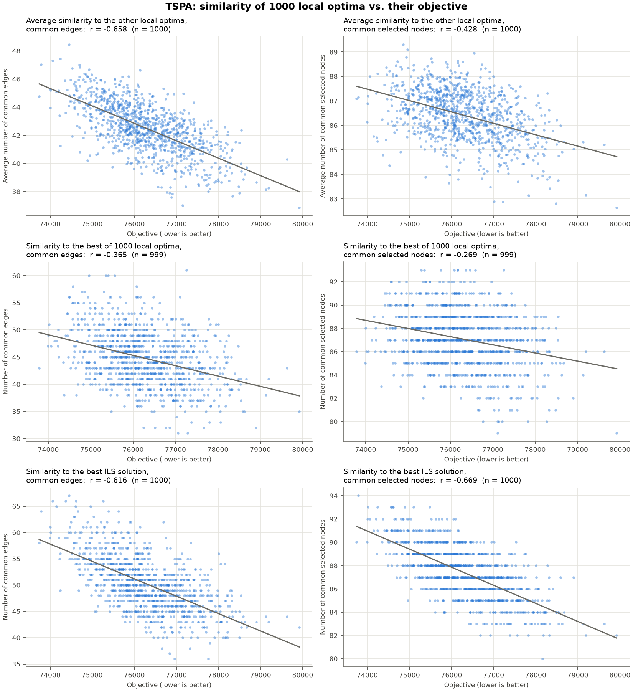
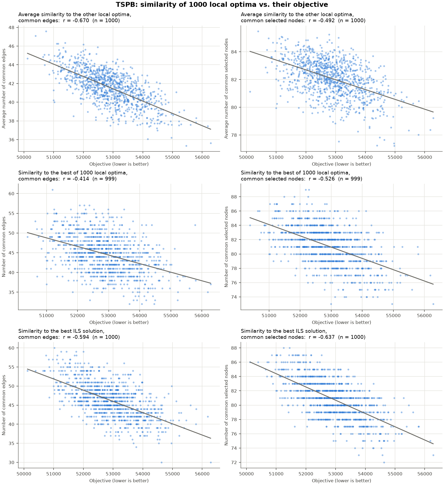

## Problem Description

We are given three columns of integers, with one row for each node. The first two columns contain the \(x\) and \(y\) coordinates of the node positions in a plane. The third column contains node costs. The goal is to select exactly 50% of the nodes (if the number of nodes is odd, we round the number of selected nodes up) and form a Hamiltonian cycle through this set of nodes such that the sum of the total length of the cycle and the total cost of the selected nodes is minimized.

The distances between nodes are calculated as Euclidean distances rounded mathematically to integer values. The distance matrix is calculated just after reading an instance, so the optimization methods can use the distance matrix without accessing node coordinates.

More formally, we may define the problem as follows:

Let $V$ be a set of $n$ nodes, each node $j \in V$ has coordinates $(x_j, y_j)$ and a cost $c_j$. Let $d(i,j) = \text{euclidean}(x_i, y_i, x_j, y_j)$ be the distance between nodes $i$ and $j$. The task is to find a cycle $P = (p_0, p_1, \dots, p_{k-1})$, where $p_i \in V$, all $p_i$ are distinct, and $k = \lceil n/2 \rceil$, that minimizes the objective function, defined as:

$$f(P) = \sum_{i=0}^{k-1} d(p_i, p_{(i+1)}) + \sum_{i=0}^{k-1} c_{p_i}$$

where $p_{k} = p_0$.

Both TSPA and TSPB contain 200 nodes, so each solution contains 100 nodes.

### Global convexity

In this laboratory, we investigate the **global convexity** of this problem. The experiment is based on the relationship between the objective function value of a local optimum and its similarity to other solutions.

The purpose is to determine whether solutions with better objective values tend to be structurally closer to other good solutions. If this relationship is strong, it may indicate that good solutions are concentrated in a relatively similar region of the search space. If the relationship is weak or absent, good solutions may be distributed across structurally different regions.

The experiment does not attempt to find a new optimization method. Instead, it examines the structure of the local optima generated by an existing local search algorithm.

## Experiment Setup

### Generation of local optima

For each instance, we generated **1000 local optima**.

Each local optimum was obtained by:

1. Generating a random initial solution.
2. Starting greedy local search from that solution.
3. Running the local search until no improving move could be found.
4. Saving the resulting local optimum and its objective function value.

The greedy local search is the one from Lab 3. It uses the two-edges exchange as the intra-route move and the exchange of a selected node with an unselected one as the inter-route move; the moves are browsed in a random order and the first improving move is applied. Of the two intra-route moves from Lab 3 we use the two-edges exchange, since it gave clearly better local optima from random solutions.

The initial solutions were generated independently and randomly. Consequently, the experiment explores different starting points in the search space rather than repeatedly improving one common initial solution.

We denote the resulting set of local optima for an instance by

\[
L=\{P_1,P_2,\ldots,P_{1000}\}.
\]

The objective value of solution \(P_i\) is denoted by

\[
f_i=f(P_i).
\]

The best solution among the generated local optima is

\[
P_{\mathrm{best}}=
\arg\min_{P_i\in L} f(P_i).
\]

The experiment uses these 1000 solutions to calculate three different types of similarity.

```latex
\begin{algorithm}
\caption{Global convexity test of one instance}
\begin{algorithmic}
\FOR{$i = 1$ \TO $1000$}
    \STATE $P_i \gets \text{GreedyLS}(\text{random solution})$
\ENDFOR
\STATE $P_{\mathrm{best}} \gets \arg\min_{i} f(P_i)$
\STATE $P_{\mathrm{reference}} \gets$ the best solution of the best method so far (ILS, Lab 6)
\FORALL{$S \in \{S_{\mathrm{edges}}, S_{\mathrm{nodes}}\}$}
    \FOR{$i = 1$ \TO $1000$}
        \STATE $S_{\mathrm{avg}}(P_i) \gets \frac{1}{999} \sum_{j \ne i} S(P_i, P_j)$
        \STATE $S_{\mathrm{best1000}}(P_i) \gets S(P_i, P_{\mathrm{best}})$ \COMMENT{only for $P_i \ne P_{\mathrm{best}}$}
        \STATE $S_{\mathrm{reference}}(P_i) \gets S(P_i, P_{\mathrm{reference}})$
    \ENDFOR
    \STATE chart and Pearson correlation of $f_i$ with each of the three similarities
\ENDFOR
\end{algorithmic}
\end{algorithm}
```

### Similarity measures

We use two independent measures of similarity. Both compare the structure of two solutions, but they describe different aspects of that structure.

**Common edges**

A solution is a cycle, so its structure includes the edges connecting consecutive selected nodes, including the edge connecting the last node back to the first one.

We treat edges as undirected. Therefore, the edge \((u,v)\) is considered identical to \((v,u)\).

Let \(E(P)\) denote the set of edges in solution \(P\). The common-edge similarity of two solutions is

\[
S_{\mathrm{edges}}(P,Q)
=
|E(P)\cap E(Q)|.
\]

Since every solution contains 100 edges, the result is between 0 and 100.

A larger value means that the two solutions share more connections between their selected nodes. This measure captures not only which nodes were selected, but also how they are connected in the cycle.

**Common selected nodes**

The second measure compares only the sets of selected nodes, without considering their order in the cycle.

Let \(N(P)\) denote the set of selected nodes in solution \(P\). The common-node similarity is

\[
S_{\mathrm{nodes}}(P,Q)
=
|N(P)\cap N(Q)|.
\]

Since every solution contains 100 selected nodes, this measure is also between 0 and 100.

A larger value means that the two solutions contain more of the same nodes. Unlike common-edge similarity, it does not distinguish between different arrangements of the same selected nodes.

These two measures are complementary. Two solutions may select almost exactly the same nodes but connect them in a different order. In that case, their common-node similarity can be high while their common-edge similarity is lower.

### Three versions of similarity

For each local optimum, we calculate similarity in three different ways.

**1. Average similarity to all other local optima**

For every solution \(P_i\), we calculate its average similarity to the remaining 999 solutions:

\[
S_{\mathrm{avg}}(P_i)
=
\frac{1}{999}
\sum_{\substack{j=1\\j\neq i}}^{1000}
S(P_i,P_j).
\]

We calculate this separately for common edges and common selected nodes.

This measure describes how similar a solution is, on average, to the rest of the generated population of local optima.

Importantly, a solution is not compared with itself. Including self-similarity would artificially increase its average similarity.

**2. Similarity to the best local optimum among the 1000 generated solutions**

First, we identify the local optimum with the smallest objective value:

\[
P_{\mathrm{best}}
=
\arg\min_{P_j\in L} f(P_j).
\]

Then, for every other solution, we calculate

\[
S_{\mathrm{best1000}}(P_i)
=
S(P_i,P_{\mathrm{best}}).
\]

The best solution itself is excluded from this comparison. Otherwise, it would have a similarity of exactly 100 to itself for both measures, producing an artificial outlier.

Therefore, this version contains 999 data points rather than 1000.

**3. Similarity to a very good solution obtained by another method**

The third version compares every generated local optimum with a reference solution obtained by a different best-so-far method. The best method so far is ILS from Lab 6, whose best solutions are better than those of all other methods, including LNS from Lab 7 (71579 and 48185).

We use the following reference solutions:

| Instance | Reference objective value | Method |
|---|---:|---|
| TSPA | 71484 | ILS, double bridge |
| TSPB | 48149 | ILS, segment relocation |

For each local optimum, we calculate

\[
S_{\mathrm{reference}}(P_i)
=
S(P_i,P_{\mathrm{reference}}).
\]

Unlike the previous version, the reference solution is not one of the 1000 generated local optima. Therefore, all 1000 local optima are included.

This comparison allows us to investigate whether solutions with better objective values are also structurally closer to a very good solution obtained independently of the generated population.

### Correlation coefficient

For every combination of instance, similarity version, and similarity measure, we calculate the Pearson correlation coefficient between the objective value and the similarity.

The Pearson correlation coefficient is

\[
r=
\frac{
\sum_{i=1}^{m}(x_i-\bar{x})(y_i-\bar{y})
}{
\sqrt{
\sum_{i=1}^{m}(x_i-\bar{x})^2
\sum_{i=1}^{m}(y_i-\bar{y})^2
}
},
\]

where:

- \(x_i\) is the objective value of a solution,
- \(y_i\) is its similarity value,
- \(\bar{x}\) and \(\bar{y}\) are the corresponding sample means,
- \(m\) is the number of observations.

The coefficient ranges from \(-1\) to \(1\).

- A value close to \(1\) indicates a strong positive linear relationship.
- A value close to \(-1\) indicates a strong negative linear relationship.
- A value close to \(0\) indicates little or no linear relationship.

In this experiment, a negative correlation means that solutions with lower objective values tend to have higher similarity values. This is the direction that would support the idea that better solutions are structurally closer to other good solutions.

A correlation close to zero means that the objective value does not provide much information about the similarity through a linear relationship.

## Computational Experiment

For each of the two instances, we generated 1000 random initial solutions and improved each one using greedy local search.

This resulted in:

- 1000 local optima for TSPA,
- 1000 local optima for TSPB,
- 2000 local optima in total.

The objective values of the generated local optima are summarised below. They are of the same quality as those of the greedy local search with the two-edges exchange from random solutions in Lab 3 (averages 76342.58 and 52869.81 there).

| Instance | avg | min | max | Reference solution |
|---|---:|---:|---:|---:|
| TSPA | 76277.26 | 73741 | 79922 | 71484 |
| TSPB | 52884.18 | 50121 | 56283 | 48149 |

For each local optimum, we recorded its objective value and calculated the six similarity values:

| Similarity version | Common edges | Common selected nodes |
|---|---|---|
| Average similarity to all other local optima | Yes | Yes |
| Similarity to the best of the 1000 local optima | Yes | Yes |
| Similarity to the reference solution | Yes | Yes |

This gives six charts for each instance and **12 charts in total**.

The charts use:

- **X-axis:** objective function value.
- **Y-axis:** similarity value.

Each chart is a scatter plot, where one point represents one local optimum. The Pearson correlation coefficient is displayed in the title of each chart, and the line is the least-squares fit.

For the comparison with the best of the 1000 local optima, the best solution itself is excluded. Thus, this chart contains 999 points. All other charts contain 1000 points.

## Results

### TSPA

The following table presents the Pearson correlation coefficients calculated for TSPA.

| Similarity version | Similarity measure | Sample size | Pearson \(r\) |
|---|---|---:|---:|
| Average similarity | Common edges | 1000 | -0.658486 |
| Average similarity | Common nodes | 1000 | -0.428195 |
| Best of 1000 | Common edges | 999 | -0.364926 |
| Best of 1000 | Common nodes | 999 | -0.268813 |
| Reference solution | Common edges | 1000 | -0.615592 |
| Reference solution | Common nodes | 1000 | -0.668959 |

**Average similarity**

The correlation between the objective value and average common-edge similarity is approximately \(-0.658\). This indicates a moderate-to-strong negative linear relationship.

Solutions with lower objective values tend to share more edges with the other generated local optima. In other words, the better local optima are, on average, structurally closer to the rest of the population when their cycle connections are considered.

The correlation using common selected nodes is approximately \(-0.428\). This is also a negative relationship, but clearly weaker than for common edges.

This difference suggests that the arrangement of nodes in the cycle carries more information about the relationship between solution quality and similarity than the selected-node set alone.

**Similarity to the best of 1000 local optima**

For common edges, the correlation is approximately \(-0.365\). This is a weaker negative relationship than the one observed for average similarity.

Thus, solutions with lower objective values tend to share more edges with the best generated local optimum, although the relationship is not particularly strong.

For common nodes, the correlation is approximately \(-0.269\), the weakest value for TSPA. The number of selected nodes shared with the best local optimum shows only a weak linear relationship with objective value.

**Similarity to the reference solution**

The correlations with the reference solution are approximately \(-0.616\) for common edges and \(-0.669\) for common nodes.

Both values indicate a moderate-to-strong negative relationship. Local optima with lower objective values share more edges and more selected nodes with the reference solution. For example, the 100 best local optima share on average 56.7 edges and 90.1 nodes with it, while the 100 worst share only 45.6 edges and 84.7 nodes.

This is an interesting difference compared with the best-of-1000 comparison. The relationship is much stronger for the external reference solution than for the best generated local optimum, and for the reference solution the common-node correlation is even slightly stronger than the common-edge one.

**TSPA summary**

The strongest relationships are observed for the reference solution with common nodes (\(r=-0.669\)) and for average common-edge similarity (\(r=-0.658\)). The similarity to the best generated local optimum shows the weakest relationships (\(r=-0.365\) and \(r=-0.269\)).

All six correlations are negative.

For TSPA, the results therefore suggest that better local optima are structurally closer both to the rest of the population and to the very good reference solution.



### TSPB

The following table presents the Pearson correlation coefficients calculated for TSPB.

| Similarity version | Similarity measure | Sample size | Pearson \(r\) |
|---|---|---:|---:|
| Average similarity | Common edges | 1000 | -0.670013 |
| Average similarity | Common nodes | 1000 | -0.491620 |
| Best of 1000 | Common edges | 999 | -0.414330 |
| Best of 1000 | Common nodes | 999 | -0.526279 |
| Reference solution | Common edges | 1000 | -0.594038 |
| Reference solution | Common nodes | 1000 | -0.637051 |

**Average similarity**

The correlation between the objective value and average common-edge similarity is approximately \(-0.670\). This is the strongest correlation observed in the entire experiment.

It indicates a moderate-to-strong negative linear relationship: local optima with lower objective values tend to share more edges with the other generated local optima.

As in TSPA, this suggests that better solutions tend to be structurally closer to the rest of the population when considering the edges of their cycles.

For common selected nodes, the correlation is approximately \(-0.492\). This is a moderate negative relationship, somewhat stronger than for TSPA.

The difference between the two measures is again noticeable. Common-edge similarity provides a considerably stronger relationship with objective value than common-node similarity.

**Similarity to the best of 1000 local optima**

The correlation for common edges is approximately \(-0.414\). This indicates a moderate negative relationship.

As in TSPA, better local optima tend to share more edges with the best solution found among the 1000 generated local optima.

For common nodes, the correlation is approximately \(-0.526\). Unlike in TSPA, the node-based measure gives a stronger relationship here than the edge-based one.

**Similarity to the reference solution**

For common edges, the correlation is approximately \(-0.594\).

For common nodes, the correlation is approximately \(-0.637\). As in TSPA, the node-based measure is slightly stronger for the reference solution.

Consequently, both measures show a clear negative linear relationship between objective value and similarity to the reference solution. The 100 best local optima share on average 51.5 edges and 83.8 nodes with it, the 100 worst only 41.8 edges and 78.0 nodes.

The result suggests that the generated local optima are closer to the reference solution the better their objective values are.

**TSPB summary**

The strongest relationship is again observed for average common-edge similarity, with \(r=-0.670\), followed by the reference solution (\(r=-0.637\) and \(r=-0.594\)).

The correlation for similarity to the best generated local optimum is weaker (\(r=-0.414\) and \(r=-0.526\)).

All six correlations are negative. Therefore, as in TSPA, better local optima are structurally closer both to the other local optima and to the reference solution.



## Comparison of TSPA and TSPB

Comparing the results from both instances reveals several similarities.

The following table contains all 12 correlation coefficients in one place.

| Similarity version | Measure | TSPA | TSPB |
|---|---|---:|---:|
| Average similarity | Common edges | -0.658 | **-0.670** |
| Average similarity | Common nodes | -0.428 | -0.492 |
| Best of 1000 | Common edges | -0.365 | -0.414 |
| Best of 1000 | Common nodes | -0.269 | -0.526 |
| Reference solution | Common edges | -0.616 | -0.594 |
| Reference solution | Common nodes | **-0.669** | -0.637 |

**1. All 12 correlations are negative.**

They range from \(-0.269\) to \(-0.670\). On both instances, better local optima are more similar to the other local optima, to the best of them and to the reference solution.

This is the most consistent result of the experiment.

**2. Average common-edge similarity and the reference solution give the strongest relationships in both instances.**

The correlation for average common-edge similarity is \(-0.658\) for TSPA and \(-0.670\) for TSPB. For the reference solution, it is between \(-0.594\) and \(-0.669\) for both measures.

Both indicate a moderate-to-strong negative relationship between objective value and similarity.

**3. Similarity to the best generated local optimum gives a weaker relationship.**

For common edges, the correlations are \(-0.365\) for TSPA and \(-0.414\) for TSPB; for common nodes, \(-0.269\) and \(-0.526\).

This indicates that better solutions tend to share more edges with the best generated local optimum, but the relationship is weaker than when similarity is averaged over all other local optima or measured to the reference solution.

One possible explanation is that average similarity captures the overall structural relationship between a solution and the population, whereas similarity to one particular solution depends more heavily on the structure of that individual solution.

**4. Common-node similarity is weaker for the average similarity, but not for the reference solution.**

For the average similarity, the common-node correlations (\(-0.428\), \(-0.492\)) are clearly weaker than the common-edge ones (\(-0.658\), \(-0.670\)). For the reference solution, common nodes are slightly stronger (\(-0.669\), \(-0.637\) vs \(-0.616\), \(-0.594\)).

The local optima select very similar sets of nodes: two of them share on average 86.4 of 100 nodes on TSPA and 82.1 on TSPB, but only about 42 edges.

**5. The reference solution is a better point of comparison than the best local optimum.**

The local optima also share more edges with the reference solution (on average 50.3 on TSPA and 46.3 on TSPB) than with each other (42.5 and 41.6).

This suggests that the reference solution lies close to the "centre" of the region where the good local optima are.

## Discussion

### What do the results tell us about global convexity?

The experiment investigates whether better solutions are located in structurally similar regions of the search space.

If a problem had a strong global-convexity-like structure, we would expect better local optima to be more similar to one another, and potentially also to a very good reference solution.

The results provide **clear evidence** of such a relationship.

For both instances and all three versions of similarity, the correlation is negative. Local optima with lower objective values tend to share more edges and more selected nodes with the other generated local optima, with the best of them and with the very good reference solution.

The relationship is strongest for average common-edge similarity and for the similarity to the reference solution. It is weaker, although still visible, when comparing each solution with the best local optimum among the 1000 generated solutions.

Therefore, the results indicate that good solutions are concentrated in one region of the search space (a "big valley") rather than distributed across structurally unrelated regions. This also explains why the methods of the previous labs that keep most of a good solution and change only a part of it (ILS in Lab 6, LNS in Lab 7) are much better than independent restarts (MSLS).

### Why can common-edge similarity be more informative?

The two similarity measures describe different properties of a solution.

Common-node similarity considers only which nodes are selected. It ignores the order in which the nodes appear in the cycle.

For example, two solutions can contain exactly the same 100 nodes but arrange them in different orders. Their common-node similarity would be 100, even though their cycles could have very different edge sets and objective values.

Common-edge similarity also considers the connections between nodes. It therefore captures more of the actual structure of the cycle.

Since the objective function includes the lengths of the edges, differences in the cycle structure can have a direct effect on the objective value.

In addition, most nodes are clearly worth selecting (or clearly not, e.g. very expensive ones), so the local search selects them from almost any starting solution. Common-node similarity is therefore high for nearly all pairs of local optima (82–86 of 100 on average) and varies less between them.

This provides a possible explanation for why common-edge similarity has a stronger relationship with objective value than common-node similarity in the average-similarity version.

### Why is average similarity stronger than similarity to the best solution?

Average similarity measures how close a local optimum is to the entire population of generated local optima.

Similarity to the best solution measures its relationship with only one particular solution.

A single solution may have a structure that is not representative of the other local optima. Therefore, its similarity values may not describe the overall structure of the population as well as an average over all other solutions. Moreover, similarity to one solution is a small integer, while the average over 999 solutions is a smoother value.

The stronger correlations for average common-edge similarity suggest that the overall population structure contains more information about objective quality than similarity to one individual solution.

### Why is the correlation with the reference solution stronger than with the best local optimum?

Both are single solutions, but they differ in quality. The best of the 1000 local optima is itself only a local optimum: it is 3.2% worse than the reference solution on TSPA (73741 vs 71484) and 4.1% worse on TSPB (50121 vs 48149). It is just one point in the region of good solutions, and its specific edges are not necessarily those shared by good solutions in general.

The reference solution was obtained by ILS, which keeps improving a good solution for a long time. It is therefore much closer to the bottom of the "valley", and the closer a local optimum is to it, the better that local optimum tends to be.

It is still important to distinguish between solution quality and structural similarity: two solutions can have similar objective values while having quite different structures, which is why the correlations are clearly negative but far from \(-1\).

### Limitations of the experiment

There are several limitations that should be considered when interpreting the results.

- **Random starting points:** The experiment uses 1000 random initial solutions per instance. The resulting local optima depend on the starting points and on the local search procedure. A different set of initial solutions could produce somewhat different results.

- **Dependence on the local search method:** The experiment studies the local optima reached by the chosen greedy local search. It does not cover every possible local optimum of the optimization problem.

- **Pearson correlation measures linear relationships:** A correlation close to zero does not prove that there is no relationship between two variables. A nonlinear relationship may still exist.

- **Similarity is not the same as objective quality:** Two structurally different solutions can have similar objective values. Likewise, two similar solutions can have different objective values.

- **The reference solution is only one point of comparison:** Similarity to one very good solution does not necessarily describe the structure of all good solutions.

- **The experiment is based on two instances:** The observations are specific to TSPA and TSPB. They should not automatically be generalized to all instances of the problem.

For these reasons, the correlations should be treated as evidence about the structure of the generated local optima rather than as a mathematical proof of global convexity.

## Solution Checker

Every generated solution was verified using the solution checker: `src/utils/checker/solution_checker.hpp`.

The checker recalculates the objective function using the distance matrix and node costs. It also verifies that each solution contains exactly \(\lceil n/2\rceil\) nodes, that all node indices are valid, and that no node occurs more than once. The objective value calculated by the checker is compared with the value reported by the algorithm.

All 2000 local optima passed these checks. The two reference solutions were read from the Lab 6 results and checked in the same way, including their objective values (71484 and 48149).

## Conclusions

The experiment investigated the relationship between objective function values and structural similarity among local optima for TSPA and TSPB.

For each instance, 1000 random initial solutions were improved using greedy local search. We then calculated three versions of similarity, using two different measures: the number of common edges and the number of common selected nodes.

The main conclusions are:

- **All 12 correlations are negative** (\(-0.269\) to \(-0.670\)). Better local optima are structurally closer to the other local optima, to the best of them and to the very good reference solution.

- **Average common-edge similarity shows one of the strongest relationships with objective value.** The correlations are \(-0.658\) for TSPA and \(-0.670\) for TSPB. This indicates that local optima with lower objective values tend to share more edges with the other generated local optima.

- **Similarity to the reference solution is also strongly correlated with objective value** (\(-0.594\) to \(-0.669\)). Better local optima are structurally closer to the best solution found by ILS.

- **Similarity to the best generated local optimum shows a weaker relationship** (\(-0.269\) to \(-0.526\)). The best local optimum is only one, still 3–4% worse, point in the region of good solutions.

- **Common-edge similarity is more informative than common-node similarity for the average similarity.** The local optima select mostly the same nodes, so the connections between them differ more and are more strongly related to solution quality.

Overall, the results provide **clear evidence of global convexity**: good solutions are concentrated in one region of the search space. The effect is visible in both instances and is very similar for TSPA and TSPB.

However, the correlations are far from \(-1\), and the results are specific to the generated local optima and the two instances. The results therefore suggest a global-convexity-like ("big valley") structure, but they do not prove that the entire search space is globally convex.

## Source Code and Results

The implementation is available in the repository:

[EC_Assignments – Lab 8](https://github.com/Igor-S-666/EC_Assignments/tree/main/src/lab_8)

The experiment (generating the local optima, calculating the similarities and the correlation coefficients) is in `src/lab_8/main.cpp`. The greedy local search is the one from Lab 3 (`src/lab_3/algorithms/local_search_greedy.hpp`).

The experiment produces the following data files in `data/lab_8/results/`:

- `TSPA_local_optima.csv` – objective values and similarity measurements for the 1000 TSPA local optima.
- `TSPB_local_optima.csv` – objective values and similarity measurements for the 1000 TSPB local optima.
- `correlations.csv` – the Pearson correlation coefficient for each combination of instance, similarity version, and similarity measure.
- `statistics.csv` – the minimum, maximum and average objective of the local optima, and the reference solution.

The local-optima CSV files contain the following columns:

| Column | Description |
|---|---|
| `objective` | Objective value of the local optimum |
| `avg_edges` | Average number of common edges with the other local optima |
| `avg_nodes` | Average number of common selected nodes with the other local optima |
| `best1000_edges` | Number of common edges with the best of the 1000 local optima |
| `best1000_nodes` | Number of common selected nodes with the best of the 1000 local optima |
| `reference_edges` | Number of common edges with the reference solution |
| `reference_nodes` | Number of common selected nodes with the reference solution |

The best of the 1000 local optima is saved in `data/lab_8/output/<instance>_best_local_optimum.txt`. Its best-of-1000 columns are empty.

The plotting script `src/utils/plotting/plot_global_convexity.py` generates two figures, one for each instance. Each figure contains six scatter plots, covering all combinations of similarity version and similarity measure.

The figures are saved in:

- `data/lab_8/plots/global_convexity_TSPA.png`
- `data/lab_8/plots/global_convexity_TSPB.png`

The correlation values are also calculated directly from the data used to produce the scatter plots, allowing the numerical results and visualizations to be checked against one another.

## Appendix A: Objective Function Values of the Methods from Previous Labs

For comparison, this appendix includes the objective function values of the methods evaluated in Lab 7 and the best methods from the previous assignments (Labs 1–6). The table reports the average, minimum and maximum objective values obtained for both TSPA and TSPB.

The previous methods include the best constructive heuristics, local search variants, MSLS and the two best ILS variants from Lab 6. The LNS methods are divided into uniform and weighted destroy strategies. For each LNS configuration, results are shown both with and without local search.

```latex
\begin{table}[H]
\centering
\small
\caption{Objective function values}
\begin{tabular}{lrrrrrr}
\toprule
 & \multicolumn{3}{c}{TSPA} & \multicolumn{3}{c}{TSPB} \\
\cmidrule(lr){2-4} \cmidrule(lr){5-7}
Method & avg & min & max & avg & min & max \\
\midrule
Greedy cycle & 73797.39 & 72590 & 75281 & 59709.47 & 53016 & 63736 \\
Weighted 2-regret nearest neighbor & 75561.20 & 72419 & 78504 & 55698.34 & 50485 & 61406 \\
Weighted 2-regret greedy cycle (0.3/0.7) & 73348.22 & 72347 & 75162 & 55951.54 & 52522 & 62491 \\
Greedy LS, edges, greedy cycle start & 73164.54 & 72088 & 74565 & 58728.54 & 51715 & 63178 \\
Steepest LS, edges, random start, LM & 76191.55 & 73440 & 79726 & 52575.82 & 50091 & 54983 \\
Steepest LS, edges, random start, candidates & 76255.74 & 74039 & 79511 & 52539.14 & 50382 & 55096 \\
MSLS & 73638.00 & 72790 & 73966 & 50239.35 & 49600 & 50617 \\
ILS, double bridge & 71616.55 & 71484 & 71850 & 48366.90 & 48151 & 49541 \\
ILS, segment relocation & 71624.25 & 71484 & 71764 & 48339.40 & 48149 & 49818 \\
\midrule
\multicolumn{7}{l}{\textit{LNS, uniform destroy (required versions)}} \\
LNS, random nodes, LS & 72004.95 & \textbf{71579} & 72752 & 48834.55 & 48207 & 50697 \\
LNS, random nodes, no LS & 72186.40 & 71704 & 73199 & 48829.30 & 48230 & 50697 \\
LNS, single subpath, LS & 71823.45 & 71747 & 72040 & 49410.45 & 48452 & 51033 \\
LNS, single subpath, no LS & 72240.55 & 71827 & 72918 & 49577.05 & 48568 & 51674 \\
LNS, 3--5 subpaths, LS & \textbf{71684.15} & 71592 & \textbf{71725} & \textbf{48782.80} & \textbf{48185} & \textbf{49688} \\
LNS, 3--5 subpaths, no LS & 71728.00 & 71644 & 71983 & 48918.65 & 48215 & 51052 \\
\midrule
\multicolumn{7}{l}{\textit{LNS, weighted destroy}} \\
LNS, weighted random nodes, LS & 72086.75 & 71676 & 73257 & 48894.50 & 48207 & 50671 \\
LNS, weighted random nodes, no LS & 72199.30 & 71682 & 73167 & 48927.10 & 48230 & 50697 \\
LNS, weighted single subpath, LS & 71897.90 & 71766 & 72547 & 49277.60 & 48452 & 51052 \\
LNS, weighted single subpath, no LS & 72172.20 & 71657 & 73018 & 49648.25 & 49046 & 51083 \\
LNS, weighted 3--5 subpaths, LS & 71688.10 & 71593 & \textbf{71725} & 48827.25 & 48210 & \textbf{49688} \\
LNS, weighted 3--5 subpaths, no LS & 71713.00 & 71650 & 71962 & 48912.85 & 48215 & 51107 \\
\bottomrule
\end{tabular}
\end{table}
```

The best values among the LNS versions are highlighted in bold, following the original Lab 7 table.

This table provides additional context for the Lab 8 experiment. In particular, the best objective values so far were obtained by ILS: **71484 for TSPA** and **48149 for TSPB**. These solutions are used as the reference solutions when comparing the local optima generated for the global convexity analysis in Lab 8. The best LNS solutions from Lab 7 (71579 and 48185) are slightly worse.
