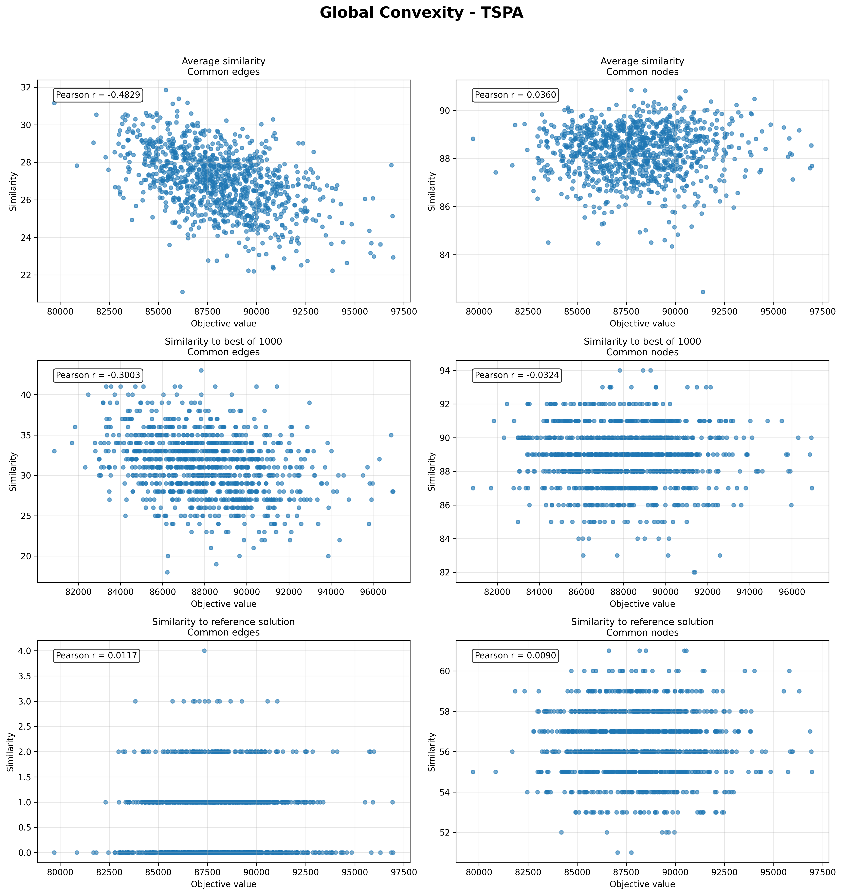
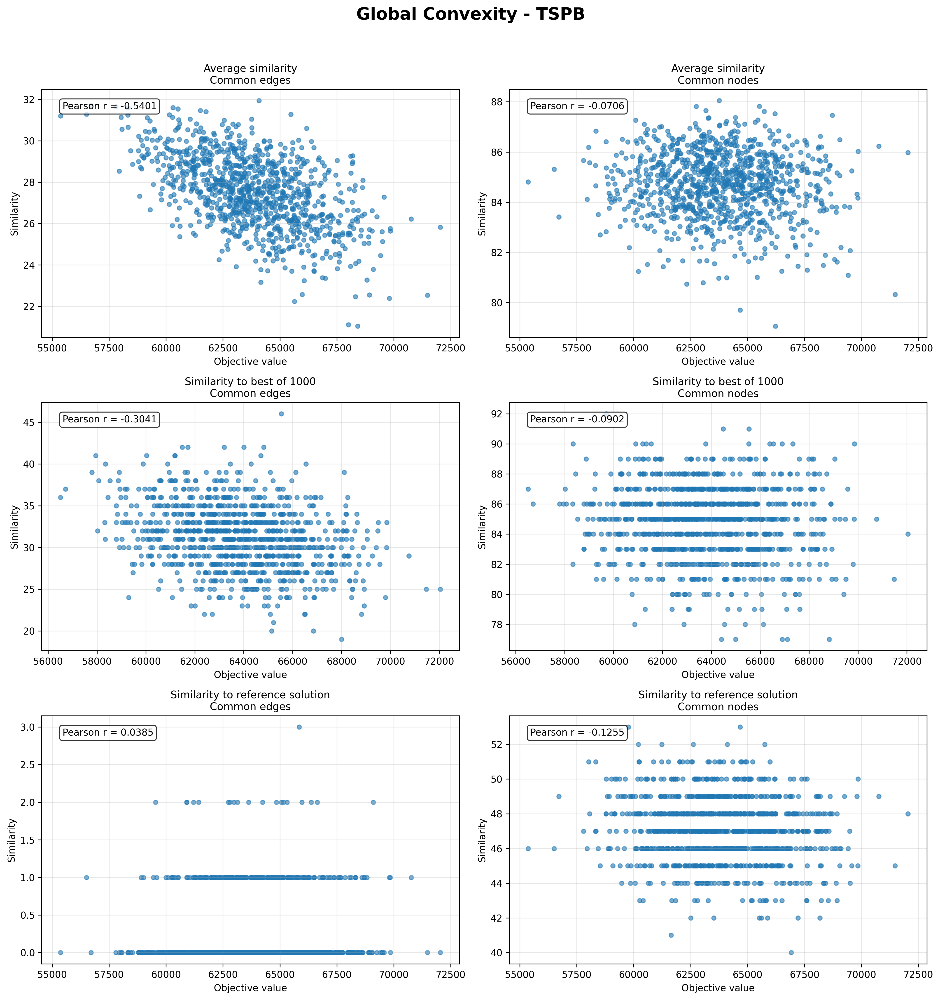

## Problem Description

In this laboratory, we investigate the **global convexity** of the optimization problem considered in the previous laboratories. The experiment is based on the relationship between the objective function value of a local optimum and its similarity to other solutions.

The purpose is to determine whether solutions with better objective values tend to be structurally closer to other good solutions. If this relationship is strong, it may indicate that good solutions are concentrated in a relatively similar region of the search space. If the relationship is weak or absent, good solutions may be distributed across structurally different regions.

We consider the same two instances as in the previous laboratories: **TSPA** and **TSPB**.

The underlying optimization problem is unchanged. We are given a set of nodes, each with coordinates and a cost. We must select exactly half of the nodes (rounded up for an odd number of nodes) and construct a cycle through the selected nodes. The objective is to minimize the sum of the cycle length and the costs of the selected nodes.

Let \(V\) be the set of \(n\) nodes. Each node \(j\) has coordinates \((x_j,y_j)\) and a cost \(c_j\). The distance between two nodes is calculated using the Euclidean distance, rounded to an integer:

\[
d(i,j)=\operatorname{round}
\left(
\sqrt{(x_i-x_j)^2+(y_i-y_j)^2}
\right).
\]

A solution is a cycle \(P=(p_0,p_1,\ldots,p_{k-1})\), where all selected nodes are distinct and

\[
k=\left\lceil\frac{n}{2}\right\rceil.
\]

The objective function is

\[
f(P)=
\sum_{i=0}^{k-1}d(p_i,p_{(i+1)\bmod k})
+
\sum_{i=0}^{k-1}c_{p_i}.
\]

Both TSPA and TSPB contain 200 nodes, so every solution contains exactly 100 selected nodes.

The experiment does not attempt to find a new optimization method. Instead, it examines the structure of the local optima generated by an existing local search algorithm.

## Experimental Method

### Generation of local optima

For each instance, we generated **1000 local optima**.

Each local optimum was obtained by:
1. Generating a random initial solution.
2. Starting greedy local search from that solution.
3. Running the local search until no improving move could be found.
4. Saving the resulting local optimum and its objective function value.

The initial solutions were generated independently and randomly. Consequently, the experiment explores different starting points in the search space rather than repeatedly improving one common initial solution.

We denote the resulting set of local optima for an instance by

\[
L=\{P_1,P_2,\ldots,P_{1000}\}.
\]

The objective value of solution \(P_i\) is denoted by

\[
f_i=f(P_i).
\]

The best solution among the generated local optima is

\[
P_{\mathrm{best}}=
\arg\min_{P_i\in L} f(P_i).
\]

The experiment uses these 1000 solutions to calculate three different types of similarity.

### Similarity measures

We use two independent measures of similarity. Both compare the structure of two solutions, but they describe different aspects of that structure.

**Common edges**

A solution is a cycle, so its structure includes the edges connecting consecutive selected nodes, including the edge connecting the last node back to the first one.

We treat edges as undirected. Therefore, the edge \((u,v)\) is considered identical to \((v,u)\).

Let \(E(P)\) denote the set of edges in solution \(P\). The common-edge similarity of two solutions is

\[
S_{\mathrm{edges}}(P,Q)
=
|E(P)\cap E(Q)|.
\]

Since every solution contains 100 edges, the result is between 0 and 100.

A larger value means that the two solutions share more connections between their selected nodes. This measure captures not only which nodes were selected, but also how they are connected in the cycle.

**Common selected nodes**

The second measure compares only the sets of selected nodes, without considering their order in the cycle.

Let \(N(P)\) denote the set of selected nodes in solution \(P\). The common-node similarity is

\[
S_{\mathrm{nodes}}(P,Q)
=
|N(P)\cap N(Q)|.
\]

Since every solution contains 100 selected nodes, this measure is also between 0 and 100.

A larger value means that the two solutions contain more of the same nodes. Unlike common-edge similarity, it does not distinguish between different arrangements of the same selected nodes.

These two measures are complementary. Two solutions may select almost exactly the same nodes but connect them in a different order. In that case, their common-node similarity can be high while their common-edge similarity is lower.

### Three versions of similarity

For each local optimum, we calculate similarity in three different ways.

**1. Average similarity to all other local optima**

For every solution \(P_i\), we calculate its average similarity to the remaining 999 solutions:

\[
S_{\mathrm{avg}}(P_i)
=
\frac{1}{999}
\sum_{\substack{j=1\\j\neq i}}^{1000}
S(P_i,P_j).
\]

We calculate this separately for common edges and common selected nodes.

This measure describes how similar a solution is, on average, to the rest of the generated population of local optima.

Importantly, a solution is not compared with itself. Including self-similarity would artificially increase its average similarity.

**2. Similarity to the best local optimum among the 1000 generated solutions**

First, we identify the local optimum with the smallest objective value:

\[
P_{\mathrm{best}}
=
\arg\min_{P_j\in L} f(P_j).
\]

Then, for every other solution, we calculate

\[
S_{\mathrm{best1000}}(P_i)
=
S(P_i,P_{\mathrm{best}}).
\]

The best solution itself is excluded from this comparison. Otherwise, it would have a similarity of exactly 100 to itself for both measures, producing an artificial outlier.

Therefore, this version contains 999 data points rather than 1000.

**3. Similarity to a very good solution obtained by another method**

The third version compares every generated local optimum with a reference solution obtained by a different best-so-far method.

We use the following reference objective values:

| Instance | Reference objective value | Method |  
|---|---|---:|   
| TSPA | 71579 | LNS, random nodes, LS |  
| TSPB | 48185 | LNS, 3--5 subpaths, LS |  

For each local optimum, we calculate

\[
S_{\mathrm{reference}}(P_i)
=
S(P_i,P_{\mathrm{reference}}).
\]

Unlike the previous version, the reference solution is not one of the 1000 generated local optima. Therefore, all 1000 local optima are included.

This comparison allows us to investigate whether solutions with better objective values are also structurally closer to a very good solution obtained independently of the generated population.

### Correlation coefficient

For every combination of instance, similarity version, and similarity measure, we calculate the Pearson correlation coefficient between the objective value and the similarity.

The Pearson correlation coefficient is

\[
r=
\frac{
\sum_{i=1}^{m}(x_i-\bar{x})(y_i-\bar{y})
}{
\sqrt{
\sum_{i=1}^{m}(x_i-\bar{x})^2
\sum_{i=1}^{m}(y_i-\bar{y})^2
}
},
\]

where:

- \(x_i\) is the objective value of a solution,
- \(y_i\) is its similarity value,
- \(\bar{x}\) and \(\bar{y}\) are the corresponding sample means,
- \(m\) is the number of observations.

The coefficient ranges from \(-1\) to \(1\).

- A value close to \(1\) indicates a strong positive linear relationship.
- A value close to \(-1\) indicates a strong negative linear relationship.
- A value close to \(0\) indicates little or no linear relationship.

In this experiment, a negative correlation means that solutions with lower objective values tend to have higher similarity values. This is the direction that would support the idea that better solutions are structurally closer to other good solutions.

A correlation close to zero means that the objective value does not provide much information about the similarity through a linear relationship.

## Computational Experiment

For each of the two instances, we generated 1000 random initial solutions and improved each one using greedy local search.

This resulted in:

- 1000 local optima for TSPA,
- 1000 local optima for TSPB,
- 2000 local optima in total.

For each local optimum, we recorded its objective value and calculated the six similarity values:

| Similarity version | Common edges | Common selected nodes |
|---|---|---|
| Average similarity to all other local optima | Yes | Yes |
| Similarity to the best of the 1000 local optima | Yes | Yes |
| Similarity to the reference solution | Yes | Yes |

This gives six charts for each instance and **12 charts in total**.

The charts use:
- **X-axis:** objective function value.
- **Y-axis:** similarity value.

Each chart is a scatter plot, where one point represents one local optimum. The Pearson correlation coefficient is also displayed on the chart.

For the comparison with the best of the 1000 local optima, the best solution itself is excluded. Thus, this chart contains 999 points. All other charts contain 1000 points.

## Results

### TSPA

The following table presents the Pearson correlation coefficients calculated for TSPA.

| Similarity version | Similarity measure | Sample size | Pearson \(r\) |
|---|---|---:|---:|
| Average similarity | Common edges | 1000 | -0.482868 |
| Average similarity | Common nodes | 1000 | 0.036014 |
| Best of 1000 | Common edges | 999 | -0.300268 |
| Best of 1000 | Common nodes | 999 | -0.032390 |
| Reference solution | Common edges | 1000 | 0.011694 |
| Reference solution | Common nodes | 1000 | 0.008966 |

**Average similarity**

The correlation between the objective value and average common-edge similarity is approximately \(-0.483\). This indicates a moderate negative linear relationship.

Solutions with lower objective values tend to share more edges with the other generated local optima. In other words, the better local optima are, on average, structurally closer to the rest of the population when their cycle connections are considered.

However, the correlation using common selected nodes is only \(0.036\), which is very close to zero. There is practically no linear relationship between the objective value and the average number of selected nodes shared with other local optima.

This difference suggests that the arrangement of nodes in the cycle carries more information about the relationship between solution quality and similarity than the selected-node set alone.

**Similarity to the best of 1000 local optima**

For common edges, the correlation is approximately \(-0.300\). This is a weaker negative relationship than the one observed for average similarity.

Thus, solutions with lower objective values tend to share more edges with the best generated local optimum, although the relationship is not particularly strong.

For common nodes, the correlation is approximately \(-0.032\), which is again very close to zero. The number of selected nodes shared with the best local optimum does not show a meaningful linear relationship with objective value.

**Similarity to the reference solution**

The correlations with the reference solution are approximately \(0.012\) for common edges and \(0.009\) for common nodes.

Both values are practically zero. Therefore, within this experiment, the objective value of a local optimum does not show a meaningful linear relationship with its similarity to the reference solution.

This is an interesting difference compared with the average-similarity and best-of-1000 comparisons. The generated local optima show some relationship between quality and similarity to one another, but this relationship is not visible when they are compared with the external reference solution.

**TSPA summary**

The strongest relationship is observed for average common-edge similarity (\(r=-0.483\)). The similarity to the best generated local optimum also shows a negative relationship, although it is weaker (\(r=-0.300\)).

The common-node correlations are all close to zero. The correlations with the reference solution are also close to zero.

For TSPA, the results therefore suggest that common edges are a more informative measure for this experiment than common selected nodes.

### TSPB

The following table presents the Pearson correlation coefficients calculated for TSPB.

| Similarity version | Similarity measure | Sample size | Pearson \(r\) |
|---|---|---:|---:|
| Average similarity | Common edges | 1000 | -0.540055 |
| Average similarity | Common nodes | 1000 | -0.070646 |
| Best of 1000 | Common edges | 999 | -0.304147 |
| Best of 1000 | Common nodes | 999 | -0.090222 |
| Reference solution | Common edges | 1000 | 0.038490 |
| Reference solution | Common nodes | 1000 | -0.125484 |

**Average similarity**

The correlation between the objective value and average common-edge similarity is approximately \(-0.540\). This is the strongest correlation observed in the entire experiment.

It indicates a moderate negative linear relationship: local optima with lower objective values tend to share more edges with the other generated local optima.

As in TSPA, this suggests that better solutions tend to be structurally closer to the rest of the population when considering the edges of their cycles.

For common selected nodes, the correlation is approximately \(-0.071\). Although it is negative, its magnitude is small. Therefore, there is only a very weak linear relationship between objective value and average common-node similarity.

The difference between the two measures is again noticeable. Common-edge similarity provides a considerably stronger relationship with objective value than common-node similarity.

**Similarity to the best of 1000 local optima**

The correlation for common edges is approximately \(-0.304\). This indicates a weak-to-moderate negative relationship.

As in TSPA, better local optima tend to share more edges with the best solution found among the 1000 generated local optima.

For common nodes, the correlation is approximately \(-0.090\). This is still close to zero and indicates only a very weak negative relationship.

The results are therefore similar to those obtained for TSPA: the edge-based measure shows a clearer relationship with objective value than the node-based measure.

**Similarity to the reference solution**

For common edges, the correlation is approximately \(0.038\), which is very close to zero.

For common nodes, the correlation is approximately \(-0.125\). This is somewhat more negative than the corresponding result for TSPA, but it is still weak.

Consequently, neither measure shows a strong linear relationship between objective value and similarity to the reference solution.

The result suggests that the generated local optima are not necessarily closer to the reference solution simply because they have better objective values.

**TSPB summary**

The strongest relationship is again observed for average common-edge similarity, with \(r=-0.540\).

The correlation for similarity to the best generated local optimum is weaker (\(r=-0.304\)), while the common-node correlations are small.

The reference-solution correlations are also weak. Therefore, as in TSPA, common-edge similarity provides the clearest evidence of a relationship between solution quality and structural similarity.

## Comparison of TSPA and TSPB

Comparing the results from both instances reveals several similarities.

The following table contains all 12 correlation coefficients in one place.

| Similarity version | Measure | TSPA | TSPB |
|---|---|---:|---:|
| Average similarity | Common edges | -0.483 | **-0.540** |
| Average similarity | Common nodes | 0.036 | -0.071 |
| Best of 1000 | Common edges | -0.300 | -0.304 |
| Best of 1000 | Common nodes | -0.032 | -0.090 |
| Reference solution | Common edges | 0.012 | 0.038 |
| Reference solution | Common nodes | 0.009 | -0.125 |

**1. Average common-edge similarity gives the strongest relationship in both instances.**

The correlation is \(-0.483\) for TSPA and \(-0.540\) for TSPB.

Both values indicate a moderate negative relationship between objective value and average common-edge similarity. The relationship is somewhat stronger for TSPB.

This is the most consistent result of the experiment.

**2. Similarity to the best generated local optimum gives a weaker relationship.**

For common edges, the correlations are almost identical: \(-0.300\) for TSPA and \(-0.304\) for TSPB.

This indicates that better solutions tend to share more edges with the best generated local optimum, but the relationship is weaker than when similarity is averaged over all other local optima.

One possible explanation is that average similarity captures the overall structural relationship between a solution and the population, whereas similarity to one particular solution depends more heavily on the structure of that individual solution.

**3. Common-node similarity is weak in both instances.**

All six common-node correlations are relatively close to zero.

This indicates that the number of selected nodes shared between solutions does not show a strong linear relationship with objective value.

The result is consistent across the two instances and all three similarity versions.

**4. Similarity to the reference solution has almost no linear relationship with objective value.**

The correlations with the reference solution are close to zero for both common edges and common nodes.

This means that, in this experiment, better local optima are not necessarily more structurally similar to the reference solution.

This is different from the relationship observed when comparing local optima with one another.

**5. Edge similarity is more informative than node similarity.**

The most important difference between the two similarity measures is that common-edge similarity consistently produces stronger negative correlations for average similarity and similarity to the best generated local optimum.

This suggests that the way selected nodes are connected in the cycle is more strongly related to objective quality than the selection of nodes alone.

## Discussion

### What do the results tell us about global convexity?

The experiment investigates whether better solutions are located in structurally similar regions of the search space.

If a problem had a strong global-convexity-like structure, we would expect better local optima to be more similar to one another, and potentially also to a very good reference solution.

The results provide **partial evidence** of such a relationship.

The clearest evidence comes from average common-edge similarity. For both instances, the correlation is moderately negative. This means that local optima with lower objective values tend to share more edges with the other generated local optima.

A similar, but weaker, relationship appears when comparing each solution with the best local optimum among the 1000 generated solutions.

However, this behaviour is not observed for common selected nodes. It is also not observed when comparing the local optima with the external reference solution.

Therefore, the results do not indicate that all aspects of solution structure become more similar as objective quality improves. The relationship is more specific: it is most visible when considering the edges shared among the generated local optima.

### Why can common-edge similarity be more informative?

The two similarity measures describe different properties of a solution.

Common-node similarity considers only which nodes are selected. It ignores the order in which the nodes appear in the cycle.

For example, two solutions can contain exactly the same 100 nodes but arrange them in different orders. Their common-node similarity would be 100, even though their cycles could have very different edge sets and objective values.

Common-edge similarity also considers the connections between nodes. It therefore captures more of the actual structure of the cycle.

Since the objective function includes the lengths of the edges, differences in the cycle structure can have a direct effect on the objective value.

This provides a possible explanation for why common-edge similarity has a stronger relationship with objective value than common-node similarity.

### Why is average similarity stronger than similarity to the best solution?

Average similarity measures how close a local optimum is to the entire population of generated local optima.

Similarity to the best solution measures its relationship with only one particular solution.

A single solution may have a structure that is not representative of the other local optima. Therefore, its similarity values may not describe the overall structure of the population as well as an average over all other solutions.

The stronger correlations for average common-edge similarity suggest that the overall population structure contains more information about objective quality than similarity to one individual solution.

### Why is the correlation with the reference solution close to zero?

The reference solution is very good in terms of objective value, but that does not necessarily mean that every other good solution must have a similar structure.

The optimization problem may have several different ways of constructing a good cycle. Different combinations of selected nodes and edges can produce similarly good objective values.

Consequently, a local optimum can have a good objective value without being particularly similar to the reference solution.

This is consistent with the very small correlations observed in this part of the experiment.

It is important to distinguish between solution quality and structural similarity: two solutions can have similar objective values while having quite different structures.

### Limitations of the experiment

There are several limitations that should be considered when interpreting the results.

- **Random starting points:** The experiment uses 1000 random initial solutions per instance. The resulting local optima depend on the starting points and on the local search procedure. A different set of initial solutions could produce somewhat different results.

- **Dependence on the local search method:** The experiment studies the local optima reached by the chosen greedy local search. It does not cover every possible local optimum of the optimization problem.

- **Pearson correlation measures linear relationships:** A correlation close to zero does not prove that there is no relationship between two variables. A nonlinear relationship may still exist.

- **Similarity is not the same as objective quality:** Two structurally different solutions can have similar objective values. Likewise, two similar solutions can have different objective values.

- **The reference solution is only one point of comparison:** Similarity to one very good solution does not necessarily describe the structure of all good solutions.

- **The experiment is based on two instances:** The observations are specific to TSPA and TSPB. They should not automatically be generalized to all instances of the problem.

For these reasons, the correlations should be treated as evidence about the structure of the generated local optima rather than as a mathematical proof of global convexity.

## Conclusions

The experiment investigated the relationship between objective function values and structural similarity among local optima for TSPA and TSPB.

For each instance, 1000 random initial solutions were improved using greedy local search. We then calculated three versions of similarity, using two different measures: the number of common edges and the number of common selected nodes.

The main conclusions are:

- **Average common-edge similarity shows the strongest relationship with objective value.** The correlations are \(-0.483\) for TSPA and \(-0.540\) for TSPB. This indicates that local optima with lower objective values tend to share more edges with the other generated local optima.

- **Similarity to the best generated local optimum also shows a negative relationship.** The correlations are approximately \(-0.300\) for both instances. However, this relationship is weaker than the one obtained using average similarity.

- **Common-node similarity shows almost no linear relationship with objective value.** Its correlations are close to zero in all three similarity versions for both instances.

- **Similarity to the external reference solution is also weakly correlated with objective value.** This suggests that better local optima are not necessarily structurally closer to the reference solution.

- **Common-edge similarity is more informative than common-node similarity in this experiment.** The connections between selected nodes appear to be more strongly related to solution quality than the selected-node sets alone.

Overall, the results provide **partial evidence of global convexity**, mainly through the negative correlation between objective value and average common-edge similarity. The effect is visible in both instances and is somewhat stronger for TSPB.

However, the weak correlations for common-node similarity and similarity to the reference solution show that the relationship is not universal across all ways of measuring similarity. The results therefore suggest some global-convexity-like structure in the population of generated local optima, but they do not prove that the entire search space is globally convex.

## Source Code and Results

The implementation used to generate the local optima, calculate similarities, and compute correlation coefficients is available in the project repository.

The experiment produces the following data files:

- `TSPA_local_optima.csv` – objective values and similarity measurements for the 1000 TSPA local optima.
- `TSPB_local_optima.csv` – objective values and similarity measurements for the 1000 TSPB local optima.
- A correlation summary CSV containing the Pearson correlation coefficient for each combination of instance, similarity version, and similarity measure.

The local-optima CSV files contain the following columns:

| Column | Description |
|---|---|
| `objective` | Objective value of the local optimum |
| `average_common_edges` | Average number of common edges with the other local optima |
| `average_common_nodes` | Average number of common selected nodes with the other local optima |
| `best1000_common_edges` | Number of common edges with the best of the 1000 local optima |
| `best1000_common_nodes` | Number of common selected nodes with the best of the 1000 local optima |
| `best_method_common_edges` | Number of common edges with the reference solution |
| `best_method_common_nodes` | Number of common selected nodes with the reference solution |

The plotting script generates two figures, one for each instance. Each figure contains six scatter plots, covering all combinations of similarity version and similarity measure.

The figures are saved in:

- `data/global_convexity/plots/TSPA_global_convexity.png`
- `data/global_convexity/plots/TSPB_global_convexity.png`

The correlation values are also calculated directly from the data used to produce the scatter plots, allowing the numerical results and visualizations to be checked against one another.

## Appendix A: Objective Function Values of the Methods from Previous Labs

For comparison, this appendix includes the objective function values of the methods evaluated in Lab 7 and the best methods from the previous assignments (Labs 1–6). The table reports the average, minimum and maximum objective values obtained for both TSPA and TSPB.

The previous methods include the best constructive heuristics, local search variants, MSLS and the two best ILS variants from Lab 6. The LNS methods are divided into uniform and weighted destroy strategies. For each LNS configuration, results are shown both with and without local search.

| Method | TSPA avg | TSPA min | TSPA max | TSPB avg | TSPB min | TSPB max |
|:---|---:|---:|---:|---:|---:|---:|
| Greedy cycle | 73797.39 | 72590 | 75281 | 59709.47 | 53016 | 63736 |
| Weighted 2-regret nearest neighbor | 75561.20 | 72419 | 78504 | 55698.34 | 50485 | 61406 |
| Weighted 2-regret greedy cycle (0.3/0.7) | 73348.22 | 72347 | 75162 | 55951.54 | 52522 | 62491 |
| Greedy LS, edges, greedy cycle start | 73164.54 | 72088 | 74565 | 58728.54 | 51715 | 63178 |
| Steepest LS, edges, random start, LM | 76191.55 | 73440 | 79726 | 52575.82 | 50091 | 54983 |
| Steepest LS, edges, random start, candidates | 76255.74 | 74039 | 79511 | 52539.14 | 50382 | 55096 |
| MSLS | 73638.00 | 72790 | 73966 | 50239.35 | 49600 | 50617 |
| ILS, double bridge | 71616.55 | 71484 | 71850 | 48366.90 | 48151 | 49541 |
| ILS, segment relocation | 71624.25 | 71484 | 71764 | 48339.40 | 48149 | 49818 |
| **LNS, uniform destroy (required versions)** | | | | | | |
| LNS, random nodes, LS | 72004.95 | **71579** | 72752 | 48834.55 | 48207 | 50697 |
| LNS, random nodes, no LS | 72186.40 | 71704 | 73199 | 48829.30 | 48230 | 50697 |
| LNS, single subpath, LS | 71823.45 | 71747 | 72040 | 49410.45 | 48452 | 51033 |
| LNS, single subpath, no LS | 72240.55 | 71827 | 72918 | 49577.05 | 48568 | 51674 |
| LNS, 3–5 subpaths, LS | **71684.15** | 71592 | **71725** | **48782.80** | **48185** | **49688** |
| LNS, 3–5 subpaths, no LS | 71728.00 | 71644 | 71983 | 48918.65 | 48215 | 51052 |
| **LNS, weighted destroy** | | | | | | |
| LNS, weighted random nodes, LS | 72086.75 | 71676 | 73257 | 48894.50 | 48207 | 50671 |
| LNS, weighted random nodes, no LS | 72199.30 | 71682 | 73167 | 48927.10 | 48230 | 50697 |
| LNS, weighted single subpath, LS | 71897.90 | 71766 | 72547 | 49277.60 | 48452 | 51052 |
| LNS, weighted single subpath, no LS | 72172.20 | 71657 | 73018 | 49648.25 | 49046 | 51083 |
| LNS, weighted 3–5 subpaths, LS | 71688.10 | 71593 | **71725** | 48827.25 | 48210 | **49688** |
| LNS, weighted 3–5 subpaths, no LS | 71713.00 | 71650 | 71962 | 48912.85 | 48215 | 51107 |

The best values among the LNS versions are highlighted in bold, following the original Lab 7 table.

This table provides additional context for the Lab 8 experiment. In particular, the best objective values from Lab 7 were **71579 for TSPA** and **48185 for TSPB**. These solutions are useful reference points when comparing the local optima generated for the global convexity analysis in Lab 8.